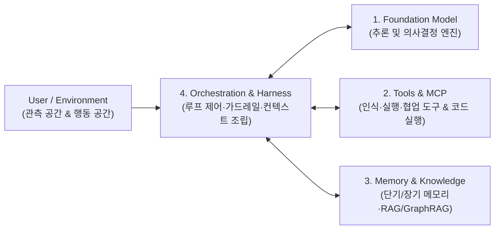

# AI Agent Architecture

## 정의 (Definition)

**AI 에이전트 아키텍처(AI Agent Architecture)** 는 파운데이션 모델(LLM)을 추론 엔진으로 삼아 외부 환경을 인지하고, 목표를 달성하기 위해 스스로 계획을 수립하며, 도구([[Model Context Protocol (MCP)]] 등)와 메모리([[Agent Memory and Knowledge]])를 조합해 다단계 작업을 자율적·반복적으로 수행하는 시스템 구조다 ([[2025-Building Applications with AI Agents]], p.23, p.42).
[[2026-AI 에이전트를 깊이 이해하기]] (Ch 2)는 이를 **`현대 에이전트 = LLM(사고 엔진) + 컨텍스트(작업 정보 집합) + 도구(관측·행동 인터페이스)`** 라는 핵심 공식으로 정의하고, 모델 바깥에서 에이전트의 신뢰성과 상한을 결정하는 시스템 설계를 **하네스 엔지니어링(Harness Engineering)** 및 **루프 엔지니어링(Loop Engineering)** 으로 명명한다.

---

## 워크플로우(Workflows) vs 에이전트(Agents)

에이전트 시스템을 설계할 때 가장 먼저 구분해야 할 개념은 **결정론적 워크플로우**와 **동적 에이전트**의 차이다 ([[2025-Building Applications with AI Agents]], p.30–33; [[2024-Prompt Engineering for LLMs]], Ch 8–9):

| 구분 | 결정론적 워크플로우 (Workflows) | 자율 에이전트 (AI Agents) |
|---|---|---|
| **제어 흐름** | 개발자가 사전에 코드로 정의한 고정 경로/조건문 | 모델이 런타임에 상황과 중간 결과를 보고 다음 행동 결정 |
| **예측 가능성** | 높음 (테스트 및 비용 추정이 용이) | 상대적으로 낮음 (루프, 예외적 도구 호출 발생 가능) |
| **유연성** | 정해진 시나리오 밖의 예외 상황에 취약 | 모호하거나 열린 문제(Open-ended tasks)에 강함 |
| **권장 적용처** | 정형화된 데이터 파이프라인, 규정 준수가 엄격한 단일 절차 | 복합 리서치, 코딩 에이전트, 동적 트러블슈팅, 고객 문제 해결 |

> [!TIP]
> 실무에서는 순수 자율 에이전트만 쓰거나 순수 워크플로우만 쓰기보다, **예측 가능한 골격은 워크플로우([[LangGraph]] 등의 상태 그래프)로 제어하고 개별 노드 내부의 판단과 도구 선택에 에이전트 자율성을 부여하는 하이브리드 패턴**이 가장 널리 쓰인다.

---

## 4대 핵심 구성요소와 하네스 엔지니어링 (Core Components & Harness)

[[2025-Building Applications with AI Agents]] (p.42–49)와 [[2026-AI 에이전트를 깊이 이해하기]] (Ch 2–7)는 모든 에이전트 시스템을 다음 구성요소로 분해한다:

1. **Model (파운데이션 모델, p.43)**: 추론 능력, 지연 시간(Latency), 컨텍스트 윈도우 크기, 비용, 로컬/클라우드 배포 요건에 따라 작업별로 대형 추론 모델과 소형 고속 모델을 조합한다.
2. **Tools (도구 및 관측/행동 공간, p.46; `AI 에이전트를 깊이 이해하기` Ch 5–7)**: 모델이 텍스트 생성을 넘어 파일 시스템 조작, DB 조회, 웹 검색, GUI 제어(Computer Use)를 수행하게 해주는 인터페이스다. 도구가 수백 개로 늘어날 때는 [[Model Context Protocol (MCP)]] 기반의 **계층형 구성과 능동적 도구 발견(Active Tool Discovery)** 으로 컨텍스트 오염을 방지하며, **코드 생성 및 실행**이 범용 에이전트의 핵심 메타 역량으로 작동한다.
3. **Memory (메모리 및 지식, p.47; Ch 4)**: 대화 상태와 작업 히스토리를 유지하는 단기/장기 사용자 메모리 및 외부 도메인 지식을 공급하는 계층이다. 상세 내용은 [[Agent Memory and Knowledge]] 참조.
4. **Orchestration & Harness (오케스트레이션과 하네스, p.49; Ch 2–3)**: 다중 라운드 `ReAct` 루프에서 상태 전이, 에러 복구, 가드레일을 제어하고 KV Cache 친화적으로 컨텍스트를 조립한다. 상세 내용은 [[Context Engineering]] 및 [[Multi-Agent Orchestration]] 참조.

---

## 에이전트 평가(Evaluation)와 지속적 진화 폐루프 (`AI 에이전트를 깊이 이해하기` `Ch 8–10`)

1. **오프라인·온라인 평가와 에이전트 관측성**:
   - **오프라인 평가**: 골든 데이터셋과 샌드박스 시뮬레이션 환경에서 작업 성공률(`pass@k`), 도구 호출 정확도, 루브릭 기반 LLM-as-a-Judge 점수의 통계적 유의성을 검증한다([[2026-AI 에이전트를 깊이 이해하기]] Ch 8; [[2024-Prompt Engineering for LLMs]] Ch 10).
   - **온라인 평가 및 LLM 관측성(Observability for AI)**: 프로덕션 환경에서 OpenTelemetry 기반으로 에이전트의 다단계 추론 궤적(Trajectory), 토큰 소비량, 지연 시간, 사용자 수락률(Acceptance Rate)을 실시간 추적한다([[2025-Open Source Observability]] Ch 7).
2. **사후 학습(Post-Training)과 지속적 진화 폐루프(Closed-Loop Evolution)**:
   - 배포된 에이전트가 첫날 저지른 실수를 매일 반복하지 않도록, 운영 중 수집된 실패 궤적(Bad Cases)과 성공 궤적을 필터링하여 ① 프롬프트/하네스 규칙 개선, ② 에이전트 메모리/스킬 축적, ③ 합성 데이터 기반 지도 미세 조정(SFT), ④ 멀티턴 강화학습(RL)으로 환류시키는 **지속적 진화 폐루프**를 구축한다([[2026-AI 에이전트를 깊이 이해하기]] Ch 9–10).

---

## 4대 엔지니어링 트레이드오프 (Design Trade-Offs)

프로덕션 에이전트 아키텍처는 항상 다음 네 가지 축의 균형을 맞춰야 한다 ([[2025-Building Applications with AI Agents]], p.49–53):

- **성능(Speed vs Accuracy)**: 다단계 리플렉션(Reflection)과 검증 루프를 추가하면 정확도는 올라가지만 응답 지연 시간(Latency)이 기하급수적으로 증가한다.
- **확장성(Scalability)**: 동시 세션 수와 도구 수가 늘어날 때 상태 관리와 비동기 처리가 병목이 되지 않도록 설계해야 한다.
- **신뢰성(Reliability)**: 환각(Hallucination), 잘못된 도구 인자 전달, 외부 API 타임아웃 시 우아한 실패(Graceful Degradation)와 재시도 가드레일이 필수적이다.
- **비용(Cost)**: 긴 컨텍스트 윈도우 반복 전송과 멀티에이전트 대화 루프는 토큰 비용을 급증시키므로, [[Context Engineering]](KV Cache 최적화)과 모델 라우팅이 중요하다.

---

## UX와 자율성 보정: The Autonomy Slider

에이전트 시스템의 성공은 모델 성능뿐 아니라 인간과의 상호작용 설계에 달려 있다 ([[2025-Building Applications with AI Agents]], Ch 3 p.77, Ch 13 p.319):
- **자율성 슬라이더(Autonomy Slider)**: 작업의 위험도(Stakes)와 에이전트에 대한 신뢰도(Trust)에 따라 `초안 제안(Draft)` → `승인 후 실행(Human-in-the-loop)` → `자율 실행 후 사후 보고(Autonomous)`로 위임 수준을 점진적으로 조절(Progressive Delegation)한다.

---

## 관점 비교: 하네스 엔지니어링의 정의

| | [[2026-AI 에이전트를 깊이 이해하기]] | [[2026-하네스 엔지니어링 with 클로드 코드]] |
|---|---|---|
| 정의 | 모델 가중치 바깥에서 에이전트의 상한과 신뢰성을 정하는 시스템 공학 (위 정의 절) | "하네스란 모델의 가중치를 바꾸지 않고, 모델 바깥의 권한·도구·검증·상태·관측을 설계해 에이전트가 일하게 하는 환경입니다." (p.34) |
| 구성 요소 | 컨텍스트 엔지니어링, 메모리·지식 베이스, 도구 생태계, 상호작용 인터페이스, 오케스트레이션/가드레일 | 권한, 도구, 검증, 상태, 관측 (p.34) |
| 프롬프트·컨텍스트와의 관계 | 컨텍스트 엔지니어링을 하네스의 한 요소로 둠 | "하네스 엔지니어링 ⊇ 컨텍스트 엔지니어링 ⊇ 프롬프트 엔지니어링" (p.35) |
| 강조점 | 루프 설계, KV 캐시, 평가와 사후 학습 | 단일 에이전트의 자기 검증 한계를 역할 분리(생성-검증 팀)와 **구조적 강제**(도구 목록, 훅)로 보완 |

두 책 모두 "모델은 그대로 두고 주변을 설계한다"는 점은 같다. 차이는 분류 축이다: 앞 책은 에이전트가 **무엇을 받는가**(컨텍스트·메모리·도구), 뒤 책은 에이전트가 **무엇을 할 수 있고 어떻게 확인되는가**(권한·검증·관측)에 무게를 둔다 (판단). Claude Code에서의 구현은 [[Claude Code Harness Design (Agents, Skills, and Orchestration)]], 평가 방법은 [[LLM Evaluation (Evals, LLM-as-Judge, and Agent Trajectories)]].

---

## 관련 개념 및 엔티티

- **하위/심화 개념**: [[Context Engineering]], [[Agent Memory and Knowledge]], [[Multi-Agent Orchestration]], [[Beyond Vibe Coding and AI-Augmented Software Engineering]], [[Claude Code Harness Design (Agents, Skills, and Orchestration)]], [[LLM Evaluation (Evals, LLM-as-Judge, and Agent Trajectories)]], [[LLM Cost Engineering (Token Economics, Caching, and Routing)]]
- **관련 기술/엔티티**: [[Model Context Protocol (MCP)]], [[LangGraph]]
- **출처 문헌**: [[2025-Building Applications with AI Agents]], [[2026-AI 에이전트를 깊이 이해하기]], [[2024-Prompt Engineering for LLMs]], [[2025-Open Source Observability]], [[2026-하네스 엔지니어링 with 클로드 코드]], [[2026-AI Evals in Practice]]
