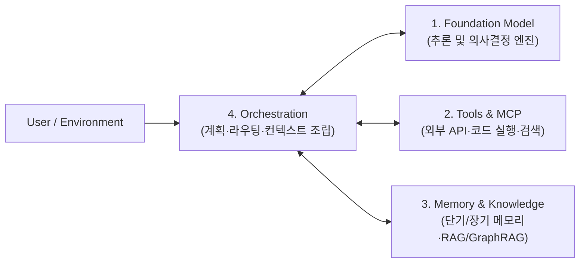

# AI Agent Architecture

## 정의 (Definition)

**AI 에이전트 아키텍처(AI Agent Architecture)** 는 파운데이션 모델(LLM)을 추론 엔진으로 삼아 외부 환경을 인지하고, 목표를 달성하기 위해 스스로 계획을 수립하며, 도구([[Model Context Protocol (MCP)]] 등)와 메모리([[Agent Memory and Knowledge]])를 조합해 다단계 작업을 자율적·반복적으로 수행하는 시스템 구조다 ([[2025-Building Applications with AI Agents]], p.23, p.42).

---

## 워크플로우(Workflows) vs 에이전트(Agents)

에이전트 시스템을 설계할 때 가장 먼저 구분해야 할 개념은 **결정론적 워크플로우**와 **동적 에이전트**의 차이다 ([[2025-Building Applications with AI Agents]], p.30–33):

| 구분 | 결정론적 워크플로우 (Workflows) | 자율 에이전트 (AI Agents) |
|---|---|---|
| **제어 흐름** | 개발자가 사전에 코드로 정의한 고정 경로/조건문 | 모델이 런타임에 상황과 중간 결과를 보고 다음 행동 결정 |
| **예측 가능성** | 높음 (테스트 및 비용 추정이 용이) | 상대적으로 낮음 (루프, 예외적 도구 호출 발생 가능) |
| **유연성** | 정해진 시나리오 밖의 예외 상황에 취약 | 모호하거나 열린 문제(Open-ended tasks)에 강함 |
| **권장 적용처** | 정형화된 데이터 파이프라인, 규정 준수가 엄격한 단일 절차 | 복합 리서치, 코딩 에이전트, 동적 트러블슈팅, 고객 문제 해결 |

> [!TIP]
> 실무에서는 순수 자율 에이전트만 쓰거나 순수 워크플로우만 쓰기보다, **예측 가능한 골격은 워크플로우([[LangGraph]] 등의 상태 그래프)로 제어하고 개별 노드 내부의 판단과 도구 선택에 에이전트 자율성을 부여하는 하이브리드 패턴**이 가장 널리 쓰인다.

---

## 4대 핵심 구성요소 (Core Components)

[[2025-Building Applications with AI Agents]] (p.42–49)는 모든 에이전트 시스템을 다음 4가지 핵심 축으로 분해한다:

1. **Model (파운데이션 모델, p.43)**: 추론 능력, 지연 시간(Latency), 컨텍스트 윈도우 크기, 비용, 로컬/클라우드 배포 요건에 따라 작업별로 대형 추론 모델과 소형 고속 모델을 조합한다.
2. **Tools (도구, p.46)**: 모델이 텍스트 생성을 넘어 파일 시스템 조작, DB 조회, 웹 검색, 외부 API 호출을 수행하게 해주는 실행 인터페이스다. 최근에는 [[Model Context Protocol (MCP)]]을 통해 도구와 컨텍스트 스키마를 표준화한다.
3. **Memory (메모리 및 지식, p.47)**: 대화 상태와 작업 히스토리를 유지하는 단기/장기 메모리 및 외부 도메인 지식을 공급하는 계층이다. 상세 내용은 [[Agent Memory and Knowledge]] 참조.
4. **Orchestration (오케스트레이션, p.49)**: 고립된 스킬과 도구들을 조합·스케줄링·감독하여 최종 목표에 도달하게 만드는 제어 논리다. 상세 내용은 [[Context Engineering]] 및 [[Multi-Agent Orchestration]] 참조.

---

## 4대 엔지니어링 트레이드오프 (Design Trade-Offs)

프로덕션 에이전트 아키텍처는 항상 다음 네 가지 축의 균형을 맞춰야 한다 ([[2025-Building Applications with AI Agents]], p.49–53):

- **성능(Speed vs Accuracy)**: 다단계 리플렉션(Reflection)과 검증 루프를 추가하면 정확도는 올라가지만 응답 지연 시간(Latency)이 기하급수적으로 증가한다.
- **확장성(Scalability)**: 동시 세션 수와 도구 수가 늘어날 때 상태 관리와 비동기 처리가 병목이 되지 않도록 설계해야 한다.
- **신뢰성(Reliability)**: 환각(Hallucination), 잘못된 도구 인자 전달, 외부 API 타임아웃 시 우아한 실패(Graceful Degradation)와 재시도 가드레일이 필수적이다.
- **비용(Cost)**: 긴 컨텍스트 윈도우 반복 전송과 멀티에이전트 대화 루프는 토큰 비용을 급증시키므로, [[Context Engineering]]과 캐싱, 모델 라우팅이 중요하다.

---

## UX와 자율성 보정: The Autonomy Slider

에이전트 시스템의 성공은 모델 성능뿐 아니라 인간과의 상호작용 설계에 달려 있다 ([[2025-Building Applications with AI Agents]], Ch 3 p.77, Ch 13 p.319):
- **자율성 슬라이더(Autonomy Slider)**: 작업의 위험도(Stakes)와 에이전트에 대한 신뢰도(Trust)에 따라 `초안 제안(Draft)` → `승인 후 실행(Human-in-the-loop)` → `자율 실행 후 사후 보고(Autonomous)`로 위임 수준을 점진적으로 조절(Progressive Delegation)한다.

---

## 관련 개념 및 엔티티

- **하위/심화 개념**: [[Context Engineering]], [[Agent Memory and Knowledge]], [[Multi-Agent Orchestration]]
- **관련 기술/엔티티**: [[Model Context Protocol (MCP)]], [[LangGraph]]
- **출처 문헌**: [[2025-Building Applications with AI Agents]]
