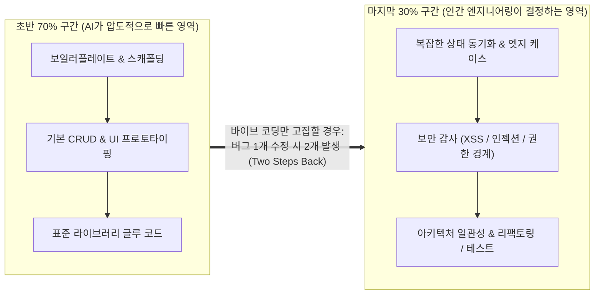

# Beyond Vibe Coding and AI-Augmented Software Engineering

## 1. 개요 (Overview)
LLM과 코딩 에이전트(Claude Code, Cursor, Copilot, Cline 등)의 등장으로 자연어 대화만으로 소프트웨어를 만드는 **'바이브 코딩(Vibe Coding)'** 이 확산되었다. 그러나 [[2025-비욘드 바이브 코딩 (Beyond Vibe Coding)]]의 저자 **Addy Osmani**와 [[2023-어떤 개발자가 되고 싶니]]의 **박동기** 저자가 공통으로 강조하듯, **무엇을 왜 만드는지 이해하지 못한 채 코드만 찍어내는 '코더(프로그래밍 노동자)'** 는 AI 시대에 가장 먼저 대체되거나 기술 부채의 늪에 빠진다. 진정한 풀스택 소프트웨어 엔지니어는 바이브 코딩의 속도감을 활용하되, 아키텍처·보안·엣지 케이스·테스트를 통제하는 **AI 보조 엔지니어링(AI-Assisted Engineering)** 역량을 갖춰야 한다.

---

## 2. '70%의 문제(The 70% Problem)'와 '다수결의 함정(Majority Problem)'

### 2.1 70%의 문제 (`2025-비욘드 바이브 코딩` Ch 3–4)
- AI 코딩 도구는 초기 요구사항의 **약 70%(보일러플레이트, 표준 CRUD, UI 시안)** 를 몇 시간 만에 완성해 준다.
- 그러나 **데모용 장난감과 프로덕션 시스템을 가르는 마지막 30%** — 비동기 경쟁 상태([[Full-Stack Authentication, Token Refresh, and Observability|401 토큰 갱신 뮤텍스]] 등), 보안 경계, 성능 병목, 모듈 간 결합도 제어 — 에서는 기초 원리를 모르는 사용자가 프롬프트만 반복할수록 기존 코드가 망가지는 **'두 걸음 후진(Two Steps Back)'** 현상이 발생한다.
- **주니어/취업 준비생의 생존 해법 (Ch 4)**: AI에게 "이 기능 짜줘"라고 답안지만 받아 복사·붙여넣기하면 영원히 70%의 벽을 넘지 못한다. 반대로 AI가 생성한 코드의 실행 컨텍스트([[JavaScript Execution Context, Closures, and Prototype]]), 타입 추론([[TypeScript Core Syntax and Full-Stack Type Annotations]]), 렌더링 원리([[React Fiber and Reconciliation]])를 하나씩 질문하며 **AI를 24시간 소크라테스식 튜터로 활용할 때** 시니어급 엔지니어로 가장 빠르게 도약할 수 있다.

### 2.2 다수결의 함정 (The "Majority" Problem, `Ch 5`)
- [[2024-Prompt Engineering for LLMs]] (Ch 2)가 밝히듯, LLM은 본질적으로 학습 데이터에서 통계적으로 가장 확률이 높은 다음 토큰을 예측하는 **자기회귀 문서 완성기(Auto-regressive Document Completer)** 다.
- 따라서 AI는 인터넷에 가장 많이 널려 있는 **'가장 흔한(Most Common)' 구버전 패턴**(예: React 19 환경인데 불필요한 `forwardRef` 남발, `useEffect` 내 연쇄 `setState`, TypeScript `any` 우회)을 기본 출력하기 쉽다.
- 이를 교정하려면 ① 프로젝트 헌법(`CLAUDE.md`)과 최신 공식 문서 스펙을 컨텍스트에 주입([[Context Engineering]])하고, ② 생성된 코드를 인간 개발자가 직접 **검토(Review) -> 개선(Refine) -> 내 코드로 소유(Own)** 해야 한다([[2025-비욘드 바이브 코딩 (Beyond Vibe Coding)]] Ch 5).

---

## 3. AI 생성 코드의 보안 감사와 신뢰성 가드레일 (`Ch 8`)

AI가 작성한 풀스택 코드에서 반드시 점검해야 할 5대 보안·품질 체크리스트:
1. **입력 검증 누락 및 인젝션**: 클라이언트 입력값을 [[Type-Safe Contract-First and Runtime Boundary Architecture|Zod 런타임 검증 게이트]]나 파라미터화된 쿼리 없이 DB에 전달하지 않았는가?
2. **하드코딩된 시크릿 및 토큰 노출**: API 키가 클라이언트 번들(`NEXT_PUBLIC_*` 등)이나 Git 커밋에 포함되지 않았는가? JWT를 취약한 `localStorage` 대신 `HttpOnly` 쿠키와 결합했는가?
3. **패키지 환각(Package Hallucination / Slopsquatting)**: AI가 존재하지 않거나 악성코드가 심어진 npm 패키지 이름을 `import`하지 않았는가?
4. **권한 검증(Authorization) 누락**: 인증(로그인 여부)만 확인하고, 다른 사용자의 리소스 ID를 수정하는 **IDOR(안전하지 않은 직접 객체 참조)** 취약점을 남겨두지 않았는가?
5. **자동화된 테스트 안전망**: AI에게 기능 코드와 함께 반드시 **단위·통합·E2E 테스트**를 작성하게 하고, [[Container Infrastructure, Kubernetes, and CI-CD Pipelines|GitHub Actions CI 파이프라인]]에서 `tsc --noEmit`과 테스트 스위트를 통과해야만 병합되도록 강제한다.

---

## 4. 인라인 코파일럿에서 자율형 백그라운드 코딩 에이전트로 (`Ch 10`, `AI 에이전트를 깊이 이해하기` `Ch 6`)

- **1세대 (In-IDE Autocomplete)**: 커서 위치의 다음 몇 줄을 예측하는 보조 도구(GitHub Copilot 초기 모델).
- **2세대 (Conversational Coding Agent)**: 개발자와 대화하며 다중 파일을 읽고 터미널 명령과 테스트를 실행하는 에이전트(Claude Code, Cursor Agent, Cline).
- **3세대 (Autonomous Background Coding Agents)**: [[2025-비욘드 바이브 코딩 (Beyond Vibe Coding)]] (Ch 10)과 [[2026-AI 에이전트를 깊이 이해하기]] (Ch 6)가 다루듯, 격리된 클라우드 컨테이너 샌드박스에서 백그라운드로 이슈 티켓을 할당받아 **코드베이스 탐색 -> 수정 계획 수립 -> 구현 -> 린트/테스트 검증 -> Pull Request 제출**까지 비동기로 완수하는 에이전트다.
- 이때 **'코드 생성 및 실행'은 코딩 도구를 넘어 모든 범용 에이전트(데이터 분석, GUI 자동화 등)가 복잡한 문제를 해결하는 핵심 메타 역량(Meta-capability)** 으로 작동한다([[2026-AI 에이전트를 깊이 이해하기]] Ch 6).

---

## 5. 오래 살아남는 소프트웨어 개발자의 본질 (`어떤 개발자가 되고 싶니?` `Part 1–4`)

[[2023-어떤 개발자가 되고 싶니]]에서 25년 차 개발자 박동기 저자가 강조하는 원칙은 AI 시대에 더욱 강력한 유효성을 갖는다:
1. **코딩은 곡괭이일 뿐, 본질은 요구사항 분석과 설계다 (Part 2)**: 무엇을 만들어야 하는지 깊이 이해하지 못한 채 코드(또는 프롬프트)부터 치는 습관을 버리고, 아날로그 현실의 문제를 디지털 인터페이스로 번역하는 설계력을 길러야 한다.
2. **막힌 문제를 끝까지 해결하는 돌파력 (Part 3)**: AI가 해결하지 못하는 나머지 30%의 난해한 버그를 만났을 때 공식 문서와 밑바닥 원리(실행 컨텍스트, 네트워크, OS/컨테이너)를 파고들어 해결하는 돌파력이 진짜 실력이다.
3. **기록과 공유의 힘 (Part 3–4)**: 자신이 겪은 시행착오와 아키텍처 지식을 기술 블로그나 위키(TechWiki)로 구조화해 기록·공유하는 개발자가 대체 불가능한 시니어로 성장한다.

---

## 6. 관련 문서 (See Also)
- [[AI-Enhanced React Applications and Specification-Driven Development]] — 스펙 주도(Spec-First) 개발 4단계 워크플로우와 AI 내장형 웹 앱 아키텍처
- [[Context Engineering]] — KV Cache 친화적 컨텍스트 설계와 탄력적 스니펫(Elastic Snippets) 조립
- [[AI Agent Architecture]] — 하네스 엔지니어링(Harness Engineering)과 에이전트 평가·진화 루프
- [[2025-비욘드 바이브 코딩 (Beyond Vibe Coding)]]
- [[2026-AI 에이전트를 깊이 이해하기]]
- [[2024-Prompt Engineering for LLMs]]
- [[2023-어떤 개발자가 되고 싶니]]
