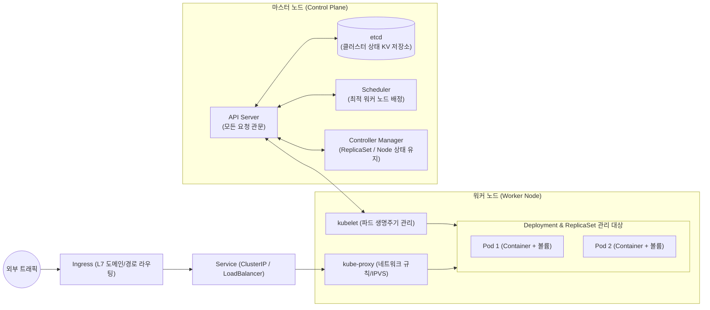

# Container Infrastructure, Kubernetes, and CI-CD Pipelines

## 1. 개요 (Overview)
풀스택 개발자가 로컬에서 작성한 [[React]] / Next.js 프론트엔드, [[React Native]] 모바일 앱, 그리고 Node.js 백엔드 코드가 실제 사용자에게 안정적으로 전달되려면 **① 코드 변경 시 자동 검증·빌드하는 CI/CD 파이프라인(GitHub Actions / Jenkins)**, **② 실행 환경을 격리·표준화하는 컨테이너(Docker)**, **③ 무중단 배포·자가 치유·오토스케일링을 담당하는 컨테이너 오케스트레이션(Kubernetes)** 이 하나로 연결되어야 한다([[2021-컨테이너 인프라 환경 구축을 위한 쿠버네티스 도커]] 1장; [[2021-Hands-on GitHub Actions]] Ch 1–2).

---

## 2. Docker 컨테이너 원리와 멀티스테이지 빌드 (`쿠버네티스/도커 4장, 부록 D`)

### 2.1 가상머신(VM) vs 컨테이너(Container)와 `PID 1`
- 가상머신(Hypervisor)은 게스트 OS 커널 전체를 중복 적재하므로 무겁고 부팅이 느리다. 반면 **컨테이너**는 호스트 리눅스 커널을 공유하면서 **Namespaces**(프로세스·네트워크·파일시스템 시야 격리)와 **cgroups**(CPU·메모리 자원 한도 제한) 기술로 프로세스를 격리하므로 수 초 내에 기동된다.
- **CRI -> containerd -> runC 호출 사슬과 `PID 1` 주의점 (부록 D)**: 쿠버네티스의 `kubelet`은 CRI(Container Runtime Interface)를 통해 `containerd`에 요청하고, 저수준 OCI 런타임인 `runC`가 컨테이너를 생성한다. 컨테이너 내부에서 실행되는 엔트리포인트 프로세스는 **`PID 1`** 이 되며, Node.js 앱을 셸 래퍼(`npm start`) 대신 `node dist/server.js` 또는 `dumb-init`/`tini`로 실행해야 쿠버네티스가 보내는 종료 시그널(`SIGTERM`)을 정상 수신해 우아한 종료(Graceful Shutdown)를 수행할 수 있다.

### 2.2 Node.js / Next.js 멀티스테이지 빌드 (`Dockerfile`)
[[2022-Real-World Next.js]] (Ch 11)와 [[2021-컨테이너 인프라 환경 구축을 위한 쿠버네티스 도커]] (4.3절)가 권장하는 **멀티스테이지 빌드(Multi-stage Build)** 는 [[TypeScript]] 컴파일러와 개발 의존성(`devDependencies`)을 빌드 스테이지에만 남기고, 최종 런타임 이미지에는 컴파일된 JS 결과물만 복사해 이미지 크기를 수백 MB에서 수십 MB로 줄이고 공격 표면(Attack Surface)을 최소화한다:
```dockerfile
# Stage 1: 의존성 설치 및 TypeScript / Next.js 빌드
FROM node:22-alpine AS builder
WORKDIR /app
COPY package*.json ./
RUN npm ci
COPY . .
RUN npm run build

# Stage 2: 경량 프로덕션 런타임 이미지
FROM node:22-alpine AS runner
WORKDIR /app
ENV NODE_ENV=production
COPY --from=builder /app/package*.json ./
RUN npm ci --omit=dev
COPY --from=builder /app/dist ./dist
USER node
EXPOSE 3000
CMD ["node", "dist/server.js"]
```

---

## 3. Kubernetes 클러스터 아키텍처와 핵심 오브젝트 (`쿠버네티스/도커 3장`)



1. **선언적 상태 관리(`kubectl apply -f`)와 자가 치유(Self-healing)**:
   - 개발자가 "컨테이너 3개를 띄워라"라고 명령형으로 지시하는 대신, **`Deployment`** 매니페스트에 `replicas: 3`(원하는 상태, Desired State)을 선언해 제출하면, 컨트롤 플레인이 현재 상태(Current State)를 감시하며 워커 노드 장애 시 자동으로 다른 노드에 새 파드를 스케줄링한다.
2. **3대 헬스 체크 프로브 (`3.2.7절`)**:
   - **`startupProbe`**: 앱 초기 기동이 완료될 때까지 다른 프로브를 유예.
   - **`livenessProbe`**: 교착 상태(Deadlock)에 빠진 컨테이너를 감지해 **자동 재시작**.
   - **`readinessProbe`**: DB 연결이나 캐시 워밍업이 끝난 파드에만 **Service 트래픽을 유입**시켜 배포 중 `502 Bad Gateway` 에러를 방지.
3. **네트워킹 계층 (`3.3절`)**:
   - 파드는 재시작될 때마다 IP가 바뀌므로 고정된 진입점인 **`Service`**(`ClusterIP`, `NodePort`, `LoadBalancer`)로 묶고, 외부 도메인(`api.example.com`, `web.example.com`)과 TLS 인증서 종단은 **`Ingress`**(NGINX Ingress Controller)에서 처리한다.

---

## 4. GitHub Actions와 GitOps 기반 CI/CD 파이프라인

[[2021-Hands-on GitHub Actions]] (Ch 1–10)와 [[2021-컨테이너 인프라 환경 구축을 위한 쿠버네티스 도커]] (5장)를 결합한 현대적 풀스택 CI/CD 아키텍처는 다음과 같다:

| 단계 | 수행 주체 및 핵심 기법 | 관련 도서 및 챕터 |
| :--- | :--- | :--- |
| **1. 의존성 캐싱 & 정적 검증 (CI)** | PR 생성 시 `actions/cache`로 `node_modules`/Gradle/CocoaPods를 복원한 뒤, `tsc --noEmit`(타입 체크), ESLint, 단위 테스트를 병렬(Matrix) 실행 | [[2021-Hands-on GitHub Actions]] Ch 2, Ch 5 |
| **2. Service Containers 통합 테스트** | GitHub Actions Job 내부에 PostgreSQL·MongoDB·Redis를 **Service Container**로 띄워 실제 DB 마이그레이션 및 API 통합 테스트 수행 | [[2021-Hands-on GitHub Actions]] Ch 8 |
| **3. 아티팩트/컨테이너 빌드** | 웹/백엔드는 멀티스테이지 Docker 이미지를 빌드해 레지스트리(GHCR/ECR)에 푸시하고, [[React Native]] 앱은 Android AAB / iOS IPA 서명 빌드를 수행 | [[2021-Hands-on GitHub Actions]] Ch 7, Ch 10 |
| **4. 선언적 무중단 배포 (CD / GitOps)** | 쿠버네티스 매니페스트 저장소의 이미지 태그를 갱신하면 **Argo CD / GitOps**가 감지하여 Rolling Update, Blue-Green, 또는 Canary 방식으로 무중단 배포 | [[2021-컨테이너 인프라 환경 구축을 위한 쿠버네티스 도커]] 5장 |

[[2025-Full Stack JavaScript Strategies]] (Ch 27)는 같은 흐름을 도구 중립적으로 **build → test → deploy** 세 단계로 정리하고, CircleCI로 예를 든다 (p.362–363, p.375–376). 원칙은 "One sign of a good pipeline is that you get failures as early in the pipeline as possible." (p.363) 이 책이 다루는 배포 전략(블루-그린·카나리의 정의 차이), feature·development·staging·production 환경, 롤백과 핫픽스는 [[Deployment Strategies, Environments, and Rollbacks]]에 정리했다.

---

## 5. 관련 문서 (See Also)
- [[Deployment Strategies, Environments, and Rollbacks]] — 블루-그린·카나리 배포, 환경 구성, 롤백·핫픽스 절차
- [[Full-Stack Authentication, Token Refresh, and Observability]] — 배포된 컨테이너 클러스터의 OpenTelemetry · Prometheus · Grafana 통합 관측성
- [[Next.js Rendering Strategies (SSR, SSG, ISR, and RSC)]] — Next.js 애플리케이션의 Standalone Docker 컨테이너 배포
- [[React Native Architecture (Bridge to New Architecture)]] — Gradle(Android) 및 CocoaPods/Xcode(iOS) 모바일 네이티브 빌드 파이프라인
- [[2021-컨테이너 인프라 환경 구축을 위한 쿠버네티스 도커]]
- [[2021-Hands-on GitHub Actions]]
- [[2025-Open Source Observability]]
