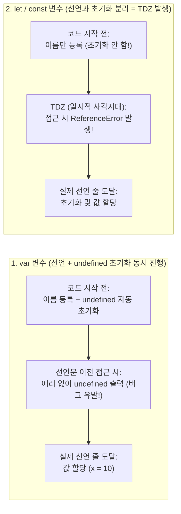

# JavaScript Core Syntax and Modern ES6+ Fundamentals

## 개요 (Overview)

[[React]]·[[React Native]] 프론트엔드와 Node.js(Express/NestJS/Prisma) 백엔드를 아우르는 **풀스택 개발자**에게 [[JavaScript (ECMAScript)]] 기초 문법은 단순한 문법 암기가 아니라 **데이터 불변성(Immutability), 비동기 상태 제어, 서버-클라이언트 JSON 직렬화**를 다루는 핵심 도구다.

이 문서는 [[2021-JavaScript from Beginner to Professional]] (Ch 2–8, 12), [[2015-인사이드 자바스크립트]] (Ch 2–4), [[2021-JavaScript Cookbook 3e]] (Ch 2–8), [[2026-Full-Stack React TypeScript and Node 2nd Edition]] (Ch 3) 및 **MDN 공식 문서(`developer.mozilla.org`)** 를 바탕으로, 기초 문법부터 풀스택 실무에서 가장 자주 겪는 문법 함정까지 코드 예제로 상세히 정리한다.

---

## 1. 변수 선언(`const`/`let`/`var`)과 스코프, 호이스팅(Hoisting), TDZ 완벽 해부

처음 자바스크립트를 공부할 때 가장 헷갈리는 **스코프(Scope), 호이스팅(Hoisting), TDZ(Temporal Dead Zone, 일시적 사각지대)** 는 자바스크립트 엔진이 코드를 실행하는 **2단계 과정**을 알면 한 번에 이해된다 ([[2015-인사이드 자바스크립트]], Ch 5 p.140–155; [[2021-JavaScript from Beginner to Professional]], Ch 6, Ch 12).

### 1.1 자바스크립트 엔진이 코드를 읽는 2단계 과정
자바스크립트 엔진(V8, Hermes 등)은 코드를 위에서 아래로 바로 실행하지 않고, 항상 **① 준비 단계(생성 단계)** 와 **② 실행 단계**로 나누어 처리한다:
1. **1단계 — 컴파일/생성 단계 (Creation Phase)**: 코드를 한 줄씩 실행하기 전에, 현재 범위(스코프) 안에 어떤 변수(`var`, `let`, `const`)와 함수(`function`)가 선언되어 있는지 **이름표를 먼저 스캔해서 메모리 사전에 등록**한다.
2. **2단계 — 실행 단계 (Execution Phase)**: 이제 코드를 첫 줄부터 한 줄씩 내려가며 실제로 값을 대입(`=`)하고 함수를 실행한다.

### 1.2 호이스팅(Hoisting, 끌어올림)이란?
- **정의**: 1단계(사전 등록 단계) 때문에, 마치 **변수나 함수의 선언문이 코드의 맨 꼭대기로 끌어올려진(Hoist) 것처럼 동작하는 현상**이다. 실제로 코드가 물리적으로 이동하는 것이 아니라, 엔진이 실행 전에 선언문을 미리 알고 있기 때문에 발생한다.
- 변수가 만들어질 때는 **① 선언(Declaration: 이름 등록) $\rightarrow$ ② 초기화(Initialization: 메모리 공간을 잡고 `undefined`를 넣음) $\rightarrow$ ③ 할당(Assignment: 실제 값 `= 10`을 넣음)** 의 3단계를 거치는데, `var`와 `let`/`const`, 그리고 `function`은 이 3단계를 처리하는 시점이 다르다!



### 1.3 TDZ (Temporal Dead Zone, 일시적 사각지대)란?
- **정의**: 스코프가 시작된 시점부터 `let`이나 `const` 변수 선언문에 실제로 도달하기 전까지, **"변수가 존재한다는 사실은 엔진이 알고 있지만 아직 초기화되지 않아 접근이 금지된 구간"** 이다.
- **왜 TDZ를 만들었을까?**: 과거 `var`는 선언하기도 전에 변수를 써도 에러를 내지 않고 조용히 `undefined`를 돌려주어 찾기 힘든 버그를 양산했다. 그래서 ES6에서 도입된 `let`과 `const`는 **"선언문이 나오기 전에 변수를 건드리면 즉시 `ReferenceError`를 던져 개발자의 실수를 잡아주도록"** TDZ라는 안전장치를 도입한 것이다.

```js
// [코드로 보는 호이스팅과 TDZ의 차이]

// 1) 함수 선언문(function): 선언 + 함수 본문 전체가 통째로 호이스팅됨!
sayHello(); // ✅ 정상 실행 ("안녕하세요!"): 아래에 선언된 함수를 위에서 호출 가능
function sayHello() {
  console.log("안녕하세요!");
}

// 2) var 변수: 이름 등록 + undefined 초기화까지 호이스팅됨 (TDZ 없음)
console.log(oldVar); // ⚠️ 에러가 안 나고 undefined가 출력됨!
var oldVar = "구형 변수";

// 3) let / const 변수 및 화살표 함수: 이름은 호이스팅되지만 선언 줄까지 TDZ에 갇힘!
// ---------- [여기서부터 myName의 TDZ 시작] ----------
// console.log(myName); // ❌ ReferenceError: Cannot access 'myName' before initialization
const myName = "Kim";   // ---------- [여기서 TDZ 끝! 이제부터 안전하게 사용 가능] ----------
console.log(myName);    // ✅ "Kim"
```

### 1.4 스코프(Scope, 유효 범위): 블록 스코프 vs 함수 스코프 vs 렉시컬 스코프
- **스코프(Scope)**: 변수에 접근할 수 있는 "유효 범위(울타리)"다.
  - **블록 스코프 (`let`, `const`)**: `if { ... }`, `for { ... }` 같은 **모든 중괄호 `{}`** 가 울타리가 된다. 중괄호 안에서 만든 변수는 중괄호 밖으로 나가는 순간 사라진다.
  - **함수 스코프 (`var`)**: 오직 `function() { ... }` 중괄호만 울타리로 인정한다. `if`문이나 `for`문 안에서 `var`로 변수를 만들면 블록 밖으로 새어 나가 기존 변수를 덮어쓰는 대형 사고가 난다.
  - **스코프 체인 (Scope Chain) & 렉시컬 스코프 (Lexical Scope)**: 함수 안에서 변수를 찾을 때 현재 함수 안에 없으면 **코드가 작성(선언)된 위치 기준**으로 바깥쪽 스코프 $\rightarrow$ 전역 스코프 순서로 꼬리를 물고 찾아 올라가는 규칙이다 ([[JavaScript Execution Context, Closures, and Prototype]] 참조).

| 키워드 | 스코프(유효 범위) | 재할당 | 중복 선언 | 호이스팅 및 TDZ | 풀스택 실무 규칙 |
|---|---|---|---|---|---|
| **`const`** | 블록 스코프 (`{ ... }`) | **불가** (단, 객체 내부 속성 변경은 가능) | 불가 | TDZ 적용 (선언 전 접근 시 `ReferenceError`) | **기본값으로 사용** (판단: 재할당이 필요 없는 변수는 `const`). 참조가 바뀌지 않음을 보장. |
| **`let`** | 블록 스코프 (`{ ... }`) | **가능** | 불가 | TDZ 적용 | 루프 카운터나 조건부 재할당이 필요한 경우에만 제한 사용. |
| **`var`** | 함수 스코프 (`function`) | 가능 | 가능 (버그 원인) | 선언 전 접근 시 `undefined` 반환 | **모던 코드에서 절대 사용 금지**. `if`/`for` 블록을 뚫고 새어 나감. |

```js
// [핵심 주의점] const는 "재할당(다른 주소로 갈아끼우기)"을 금지할 뿐, 객체 내부를 얼리지(Freeze) 않는다!
const user = { name: "Kim", role: "user" };
user.role = "admin"; // ✅ 가능 (힙 메모리의 같은 객체를 수정함 — 단, React state에서는 금지!)
// user = { name: "Lee", role: "admin" }; // ❌ TypeError: Assignment to constant variable.
```

---

## 1.5 풀스택 입문자가 꼭 알아야 할 코어 개념 용어 사전 (8선)

호이스팅·TDZ와 함께 기술 서적이나 면접, 실무 코드 리뷰에서 끊임없이 등장하는 **8가지 필수 배경 개념**을 직관적인 비유와 함께 정리한다:

| 핵심 용어                                                         | 직관적 비유 및 쉬운 정의                                                                                                                                                                       | 풀스택(React / RN / Node.js) 실무에서의 의미                                                                                                                                                              |
| ------------------------------------------------------------- | ------------------------------------------------------------------------------------------------------------------------------------------------------------------------------------ | ----------------------------------------------------------------------------------------------------------------------------------------------------------------------------------------------- |
| **① 콜 스택(Call Stack) vs 힙(Heap) 메모리**                         | - **스택(Stack)**: 크기가 정해진 작은 포스트잇 메모장. 원시값(`10`, `true`)과 객체가 어디 있는지 적어둔 **집 주소(참조값)** 가 저장됨.<br>- **힙(Heap)**: 크기가 자유로운 거대한 창고. 실제 객체(`{ ... }`)와 배열(`[ ... ]`) 본체가 저장됨.             | `const a = { count: 1 }; const b = a;`를 하면 창고의 객체가 복사되는 게 아니라 **포스트잇의 집 주소만 복사**됨. 따라서 `b.count = 2`로 바꾸면 `a.count`도 `2`가 됨!                                                                    |
| **② 불변성(Immutability)과 부수 효과(Side Effect)**                   | - **불변성**: 한 번 만든 원본 데이터는 직접 고치지 않고, 변경이 필요하면 **새 복사본을 만들어 수정**하는 원칙.<br>- **부수 효과**: 함수가 결과값 반환 외에 함수 바깥의 변수·화면·DB·네트워크를 변경하는 모든 행위.                                                | [[React]]는 포스트잇의 **집 주소(참조값)가 바뀌었을 때만** 화면을 다시 그린다. 원본을 직접 고치면(`user.name = 'Lee'`) 주소가 그대로라 화면이 안 바뀜!                                                                                          |
| **③ 얕은 복사(Shallow Copy) vs 깊은 복사(Deep Copy)**                 | - **얕은 복사(`{ ...obj }`)**: 겉표지(1단계 속성)만 새로 복사하고, 그 안의 중첩 객체는 여전히 같은 주소를 공유함.<br>- **깊은 복사(`structuredClone(obj)`)**: 중첩된 내부 객체와 배열까지 전부 새 창고에 완전히 독립적으로 복제함.                         | 중첩된 상태를 업데이트할 때 1단계만 스프레드(`{ ...user }`)하고 내부(`user.profile.age = 20`)를 직접 바꾸면 원본까지 오염됨 ([[JavaScript Execution Context, Closures, and Prototype]] 4.2절 참조).                                    |
| **④ 일급 함수(First-Class Function) & 고차 함수(HOF) & 콜백(Callback)** | - **일급 함수**: 함수를 숫자나 문자열처럼 변수에 담고, 다른 함수의 인자로 넘기고, 반환값으로 돌려줄 수 있는 성질.<br>- **고차 함수**: 함수를 인자로 받거나 함수를 반환하는 함수 (`map`, `filter`).<br>- **콜백 함수**: "이 작업 끝나면 이 함수를 불러줘"라며 인자로 넘겨주는 함수. | `items.map(item => <Card />)`에서 `map`이 **고차 함수**이고, 인자로 넘긴 `item => <Card />` 화살표 함수가 **콜백 함수**다.                                                                                               |
| **⑤ 클로저(Closure)**                                            | **"배낭(Backpack)을 멘 함수"**: 바깥 함수가 이미 실행을 마치고 사라졌는데도, 그 안에서 태어난 내부 함수가 바깥 함수의 변수들을 **배낭에 넣어 기억하고 계속 꺼내 쓰는 현상**.                                                                        | React 컴포넌트 함수가 렌더링 후 끝나도, 그 안의 `onClick` 핸들러나 `useEffect` 콜백이 당시의 `count` 상태값을 기억하는 원리다. (단, 옛날 배낭만 바라보는 버그가 **Stale Closure**).                                                                |
| **⑥ 가비지 컬렉션(Garbage Collection, GC)**                         | **"자동 청소부"**: 아무도 집 주소(참조)를 들고 있지 않은 힙(Heap) 창고의 객체들을 엔진이 주기적으로 찾아내어 메모리를 자동 회수하는 기능.                                                                                                | 단, `setInterval`이나 이벤트 리스너를 등록해 놓고 컴포넌트가 꺼질 때 해제(`clearInterval` / `removeEventListener`)하지 않으면 청소부가 치우지 못해 **메모리 누수(Memory Leak)** 가 발생함!                                                      |
| **⑦ 동기(Sync) vs 비동기(Async) & 논블로킹(Non-blocking)**             | - **동기(Sync)**: 앞사람 주문이 나올 때까지 줄 선 뒤사람이 아무것도 못 하고 기다림.<br>- **비동기 논블로킹(Async)**: 진동벨(**`Promise`**)만 먼저 받고 자리로 가서 다른 일을 하다가, 벨이 울리면(`await` / `.then`) 음식을 받음.                       | JS는 스레드가 1개뿐이라 DB 조회나 API 호출을 동기로 기다리면 앱 화면이 통째로 멈춘다. 그래서 모든 네트워크·DB 작업은 `async/await` 비동기로 처리한다 ([[JavaScript Event Loop and Asynchronous Patterns]]).                                         |
| **⑧ 직렬화(Serialization) & 역직렬화(Deserialization)**              | - **직렬화(`JSON.stringify`)**: 메모리에 살아 있는 JS 객체를 네트워크로 전송할 수 있게 **순수 문자열(Text)** 로 포장하는 것.<br>- **역직렬화(`JSON.parse` / `res.json()`)**: 받은 문자열을 다시 JS 객체로 조립하는 것.                       | 프론트엔드(React)와 백엔드(Node.js)는 메모리를 공유할 수 없으므로 HTTP 통신 시 항상 JSON 직렬화/역직렬화를 거치며, 이때 `Date` 객체가 문자열로 변하거나 타입 정보가 사라지므로 런타임 검증([[Type-Safe Contract-First and Runtime Boundary Architecture]])이 필요하다. |

---

## 2. 데이터 타입, Truthy/Falsy, 그리고 안전한 연산자 (`===`, `??`, `?.`)

### 2.1 동등 비교: 왜 `==` 대신 반드시 `===`를 써야 하는가?
- **`==` (추상 동등 비교)**: 타입을 암묵적으로 강제 변환(Type Coercion)한 뒤 비교하여 `0 == ""` (`true`), `false == "0"` (`true`), `null == undefined` (`true`) 같은 예측 불가능한 버그를 만든다 ([[2015-인사이드 자바스크립트]], p.34).
- **`===` (엄격 동등 비교)**: **타입과 값이 모두 일치할 때만 `true`** 를 반환한다 (`0 === ""` $\rightarrow$ `false`).

### 2.2 Falsy 값과 React/React Native 렌더링 함정
JavaScript 조건문(`if`, `&&`, `? :`)에서 **`false`로 평가되는 값(Falsy)** 은 정해져 있으며, 빈 배열(`[]`)과 빈 객체(`{}`)를 포함한 **나머지 값은 Truthy(`true`)** 다:
- **실무에서 만나는 Falsy 값 6종**: `false`, `0`, `""` (빈 문자열), `null`, `undefined`, `NaN`
- **MDN 전체 목록 (9개)**: 위 6종 + `-0`, `0n`, `document.all` ([MDN, *Falsy*](https://developer.mozilla.org/en-US/docs/Glossary/Falsy)). 입문용 설명은 [[JS 첫걸음 03 - 자료형]] 6.4절.
- **주의! Truthy인 값**: `[]` (빈 배열), `{}` (빈 객체), `"0"` (문자열 0), `"false"`

> [!WARNING]
> **React / React Native에서 가장 흔한 `&&` 단축 평가 버그**
> `count && <CartBadge count={count} />` 처럼 작성하면, `count`가 `0`일 때 `&&` 연산자가 Falsy 값인 숫자 `0`을 그대로 반환한다.
> - 웹 [[React]]에서는 화면에 원치 않는 문자 `"0"`이 그대로 출력된다.
> - 모바일 **[[React Native]]에서는 `<Text>` 바깥에 텍스트 노드를 둘 수 없다.** 공식 문서: "you must wrap all the text nodes inside of a `<Text>` component. You cannot have a text node directly under a `<View>`."이며, 예제 주석에 "will raise exception"이라고 적혀 있다 ([reactnative.dev/docs/text](https://reactnative.dev/docs/text)). `&&`가 돌려준 `0`이 `<View>` 바로 아래에 놓이면 이 경우에 해당한다 (판단). 이때 나오는 정확한 에러 문구는 공식 문서에 없어 미확인이다 (확인 방법: RN 앱에서 `<View>{0 && <Text />}</View>`를 렌더링해 본다).
> - **해결책**: 반드시 **`count > 0 && <CartBadge count={count} />`** 또는 삼항 연산자(`count ? <CartBadge /> : null`)로 명확한 불리언을 만들어야 한다.

### 2.3 옵셔널 체이닝(`?.`)과 널 병합 연산자(`??`)
풀스택 개발에서 백엔드 API 응답이나 DB 조회 결과(`null` 또는 `undefined` 가능)를 안전하게 다룰 때 필수적인 두 연산자다 ([[2026-Full-Stack React TypeScript and Node 2nd Edition]], p.95–98):

```js
// 1. 옵셔널 체이닝 (?.): 좌항이 null 또는 undefined이면 에러를 던지지 않고 즉시 undefined를 반환
const city = response?.data?.user?.address?.city; // 중간 단계가 없어도 TypeError가 나지 않음
const firstItem = items?.[0];                     // 배열 인덱스 안전 접근
onSuccess?.(result);                              // 콜백 함수가 전달되었을 때만 안전하게 호출

// 2. 논리합(||) vs 널 병합 연산자(??)의 결정적 차이
const inputScore = 0; // 사용자가 0점을 입력한 정상 데이터
const badScore = inputScore || 100;  // ❌ 0을 Falsy로 취급해 100으로 덮어써버림!
const goodScore = inputScore ?? 100; // ✅ 오직 null 또는 undefined일 때만 기본값 100을 적용 (결과: 0)
```

---

## 3. 함수 선언 방식과 화살표 함수(`=>`)의 문법적 함정

([[2021-JavaScript from Beginner to Professional]], Ch 6 p.143–165; [[2015-인사이드 자바스크립트]], Ch 4 p.75–121)

```js
// 1. 함수 선언문 (호이스팅되므로 선언 전에도 호출 가능)
function add(a, b = 0) {
  return a + b;
}

// 2. 화살표 함수 (Arrow Function — 간결한 문법 & 상위 렉시컬 this 유지)
const multiply = (a, b) => a * b; // 중괄호 {}를 생략하면 표현식 결과가 자동 return됨
```

### 화살표 함수에서 객체를 반환할 때의 필수 규칙 (`=> ({ ... })`)
화살표 함수에서 중괄호 `{}`는 **"객체 리터럴"** 이 아니라 **"함수 본문 블록(Block)"** 으로 해석된다. 따라서 객체를 즉시 반환할 때는 **반드시 소괄호 `({})`로 감싸야 한다**:

```js
// ❌ 잘못된 예: 중괄호를 함수 블록으로 해석하여 undefined를 반환하거나 문법 에러 발생
const createTodoBad = (id, text) => { id: id, text: text };

// ✅ 올바른 예: 소괄호 ()로 객체 리터럴임을 명시 (React setState, Zustand 스토어에서 매일 사용!)
const createTodoGood = (id, text) => ({ id, text }); // 단축 속성명(Shorthand Property) 적용
setUser((prev) => ({ ...prev, isVerified: true }));
```

---

## 4. 구조 분해 할당(Destructuring)과 스프레드(`...`) 연산자

프론트엔드(Props, Hooks)와 백엔드(Express `req.body`/`req.params`, Prisma 쿼리) 코드의 80% 이상을 차지하는 핵심 문법이다 ([[2026-Full-Stack React TypeScript and Node 2nd Edition]], p.99–106).

### 4.1 객체 및 배열 구조 분해 할당
```js
// 1. 객체 구조 분해: 키 이름으로 추출 + 변수명 변경(Aliasing, :) + 기본값(=) 지정
const req = { params: { id: "u_123" }, query: {} };
const {
  params: { id: userId },         // 중첩 객체에서 id를 꺼내면서 변수명을 userId로 변경
  query: { page = 1, limit = 20 } // 값이 undefined일 때 기본값 1, 20 할당
} = req;

// 2. 배열 구조 분해: 순서(인덱스) 기준으로 추출 (React useState의 원리!)
const [count, setCount] = useState(0);
const [first, second, ...restItems] = [10, 20, 30, 40]; // first=10, second=20, restItems=[30, 40]
```

### 4.2 스프레드 연산자(`...`)를 이용한 불변(Immutable) 상태 업데이트
[[JavaScript Execution Context, Closures, and Prototype]]에서 다루었듯, React는 참조 주소가 바뀌어야 리렌더링을 수행한다. 스프레드 연산자는 기존 객체/배열을 복제한 뒤 일부 속성만 덮어쓰는 표준 패턴이다:

```js
// 객체 불변 업데이트 (주의: 뒤에 오는 속성이 앞의 속성을 덮어쓴다!)
const updatedUser = {
  ...originalUser,           // 1. 기존 속성 전체 복사
  name: "박풀스택",            // 2. 변경할 속성 덮어쓰기
  profile: {                 // 3. 중첩 객체도 반드시 새로 스프레드해야 참조가 바뀜 (얕은 복사 주의!)
    ...originalUser.profile,
    bio: "Full-Stack Engineer"
  }
};

// 배열 불변 추가 / 삭제 / 수정
const added = [...todos, newTodo];                                      // 끝에 추가
const removed = todos.filter((t) => t.id !== targetId);                 // 조건부 삭제
const toggled = todos.map((t) => t.id === targetId ? { ...t, done: !t.done } : t); // 특정 항목 수정
```

---

## 5. 풀스택 필수 배열 고차 함수 5대장 & `Map`/`Set`

프론트엔드 UI 리스트 변환과 백엔드 데이터 집계에서 `for` 루프를 대체하는 5가지 필수 메서드다 ([[2021-JavaScript Cookbook 3e]], Ch 5 p.107–136):

| 메서드 | 반환값 | 원본 변경 여부 | 풀스택 대표 유스케이스 |
|---|---|---|---|
| **`arr.map(fn)`** | 변환된 **동일 길이의 새 배열** | 불변 (새 배열) | DB 레코드를 DTO로 변환, React에서 데이터 배열을 `<Card key={item.id} />` JSX 배열로 변환 |
| **`arr.filter(fn)`** | 조건(`true`)을 만족하는 요소만 모은 **새 배열** | 불변 (새 배열) | 삭제된 항목 제외, 검색어 일치 목록 필터링 (조건 만족 요소가 없으면 빈 배열 `[]` 반환) |
| **`arr.find(fn)`** | 조건을 만족하는 **첫 번째 요소 1개** (없으면 `undefined`) | 불변 | 특정 `id`를 가진 단일 아이템 조회 (`arr.findIndex(fn)`는 인덱스 또는 `-1` 반환) |
| **`arr.some(fn)` / `every(fn)`** | `boolean` (`true` / `false`) | 불변 | `some`: 하나라도 조건 만족 여부(권한 보유 확인), `every`: 전체 항목 유효성 통과 여부 |
| **`arr.reduce((acc, cur) => ..., init)`** | 누적 계산된 **단일 값(숫자, 객체, 배열)** | 불변 | 장바구니 총액 합산(`acc + cur.price * cur.qty`), 배열을 ID 기준 조회 사전(`Record`)으로 변환 |

```js
// 실전 파이프라인 체이닝: 결제 완료된 주문만 골라 총매출액 계산
const totalRevenue = orders
  .filter((order) => order.status === "PAID")
  .reduce((sum, order) => sum + order.totalAmount, 0); // 두 번째 인자 초기값 0 필수!
```

### 언제 일반 객체/배열 대신 `Map`과 `Set`을 쓰는가?
- **`Set` (중복 없는 집합)**: 배열에서 중복 ID를 제거할 때 `[...new Set(ids)]` 한 줄로 처리하며, 특정 값 존재 여부 검사(`set.has(id)`)가 배열의 `arr.includes(id)`($O(N)$)보다 훨씬 빠른 **$O(1)$ 해시 탐색**으로 동작한다.
- **`Map` (키-값 해시 테이블)**: 키의 삽입 순서를 보장하고, 빈번한 키 추가·삭제 및 대량 데이터 조회 시 일반 객체보다 성능이 뛰어나다 (`map.set(key, val)`, `map.get(key)`, `map.has(key)`).

---

## 6. 모던 클래스(`class`)와 ES Modules (`import` / `export`)

### 6.1 백엔드 서비스와 커스텀 에러를 위한 `class` 문법
React UI 컴포넌트는 함수형으로 작성하지만, **Node.js 백엔드의 비즈니스 서비스, 커스텀 예외 클래스(`AppError`), 프레임워크 내부 구현([[2024-Build a Frontend Web Framework (From Scratch)]])** 에서는 ES6+ `class` 문법이 표준으로 쓰인다 ([[2021-JavaScript Cookbook 3e]], Ch 8 p.199–220):

```js
// 백엔드 API 표준 커스텀 에러 클래스 패턴 (Error 내장 클래스 상속)
export class HttpError extends Error {
  #statusCode; // ES2022 진짜 Private 필드 (#): 클래스 외부에서 절대 접근 불가

  constructor(statusCode, message) {
    super(message); // 부모(Error) 생성자 호출 필수
    this.name = "HttpError";
    this.#statusCode = statusCode;
  }

  get statusCode() {
    return this.#statusCode;
  }
}
```

### 6.2 ES Modules (`export` vs `export default`)
파일 간 코드를 분리하고 불러오는 두 가지 방식을 정확히 구분해야 임포트 에러(`Attempted import error`)를 피할 수 있다:

| 구분 | Named Export (이름 있는 내보내기 — **실무 권장**) | Default Export (기본 내보내기) |
|---|---|---|
| **내보내는 쪽** | `export const fetchUser = ...;`<br>`export function formatDate() {}` (한 파일에 여러 개 가능) | `export default function UserPage() {}` (한 파일에 단 1개만 가능) |
| **불러오는 쪽** | **중괄호 `{}` 필수 & 이름 일치 필수**:<br>`import { fetchUser, formatDate as fmt } from './api';` | **중괄호 없이 원하는 이름으로 임포트**:<br>`import UserPage from './UserPage';` |
| **장점** | IDE 자동 임포트, 리팩터링(이름 일괄 변경), 번들러 트리 셰이킹에 유리 (`2026-Clean Code with TS` p.125) | Next.js / Expo Router 등 파일 기반 라우팅의 페이지 컴포넌트 규격에서 주로 요구 |

---

## 관련 개념 및 엔티티

- **선행 학습 (입문자용)**: [[JS 첫걸음 00 - 로드맵]] — 이 페이지의 낱말(스코프, TDZ, falsy 등)이 낯설다면 먼저 보는 쉬운 레슨 시리즈
- **다음 단계 학습**: [[TypeScript Core Syntax and Full-Stack Type Annotations]], [[JavaScript Execution Context, Closures, and Prototype]], [[JavaScript Event Loop and Asynchronous Patterns]]
- **구현 기술/엔티티**: [[JavaScript (ECMAScript)]], [[TypeScript]], [[React]], [[React Native]]
- **출처 문헌**: [[2021-JavaScript from Beginner to Professional]] (Ch 2–8, Ch 12), [[2015-인사이드 자바스크립트]] (Ch 2–4), [[2021-JavaScript Cookbook 3e]] (Ch 2–8), [[2026-Full-Stack React TypeScript and Node 2nd Edition]] (Ch 3), MDN Web Docs (`developer.mozilla.org`)
