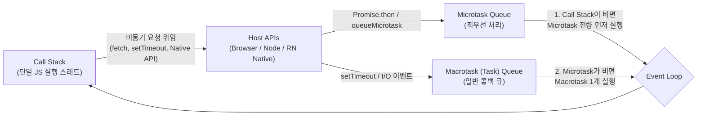

# JavaScript Event Loop and Asynchronous Patterns

## 정의 (Definition)

[[JavaScript (ECMAScript)]]는 브라우저와 [[React Native]]의 JS 스레드 모두에서 **단일 호출 스택(Single Call Stack)** 으로 동작하지만, 호스트 환경(Web APIs, Node.js C++ APIs, [[React Native Architecture (Bridge to New Architecture)|React Native Native Modules/JSI]])과 **이벤트 루프(Event Loop)**, 그리고 작업 큐(Microtask / Macrotask Queue)를 조합하여 UI 블로킹 없이 비동기 I/O를 처리한다 ([[2021-JavaScript from Beginner to Professional]], Ch 13 p.370–386; [[2024-JavaScript Design Patterns]], Ch 7 p.202–227).

---

## 1. 이벤트 루프(Event Loop)와 태스크 큐 아키텍처



1. **Call Stack (호출 스택)**: 현재 실행 중인 함수들의 [[JavaScript Execution Context, Closures, and Prototype|실행 컨텍스트]]가 LIFO 순서로 쌓이는 단일 스레드 공간.
2. **Microtask Queue (`Promise.then/catch/finally`, `await` 이후 코드, `queueMicrotask`)**: 현재 실행 중인 스크립트가 끝나고 Call Stack이 비는 즉시, 다음 화면 렌더링이나 일반 타이머보다 **항상 먼저** 큐가 빌 때까지 실행된다.
3. **Macrotask / Task Queue (`setTimeout`, `setInterval`, UI I/O 이벤트)**: Microtask Queue가 완전히 비워진 뒤에 하나씩 Call Stack으로 이동해 실행된다 ([[2021-JavaScript from Beginner to Professional]], p.380–384).

---

## 2. 실무 고성능 비동기 제어 패턴 (Ch 7, `2024-JS Design Patterns`)

[[2024-JavaScript Design Patterns]] (Ch 7, p.202–226)와 [[2026-Clean Code with TypeScript]] (Ch 6–7, p.194–199, p.241)에서 강조하는 프로덕션 비동기 패턴:

### 2.1 순차 실행 vs 병렬 실행 (`Promise.all` / `Promise.allSettled`)
- **안티패턴 (Waterfall)**: 서로 의존성이 없는 여러 API 요청을 루프나 연속된 `await`로 직렬 호출하면 전체 응답 시간이 합산($T_1 + T_2 + T_3$)되어 지연된다 (p.202).
- **병렬 최적화 (p.208–214)**:
  - **`Promise.all([req1, req2, req3])`**: 모든 요청을 동시에 출발시켜 가장 느린 요청 하나만큼의 시간($\max(T_1, T_2, T_3)$)만 소요. 하나라도 실패(reject)하면 즉시 전체가 실패한다.
  - **`Promise.allSettled([...])`**: 일부 요청이 실패하더라도 모든 Promise가 완료될 때까지 기다려 각각의 `{ status: 'fulfilled', value }` 또는 `{ status: 'rejected', reason }` 결과를 안전하게 수집한다 (대시보드나 다중 위젯 로딩에 필수).

### 2.2 `AbortController`를 통한 비동기 취소 및 타임아웃 (p.215–218)
- 사용자가 [[React]] / [[React Native]] 화면에서 빠르게 뒤로가기를 누르거나 검색어를 바꿀 때, 이전 `fetch()` 요청이 뒤늦게 도착해 상태를 덮어쓰는 **경쟁 상태(Race Condition)** 를 막기 위해 표준 `AbortController` 시그널(`signal`)을 전달해 네트워크 요청을 즉시 취소한다:
  ```ts
  const controller = new AbortController();
  const timeoutId = setTimeout(() => controller.abort(), 5000); // 5초 타임아웃
  fetch(url, { signal: controller.signal }).finally(() => clearTimeout(timeoutId));
  ```

### 2.3 Throttling, Debouncing, Batching (p.219–226)
| 기법 | 작동 원리 | React / React Native 대표 유스케이스 |
|---|---|---|
| **Debouncing (디바운싱)** | 연속된 이벤트 발생이 멈추고 일정 시간(예: 300ms)이 지났을 때 **마지막 1회만 실행** | 실시간 검색창 자동완성 API 호출, 창 크기 조절 완료 후 재계산 (`2026-React Arch 2e` p.248) |
| **Throttling (스로틀링)** | 이벤트가 아무리 많이 발생해도 일정 주기(예: 100ms)당 **최대 1회만 실행되도록 제한** | 무한 스크롤(`onScroll`) 위치 추적, 드래그/제스처 좌표 로깅, 버튼 연타 방지 |
| **Batching (배칭)** | 짧은 시간 동안 발생한 여러 개의 개별 작업/요청을 모아 단일 페이로드나 단일 렌더링으로 묶어 처리 | React 18/19의 Automatic State Batching([[React Fiber and Reconciliation]]), GraphQL DataLoader |

---

## 3. 심화 비동기 아키텍처 및 MDN 공식 표준(ES2024+) 보강

1. **`queueMicrotask` 기반 프레임워크 스케줄러 ([[2024-Build a Frontend Web Framework (From Scratch)]], Ch 13 p.322–340)**:
   - 컴포넌트의 `onMounted`/`onUnmounted` 생명주기 훅을 동기적으로 즉시 실행하면 DOM 패치(`patchDOM`) 도중 메인 스레드가 블로킹될 수 있다. 표준 `queueMicrotask(job)` API를 사용하면 현재 동기 DOM 렌더링을 먼저 끝낸 직후, 브라우저가 다음 페인트(Paint)를 수행하기 전에 Microtask Queue에서 생명주기 훅들을 일괄 비동기 실행할 수 있다.
2. **비동기 제너레이터 (`async function*` & `for await...of`, [[2021-JavaScript Cookbook 3e]] Ch 9.6 p.238)**:
   - 커서 기반 페이지네이션 API나 LLM 토큰 스트리밍([[2026-Build AI-Enhanced Web Apps]] Ch 3)처럼 시간에 걸쳐 조각(Chunk) 단위로 도착하는 비동기 데이터 스트림을 선언적인 `for await (const chunk of stream)` 루프로 소비한다.
3. **Web Workers 백그라운드 스레드 오프로딩 ([[2021-JavaScript Cookbook 3e]], Ch 9.7–9.8 p.240–246)**:
   - 단일 스레드 이벤트 루프 특성상 무거운 CPU 연산(대용량 데이터 정렬, 이미지/암호화 처리)을 메인 스레드에서 실행하면 16.6ms(60fps) 프레임 예산을 초과해 UI가 멈춘다. 별도의 OS 스레드에서 실행되는 **Web Worker**에 작업을 위임하고 `postMessage`로 진행률과 결과만 수신하여 UI 반응성을 보존한다.
4. **`Promise.withResolvers()` (MDN ES2024 공식 표준)**:
   - 기존에는 Promise 생성자 바깥에서 `resolve`/`reject`를 호출하기 위해 외부 변수를 선언해야 했으나, ES2024 표준인 `const { promise, resolve, reject } = Promise.withResolvers()`를 사용하면 이벤트 리스너를 Promise로 변환하거나 [[Full-Stack Authentication, Token Refresh, and Observability|401 토큰 갱신 단일 뮤텍스(Single-Flight Lock)]]를 구현할 때 보일러플레이트를 제거할 수 있다.

---

## 관련 개념 및 엔티티

- **선행 학습 (입문자용)**: [[JS 첫걸음 11 - 비동기 기초]] — 동기/비동기, Promise, `async`/`await`, 이벤트 루프의 간단한 모형을 먼저 익히는 레슨 ([[JS 첫걸음 00 - 로드맵|시리즈 로드맵]])
- **상위/연관 개념**: [[JavaScript Execution Context, Closures, and Prototype]], [[Virtual DOM and Reconciliation from Scratch]], [[React Fiber and Reconciliation]], [[React Native Architecture (Bridge to New Architecture)]], [[Full-Stack Authentication, Token Refresh, and Observability]]
- **구현 기술/엔티티**: [[JavaScript (ECMAScript)]], [[TypeScript]], [[TanStack Query and Zustand]]
- **출처 문헌**: [[2021-JavaScript from Beginner to Professional]] (Ch 13), [[2021-JavaScript Cookbook 3e]] (Ch 9, Ch 13), [[2024-JavaScript Design Patterns]] (Ch 7–8), [[2024-Build a Frontend Web Framework (From Scratch)]] (Ch 13), [[2025-TypeScript 5 Design Patterns and Best Practices 2nd Edition]] (Ch 8), [[2026-Clean Code with TypeScript]] (Ch 6–7), [[2026-Full-Stack React TypeScript and Node 2nd Edition]] (Ch 8, Ch 12), MDN Web Docs (`developer.mozilla.org`)
