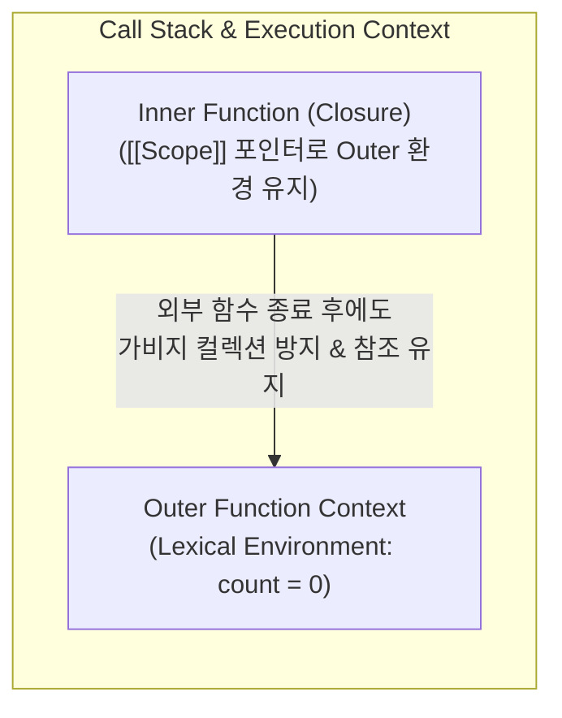

# JavaScript Execution Context, Closures, and Prototype

## 정의 (Definition)

[[JavaScript (ECMAScript)]]의 핵심 동작 메커니즘은 **① 원시값과 참조값의 메모리 분리**, **② 일급 함수와 실행 컨텍스트(Execution Context) 기반의 렉시컬 스코프 및 클로저(Closure)**, 그리고 **③ 클래스 문법(`class`) 이면에서 작동하는 프로토타입 체이닝(Prototype Chaining)과 `this` 바인딩**이라는 세 가지 기둥 위에 서 있다 ([[2015-인사이드 자바스크립트]], Ch 3–5 p.36–169; [[2026-Clean Code with TypeScript]], Ch 3 p.96–103).

이 메커니즘들은 [[React]]와 [[React Native]]에서 **왜 상태를 불변(Immutable)하게 다루어야 하는지**, 그리고 **왜 [[React Hooks and Component Design Patterns|React Hooks]]에서 Stale Closure(오래된 클로저) 버그가 발생하는지**를 설명하는 직접적인 기반 지식이다.

---

## 1. 원시 타입 vs 참조 타입과 React 불변성(Immutability)

[[2015-인사이드 자바스크립트]] (Ch 3, p.37–49)에 따르면 JavaScript 데이터는 메모리에 저장되고 전달되는 방식에 따라 두 가지로 나뉜다:

- **원시 타입 (Primitive Types — `number`, `string`, `boolean`, `null`, `undefined`, `symbol`, `bigint`)**: 변수에 실제 값이 저장되며, 대입이나 함수 인자 전달 시 **값 자체가 복사(Call by Value)** 된다.
- **참조 타입 (Reference Types — `Object`, `Array`, `Function`)**: 변수에는 실제 객체가 저장된 힙(Heap) 메모리의 **참조 주소값(Reference)** 만 저장된다.
  - 따라서 `const objB = objA; objB.count = 1;`처럼 객체 내부 프로퍼티를 직접 수정(Mutate)하면 `objA === objB` 참조 비교가 여전히 `true`를 반환한다.
  - [[React]]의 `useState`와 [[React Hooks and Component Design Patterns|의존성 배열(`Object.is` 비교)]]은 참조 주소가 바뀌었는지만 검사하므로, 반드시 스프레드 연산자(`{ ...objA, count: 1 }`)나 `map`/`filter`로 **새 참조 객체를 생성해야 리렌더링이 트리거**된다.

---

## 2. 실행 컨텍스트, 렉시컬 스코프, 그리고 클로저(Closure)

[[2015-인사이드 자바스크립트]] (Ch 5, p.140–169)가 도해하는 함수 실행과 클로저의 작동 원리:

1. **실행 컨텍스트 (Execution Context, p.140–147)**: 함수가 호출될 때마다 생성되어 콜 스택에 쌓이는 실행 환경으로, 변수/함수 선언을 먼저 등록하는 **호이스팅(Hoisting)**, 스코프 체인 생성, `this` 바인딩이 이 시점에 일어난다. (`let`/`const`는 호이스팅되지만 초기화 전까지 접근이 금지되는 TDZ—Temporal Dead Zone—가 적용됨).
2. **렉시컬 스코프와 스코프 체인 (Lexical Scope & Scope Chain, p.148–155)**: 함수가 **어디서 호출되었는지가 아니라 어디서 선언(정의)되었는지**에 따라 상위 스코프(`[[Scope]]`)가 결정된다.
3. **클로저 (Closure, p.156–169)**:
   - 이미 실행 컨텍스트가 콜 스택에서 제거된 외부 함수의 지역 변수를, 반환된 내부 함수(콜백, 이벤트 핸들러, 이펙트 함수)가 자신의 스코프 체인을 통해 계속 참조·유지하는 현상이다.
   - **React Hooks와의 직결**: 함수형 컴포넌트가 매번 다시 호출될 때 각 렌더링 시점의 `state`와 `props`는 그 렌더링 스냅샷의 클로저에 캡처된다. 만약 `useEffect`나 `useCallback`의 의존성 배열에 변수를 누락하면, 과거 첫 번째 렌더링의 클로저 환경을 계속 바라보는 **Stale Closure(오래된 클로저)** 버그가 발생한다 ([[React Hooks and Component Design Patterns]] 참조).

---

## 3. `this` 바인딩 규칙과 프로토타입 체이닝

### 3.1 호출 방식에 따른 `this` 바인딩 (Ch 4.4, p.100–121)
- 일반 함수의 `this`는 선언 시점이 아니라 **호출 방식**에 따라 동적으로 결정된다 (메서드 호출 `obj.fn()` → `obj`, 일반 호출 `fn()` → 전역 객체 또는 strict 모드에서 `undefined`, 생성자 호출 `new Fn()` → 새 인스턴스, 명시적 `fn.call/apply/bind(target)` → `target`).
- 반면 **ES6 화살표 함수(`() => {}`)** 는 자체적인 `this` 바인딩을 생성하지 않고, 상위 렉시컬 스코프의 `this`를 그대로 물려받는다 ([[2021-JavaScript from Beginner to Professional]], p.148).

### 3.2 프로토타입 체이닝 (`prototype` vs `[[Prototype]]`)
- JavaScript(및 [[TypeScript]]의 `class`, [[2026-Clean Code with TypeScript]] p.96–103)는 고전적 클래스 복제 방식이 아니라, 객체 간 위임 링크인 **`[[Prototype]]` (`Object.getPrototypeOf()` / `__proto__`)** 을 따라 상위 생성자 함수의 `prototype` 객체에 정의된 메서드를 탐색하는 **프로토타입 기반 상속(Prototypal Inheritance)** 으로 작동한다 ([[2015-인사이드 자바스크립트]], p.122–139; [[2024-JavaScript Design Patterns]], p.23–29).

---

## 4. 심화 이론(SICP) 및 MDN 공식 표준(ES2023–ES2025) 최신 보강

### 4.1 컴퓨터 과학 원론: 평가의 환경 모형과 클로저 데이터 추상화 (`2022-SICP JS`)
- **클로저만으로 복합 데이터 구축 ([[2022-자바스크립트로 배우는 SICP]], Ch 2.1 p.152)**: 배열이나 객체 리터럴이 없더라도 `function pair(x, y) { return m => m(x, y); }`처럼 고차 함수와 클로저 환경만으로 모든 연결 리스트와 트리 데이터 구조를 완벽히 구축할 수 있다.
- **치환 모형의 붕괴와 평가의 환경 모형 (Ch 3.1–3.2, p.308–351)**: 변수 배정(`=`)이 도입되는 순간 동일한 함수 호출이 시간에 따라 다른 결과를 내며 치환 모형(참조 투명성)이 깨진다. 이를 엄밀히 모델링한 **환경 구조(프레임 + 바깥 환경 포인터)** 가 곧 ECMAScript 명세의 **Lexical Environment** 그 자체이며, [[Virtual DOM and Reconciliation from Scratch]] 및 [[2021-Designing React Hooks the Right Way]] (Ch 2–3)에서 함수형 컴포넌트가 클로저로 훅 상태를 유지하는 원리와 직결된다.

### 4.2 MDN 공식 문서(`developer.mozilla.org`) 기준 ES2023–ES2025 불변(Immutable) 표준 API
2015–2021년 도서 집필 당시에는 원본 배열을 직접 변이(Mutate)시키는 메서드(`sort`, `reverse`, `splice`) 때문에 React 상태 업데이트 시 `[...arr].sort()`처럼 수동 복사를 해야 했고, 깊은 복사를 위해 `JSON.parse(JSON.stringify(obj))` 꼼수를 써야 했다([[2021-JavaScript Cookbook 3e]], Ch 5, Ch 7). 최신 ECMAScript 및 MDN Baseline 표준은 이를 언어 내장 API로 완전히 해결했다:

| 최신 표준 API | 도입 표준 | 기존 구형 패턴의 문제점 | 공식 표준 동작 및 React / RN 활용 이점 |
|---|---|---|---|
| **`toSorted()` / `toReversed()`** | ES2023 | `arr.sort()`와 `arr.reverse()`는 원본 배열을 직접 변경(Mutate)하여 React `useState` 불변성을 파괴함. | 원본 배열을 전혀 건드리지 않고 **정렬/역순 정렬된 새 배열 참조를 즉시 반환** (`setItems(items.toSorted(...))`). |
| **`toSpliced(start, deleteCount, ...items)`** | ES2023 | `arr.splice()`는 원본을 변경하고 삭제된 요소 배열을 반환하여 불변 상태 갱신에 부적합. | 특정 인덱스 요소를 삭제·삽입한 **새로운 배열 복사본을 반환**. |
| **`arr.with(index, value)`** | ES2023 | 특정 인덱스 값 하나를 불변 변경하려면 `arr.map((v, i) => i === idx ? newVal : v)`를 작성해야 했음. | `items.with(2, updatedItem)` 한 줄로 해당 인덱스만 교체된 **새 배열을 반환**. |
| **`structuredClone(value)`** | Web / Node 표준 | `Object.assign`이나 `{ ...obj }`는 1단계 얕은 복사만 수행하고, `JSON.parse(JSON.stringify())`는 `Date`, `Map`, `Set`, `undefined`, 순환 참조를 손실/에러 처리함. | 외부 라이브러리(`lodash.cloneDeep`) 없이 **`Date`, `RegExp`, `Map`, `Set`, `ArrayBuffer`, 순환 참조까지 완벽하게 깊은 복사(Deep Copy)** 수행. |
| **`Object.groupBy()` / `Map.groupBy()`** | ES2024 | 배열을 특정 키로 그룹화하기 위해 복잡한 `Array.prototype.reduce()` 보일러플레이트를 작성해야 했음. | `Object.groupBy(items, item => item.category)` 한 줄로 직관적인 그룹화 객체 생성. |
| **Set 집합 연산 메서드** | ES2025 | 교집합/차집합을 구하기 위해 매번 `[...setA].filter(x => setB.has(x))`로 배열 변환을 거쳐야 했음. | `setA.intersection(setB)`, `setA.union(setB)`, `setA.difference(setB)`, `setA.isSubsetOf(setB)` 네이티브 지원. |

---

## 관련 개념 및 엔티티

- **선행 학습 (입문자용)**: [[JS 첫걸음 10 - 스코프와 클로저]] — 스코프·스코프 체인·클로저를 비유와 실행 예제로 먼저 익히는 레슨 ([[JS 첫걸음 00 - 로드맵|시리즈 로드맵]])
- **선행/연관 개념**: [[JavaScript Core Syntax and Modern ES6+ Fundamentals]], [[JavaScript Event Loop and Asynchronous Patterns]], [[React Hooks and Component Design Patterns]], [[Virtual DOM and Reconciliation from Scratch]], [[TypeScript Type System and Advanced Generics]]
- **구현 기술/엔티티**: [[JavaScript (ECMAScript)]], [[TypeScript]], [[React]], [[React Native]]
- **출처 문헌**: [[2015-인사이드 자바스크립트]] (Ch 3–7), [[2022-자바스크립트로 배우는 SICP]] (Ch 2–3), [[2021-JavaScript Cookbook 3e]] (Ch 5–7), [[2021-JavaScript from Beginner to Professional]] (Ch 6–7, Ch 12), [[2024-JavaScript Design Patterns]] (Ch 1–2), [[2026-Clean Code with TypeScript]] (Ch 2–3), MDN Web Docs (`developer.mozilla.org`)
