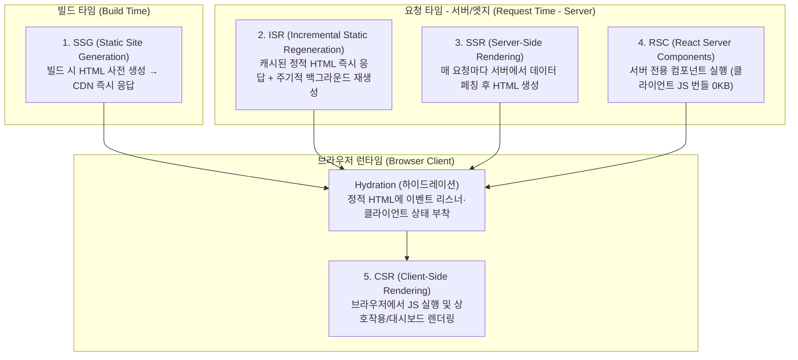

# Next.js Rendering Strategies (SSR, SSG, ISR, and RSC)

## 1. 개요 (Overview)
순수 클라이언트 사이드 [[React]] SPA(Single Page Application)는 브라우저가 빈 `

` HTML과 거대한 JavaScript 번들을 다운로드·실행한 뒤에야 첫 화면을 그리므로 **초기 로딩 지연(FCP/LCP 저하)** 과 **검색 엔진 최적화(SEO) 취약성**이라는 태생적 한계를 지닌다([[2022-Real-World Next.js]] Ch 1–2; [[2024-Fluent React]] Ch 8). **Next.js**는 이를 해결하기 위해 **페이지/컴포넌트 단위로 CSR, SSR, SSG, ISR, 그리고 React Server Components(RSC)를 조합하는 하이브리드 풀스택 렌더링 아키텍처**를 제공한다.

---

## 2. 5대 웹 렌더링 전략 비교 (Rendering Spectrum)

| 렌더링 전략 | HTML 생성 시점 | Pages Router API (`Real-World Next.js`) | App Router (Next.js 14–15+ / React 19) | 최적 사용 사례 (SEO & 성능 기준) |
| :--- | :--- | :--- | :--- | :--- |
| **1. CSR** (Client-Side Rendering) | 브라우저에서 JS 로드 후 | `useEffect` 페칭 또는 `next/dynamic({ ssr: false })` | `'use client'` + `useEffect` / [[TanStack Query and Zustand\|TanStack Query]] | SEO가 불필요한 비공개 관리자 대시보드, `window`/`canvas` 의존 차트 ([[2022-Real-World Next.js]] Ch 2, Ch 10) |
| **2. SSR** (Server-Side Rendering) | **매 사용자 요청마다** 서버에서 동적 생성 | `export async function getServerSideProps(ctx)` | Server Component 내 `fetch(url, { cache: 'no-store' })` 또는 `cookies()`/`headers()` 참조 | 실시간 주가/재고, 사용자별 맞춤 피드면서 SEO와 첫 화면 속도가 모두 중요한 페이지 |
| **3. SSG** (Static Site Generation) | **빌드 타임(`next build`)** 에 1회 생성 | `getStaticProps` + 동적 경로 `getStaticPaths` | 기본 정적 Server Component + `generateStaticParams()` | 마케팅 랜딩 페이지, 기술 블로그, 문서 사이트 (CDN 엣지 캐싱으로 TTFB 최단) |
| **4. ISR** (Incremental Static Regeneration) | 빌드 타임 생성 후 **지정 주기/이벤트마다 백그라운드 갱신** | `getStaticProps` 반환값에 `{ revalidate: 60 }` 지정 | `fetch(url, { next: { revalidate: 60 } })` 또는 `revalidatePath()` / `revalidateTag()` | 수십만 개의 이커머스 상품 상세 페이지 — 빌드 시간 폭증을 막으면서 최신 가격/재고 반영 ([[2022-Real-World Next.js]] Ch 2, Ch 13) |
| **5. RSC** (React Server Components) | 서버에서 컴포넌트 트리 직렬화 페이로드(RSC Payload) 스트리밍 | 미지원 (Pages Router는 전체 페이지가 클라이언트 번들에 포함됨) | **App Router 기본값** (상호작용이 필요한 리프 노드에만 `'use client'` 선언) | DB/파일시스템/LLM API 직접 호출, 무거운 마크다운/구문 강조 라이브러리의 **클라이언트 번들 크기 0KB 달성** ([[2024-Fluent React]] Ch 9; [[2026-Build AI-Enhanced Web Apps]] Ch 2–3) |

---

## 3. 하이드레이션(Hydration) 불일치 방지와 내장 최적화

### 3.1 Hydration과 SSR 주의점
- 서버가 생성한 HTML은 아직 클릭 핸들러나 `useState`가 연결되지 않은 '메마른(Dry) 마크업'이다. 브라우저가 JS 번들을 로드해 가상 DOM 트리와 기존 DOM 노드를 매칭하며 이벤트 리스너를 연결하는 과정을 **하이드레이션(Hydration)** 이라 한다([[2024-Fluent React]] Ch 8).
- **Hydration Mismatch 주의**: 컴포넌트 렌더링 본문에서 `typeof window !== 'undefined'`, `Date.now()`, `Math.random()`처럼 서버와 브라우저의 실행 결과가 다른 코드를 직접 렌더링하면 하이드레이션 에러가 발생한다. 브라우저 전용 로직은 반드시 `useEffect` 내부나 `dynamic(() => import(...), { ssr: false })`로 분리해야 한다([[2022-Real-World Next.js]] Ch 2).

### 3.1.1 하이드레이션의 비용과 대안 ([[2026-Web Performance Engineering in the Age of AI]] Ch 5)
- **빨리 보이지만 늦게 반응할 수 있다**: SSR은 LCP를 크게 줄일 수 있지만, 하이드레이션은 페이지 로드 중에 일어나는 추가 JavaScript 작업이고 "during hydration the page might not respond to input. It's not uncommon to see fast LCP but slow time to interactive (TTI) if hydration is heavy." (p.99) → 지표는 [[Web Performance Metrics and Core Web Vitals]].
- **대안** (p.99–101):
  - **부분 하이드레이션 / islands**: 상호작용이 필요한 부분만 하이드레이션 (Astro, Marko, Qwik, Fresh, Eleventy 등)
  - **점진적 하이드레이션**: 덜 중요한 부분을 나중에(예: idle 시간에) 하이드레이션. 너무 미루면 사용자가 누를 때 반응하지 않을 수 있음
  - **재개 가능성(resumability)**: Qwik처럼 상태를 HTML에 직렬화해 클라이언트에서 컴포넌트를 다시 실행하지 않음
  - **React 18 선택적 하이드레이션**: 사용자가 상호작용하는 컴포넌트를 먼저 하이드레이션 (p.101)
- 결론: "render on the server when you can; in the client, do as little work as possible to go interactive." (p.101)

### 3.2 Next.js 핵심 내장 컴포넌트 최적화 (`Ch 3, Ch 10`)
- **`next/link` (`<Link>`)**: 뷰포트에 들어온 링크의 대상 페이지 코드와 정적 데이터를 백그라운드에서 **자동 프리페칭(Prefetching)** 하여 페이지 전환 시 즉각적인 클라이언트 사이드 네비게이션을 제공한다.
- **`next/image` (`<Image>`)**: 기기 해상도에 맞춘 리사이징, 모던 포맷(WebP/AVIF) 자동 변환, 뷰포트 진입 시점 지연 로딩(Lazy Loading), 그리고 이미지 로드 전 자리 영역을 확보해 **CLS(Cumulative Layout Shift, 누적 레이아웃 이동)를 0으로 방지**한다.

---

## 4. 풀스택 백엔드 통합, 인증 및 배포 전략 (`Ch 8, Ch 11–12`)

1. **API Routes / Route Handlers & Server Actions**:
   - 별도의 백엔드 서버 없이도 Next.js 내부에서 REST/GraphQL 엔드포인트나 AI 스트리밍 라우트(`app/api/chat/route.ts`에서 Vercel AI SDK `streamText` 반환)를 구축하고, CORS 문제 없이 외부 API 시크릿 키를 서버 환경 변수에 안전하게 은닉한다([[2022-Real-World Next.js]] Ch 4; [[2026-Build AI-Enhanced Web Apps]] Ch 3).
2. **인증 및 세션 관리**:
   - SSR/RSC 서버 컨텍스트에서 요청의 `HttpOnly` 쿠키(JWT 또는 세션 ID)를 읽어 비인가 사용자를 렌더링 전에 즉시 리다이렉트함으로써 클라이언트 사이드 인증 특유의 '화면 깜빡임(Flash of Unauthenticated Content)'을 원천 차단한다([[2022-Real-World Next.js]] Ch 12; [[Full-Stack Authentication, Token Refresh, and Observability]]).
3. **프로덕션 배포 (Vercel vs Docker 컨테이너)**:
   - **Vercel / Serverless**: 설정 없이 글로벌 CDN과 엣지/서버리스 함수로 자동 분할 배포된다.
   - **자체 서버 / Kubernetes (`Dockerfile`)**: 사내 인프라나 AWS/GCP 쿠버네티스 클러스터에 배포할 때는 `output: 'standalone'` 설정과 멀티스테이지 `Dockerfile`을 사용하여 경량 Node.js 컨테이너로 패키징한다([[2022-Real-World Next.js]] Ch 11; [[Container Infrastructure, Kubernetes, and CI-CD Pipelines]]).

---

## 5. 관련 문서 (See Also)
- [[React Fiber and Reconciliation]] — SSR, Streaming Suspense, Hydration 및 React Server Components 내부 원리
- [[Browser Rendering Pipeline and Frame Lifecycle]] — 하이드레이션 같은 큰 JavaScript 작업이 메인 스레드와 렌더링을 막는 이유
- [[Web Performance Metrics and Core Web Vitals]] — LCP·INP·CLS와 하이드레이션 비용
- [[AI-Enhanced React Applications and Specification-Driven Development]] — Next.js App Router와 Vercel AI SDK를 결합한 AI 스트리밍 웹 앱 구축
- [[Full-Stack Authentication, Token Refresh, and Observability]] — 쿠키/JWT 기반 풀스택 인증 아키텍처
- [[Container Infrastructure, Kubernetes, and CI-CD Pipelines]] — Docker 및 Kubernetes 기반 컨테이너 배포
- [[2022-Real-World Next.js]]
- [[2024-Fluent React]]
- [[2026-Build AI-Enhanced Web Apps]]
