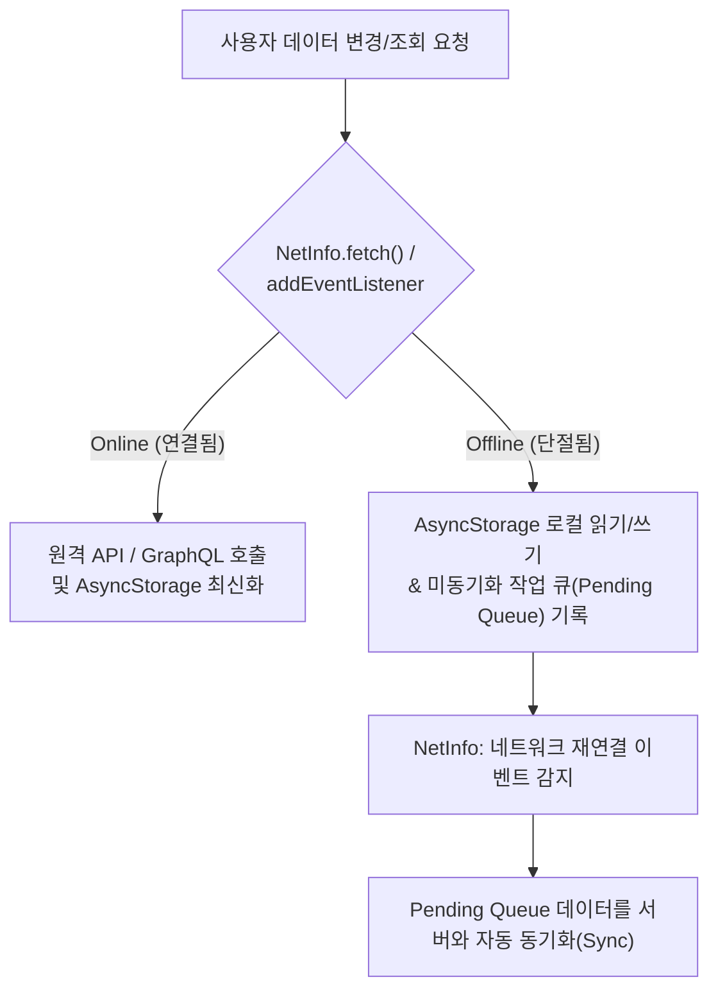

# Offline-First and Mobile State Management

## 정의 (Definition)

모바일 애플리케이션은 데스크톱 웹과 달리 **네트워크 연결이 수시로 끊기거나 불안정하며, 백그라운드 전환 시 앱 프로세스가 종료될 수 있는 환경**에서 동작한다. 따라서 [[React Native]]의 상태 관리 아키텍처는 메모리 내 UI/전역 상태(React Hooks, Context API, Redux)뿐만 아니라, **서버 상태(REST/GraphQL)와 기기 로컬 영속 저장소(`AsyncStorage`), 네트워크 상태 감지(`NetInfo`)를 결합한 오프라인 퍼스트(Offline-First) 동기화 전략**을 필수적으로 포함한다 ([[2019-React Native in Action]], p.203, p.226; [[2021-Do it! 리액트 네이티브 앱 프로그래밍]], p.628; [[2022-React and React Native, Fourth Edition]], p.512, p.548, p.564).

---

## 1. 모바일 상태의 4대 계층 비교

3권의 도서에 등장하는 상태 관리 도구들을 범위와 목적에 따라 계층화하면 다음과 같다:

| 상태 계층 | 주요 기술 및 훅 | 핵심 역할 및 특징 | 출처 도서 |
|---|---|---|---|
| **1. 컴포넌트 로컬 상태** | `useState`, `useReducer`, `useMemo`, `useCallback` | 단일 컴포넌트 또는 직계 자식 내부의 UI 상태(폼 입력값, 모달 열림 여부 등) 제어 | `2021-Do it! RN` Ch 04; `2022-RN 4e` Ch 4 |
| **2. 경량 공유 상태** | **React Context API** (`createContext`, `useContext`) | Prop Drilling 없이 트리 하위로 테마(다크모드), 로케일, 현재 인증 사용자 정보를 주입 | `2021-Do it! RN` Ch 05; `2022-RN 4e` Ch 29 |
| **3. 전역 클라이언트 상태** | **[[TanStack Query and Zustand\|Zustand]]**, **Redux / RTK** (`combineReducers`, `createSlice`, `useSelector`) | 예측 가능한 단방향 데이터 흐름 또는 셀렉터 기반 경량 스토어로 앱 수준 상태 관리 | `2019-RN in Action` Ch 8; `2021-Do it! RN` Ch 08; `2024-React in Depth` Ch 8 |
| **4. 선언적 서버 상태** | **[[TanStack Query and Zustand\|TanStack Query (React Query)]]**, **GraphQL & Apollo Client** | 스키마/쿼리 키 기반 선언적 데이터 페칭, 자동 정규화/반응형 캐싱, 낙관적 UI 업데이트로 보일러플레이트 대폭 절감 | `2022-RN 4e` Ch 30–31; `2024-React in Depth` Ch 9; `2026-React Arch 2e` Ch 5 |

> [!TIP]
> **관점 비교 (고전 Redux vs Context + GraphQL/TanStack Query + Zustand)**:
> - [[2019-React Native in Action]] (Ch 8)과 [[2021-Do it! 리액트 네이티브 앱 프로그래밍]] (Ch 08)은 전역 상태와 서버 API 비동기 통신(`redux-thunk`)을 모두 **Redux** 중앙 스토어에서 처리하는 고전적 패턴을 상세히 다룬다.
> - [[2022-React and React Native, Fourth Edition]] (Part 3, Ch 29–31)은 UI/클라이언트 전역 상태는 **Context API + `useReducer`** 로 경량화하고, 백엔드 데이터 동기화와 캐싱은 **GraphQL(Apollo Client)** 에 위임한다.
> - 나아가 최신 React 아키텍처 도서인 [[2024-React in Depth]] (Ch 8–9)와 [[2026-React Application Architecture for Production Second Edition]] (Ch 5–6)은 REST/GraphQL에 구애받지 않는 **[[TanStack Query and Zustand|TanStack Query]]**(서버 상태 캐싱) + **[[TanStack Query and Zustand|Zustand]]**(초경량 셀렉터 스토어) 조합을 현대적인 표준으로 제시하며, 이는 React Native에서도 `AsyncStorage` 퍼시스턴스와 결합해 가장 널리 쓰인다.

---

## 2. Offline-First 아키텍처 (`NetInfo` + `AsyncStorage` 동기화)

[[2022-React and React Native, Fourth Edition]] (Ch 27 "Going Offline", p.512–527)은 모바일 앱이 네트워크 단절 상황에서도 끊김 없이 작동하기 위한 **3단계 오프라인 동기화 패턴**을 제시한다:

1. **네트워크 상태 선제 감지 (`@react-native-community/netinfo`, p.513–516)**:
   - `fetch()`가 실패할 때까지 기다리지 않고, `NetInfo.addEventListener`로 연결 상태(`isConnected`, Wi-Fi/Cellular 여부)를 실시간 구독하여 오프라인 배너를 띄우거나 오프라인 모드로 즉시 전환한다.
2. **기기 내 영속 저장 (`@react-native-async-storage/async-storage`, p.517–520)**:
   - OS의 네이티브 키-값 저장소(iOS는 직렬화된 사전/파일, Android는 RocksDB/SQLite 기반)에 JSON 문자열 형태로 데이터를 비동기(`setItem`, `getItem`) 저장한다.
   - [[2021-Do it! 리액트 네이티브 앱 프로그래밍]] (Ch 09-3, p.751)에서는 사용자가 로그인할 때 발급받은 **JWT(JSON Web Token)** 를 `AsyncStorage`에 보관하여 앱 재실행 시 자동 로그인을 유지하는 용도로 활용한다.
3. **재연결 시 상태 동기화 (Synchronizing Application Data, p.521–526)**:
   - 오프라인 상태에서 발생한 변경 사항을 로컬에 먼저 반영(Optimistic Offline Write)하고, `NetInfo`가 온라인 복구를 감지하는 즉시 보류 중이던 쓰기 작업들을 원격 서버로 플러시(Flush)한다.

---

## 관련 개념 및 엔티티

- **상위/연관 개념**: [[React Native Architecture (Bridge to New Architecture)]], [[React Hooks and Component Design Patterns]], [[Web React vs React Native Shared Core and Differences]]
- **구현 기술/엔티티**: [[React Native]], [[Expo]], [[TanStack Query and Zustand]], [[React]]
- **출처 문헌**: [[2019-React Native in Action]] (Ch 8–9), [[2021-Do it! 리액트 네이티브 앱 프로그래밍]] (Ch 04–05, Ch 08–09), [[2022-React and React Native, Fourth Edition]] (Ch 27, Ch 29–31), [[2024-React in Depth]] (Ch 8–9), [[2026-React Application Architecture for Production Second Edition]] (Ch 5–6)
