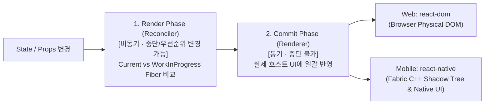

# React Fiber and Reconciliation

## 정의 (Definition)

**재조정(Reconciliation)** 은 [[React]]가 인메모리 상태 스냅샷인 **가상 DOM(Virtual DOM)** 의 변경 전후 트리를 비교(Diffing)하여, 실제 호스트 환경(웹 브라우저의 물리 DOM 또는 [[React Native]]의 iOS/Android 네이티브 뷰)에 반영해야 할 최소한의 변경 작업만을 도출하고 적용하는 핵심 알고리즘이다 ([[2024-Fluent React]], Ch 3 p.71, Ch 4 p.97; [[2023-Do it! 리액트 모던 웹 개발 with 타입스크립트]], Ch 02-1 p.51).

React 16 이후 도입되고 React 18에서 동시성(Concurrency)으로 완성된 **Fiber Reconciler**는 기존의 동기식 재귀 호출 스택(Stack Reconciler)을 **단일 연결 리스트 기반의 작업 단위(Fiber Node)** 로 재설계하여, 렌더링 작업을 우선순위(**Render Lanes**)에 따라 일시 중지·재개·폐기할 수 있게 만든 엔진이다 ([[2024-Fluent React]], Ch 4 p.103–112, Ch 7 p.205–215).

---

## 1. 왜 Stack Reconciler에서 Fiber Reconciler로 진화했는가?

[[2024-Fluent React]] (Ch 4, p.100–105)는 구형 Stack Reconciler의 한계와 Fiber의 해결책을 다음과 같이 비교한다:

- **구형 Stack Reconciler의 한계 (p.103)**:
  - JS 호출 스택을 따라 컴포넌트 트리를 재귀적으로 순회하며 한 번 시작된 렌더링은 끝날 때까지 **중단(Interrupt)하거나 취소할 수 없었다**.
  - 예컨대 무거운 백그라운드 데이터 목록 계산이 먼저 시작되면, 사용자가 텍스트 입력창(`input`/`TextInput`)에 타이핑하는 긴급한 이벤트가 블로킹되어 심각한 프레임 드롭(Jank)이 발생했다.
- **Fiber 데이터 구조의 핵심 (p.104–106)**:
  - 각 React 엘리먼트(`{ type, props }`)에 대응하는 **Fiber Node**는 JS 호출 스택 대신 힙 메모리에 존재하는 가변 객체로, **`child`(첫째 자식), `sibling`(형제), `return`(부모)** 세 개의 포인터를 통해 단일 연결 리스트(Singly Linked List) 트리를 구성한다.
  - 덕분에 React의 `workLoop`는 트리를 순회하다가도 남은 프레임 시간이 부족하거나 더 높은 우선순위의 이벤트가 들어오면 현재 포인터 위치만 기억해 두고 **메인(JS) 스레드 제어권을 즉시 양보(Yield)** 할 수 있다.

---

## 2. 2단계 렌더링 파이프라인과 호스트 렌더러 분리

1. **Render Phase (렌더 단계 — 비동기/중단 가능, `react` 코어)**:
   - 현재 화면에 표시된 `current` Fiber 트리를 복제해 메모리 상에서 `workInProgress` 트리를 구축하며 변경된 노드(Effects/Flags)를 표시한다(Double Buffering, [[2024-Fluent React]] p.108). 실제 화면에는 아무런 변화가 일어나지 않으므로 언제든 중단하거나 버리고 다시 계산할 수 있다.
2. **Commit Phase (커밋 단계 — 동기/일괄 적용, 호스트 렌더러)**:
   - 계산이 완료된 `workInProgress` 트리를 단 한 번의 동기적 패스로 실제 호스트 환경에 반영하고 `current` 포인터를 교체한다 (`useLayoutEffect`는 화면 페인트 직전 이 단계에서 동기 실행됨).
   - 이때 **웹에서는 `react-dom`** 이 물리 DOM 노드를 조작하고, **모바일에서는 [[React Native Architecture (Bridge to New Architecture)|React Native의 Fabric 렌더러]]** 가 C++ Shadow Tree와 Yoga 엔진을 거쳐 `UIView`/`android.view`를 갱신한다 ([[2024-Fluent React]], p.97; [[2022-React and React Native, Fourth Edition]], p.318–319).

---

## 3. Concurrent React와 Render Lanes (React 18+)

[[2024-Fluent React]] (Ch 7, p.203–223)와 [[2022-React and React Native, Fourth Edition]] (Ch 13, p.288–301)이 다루는 동시성 스케줄링 핵심 기법:

- **Automatic Batching (자동 배칭)**: 이벤트 핸들러 내부뿐 아니라 `Promise`, `setTimeout`, 네이티브 이벤트 콜백 내부의 여러 `setState` 호출을 하나로 묶어 단 한 번만 리렌더링한다 (`2022-RN 4e` p.289).
- **Render Lanes (렌더 레인, `2024-Fluent React` p.212)**: 31비트 비트마스크로 표현되는 우선순위 트랙(`SyncLane`, `InputContinuousLane`, `TransitionLane`, `IdleLane`).
- **`useTransition` & `useDeferredValue` (p.216–223)**:
  - 사용자 입력(타이핑, 터치)은 긴급한 `SyncLane`에서 즉시 처리하고, 그로 인해 유발되는 무거운 리스트 필터링이나 탭 화면 전환은 `startTransition` 또는 `useDeferredValue`로 감싸 낮은 우선순위(`TransitionLane`)로 백그라운드에서 인터럽트 가능하게 렌더링한다.

---

## 관련 개념 및 엔티티

- **상위/연관 개념**: [[React Hooks and Component Design Patterns]], [[Web React vs React Native Shared Core and Differences]], [[React Native Architecture (Bridge to New Architecture)]]
- **심층 분석**: [[React and React Native Internal Implementation Deep Dive]]
- **구현 기술/엔티티**: [[React]], [[React Native]]
- **출처 문헌**: [[2024-Fluent React]] (Ch 3–4, Ch 7), [[2023-Do it! 리액트 모던 웹 개발 with 타입스크립트]] (Ch 02), [[2022-React and React Native, Fourth Edition]] (Ch 1, Ch 13, Ch 15), [[2026-React Official Documentation]] (preserving-and-resetting-state)
