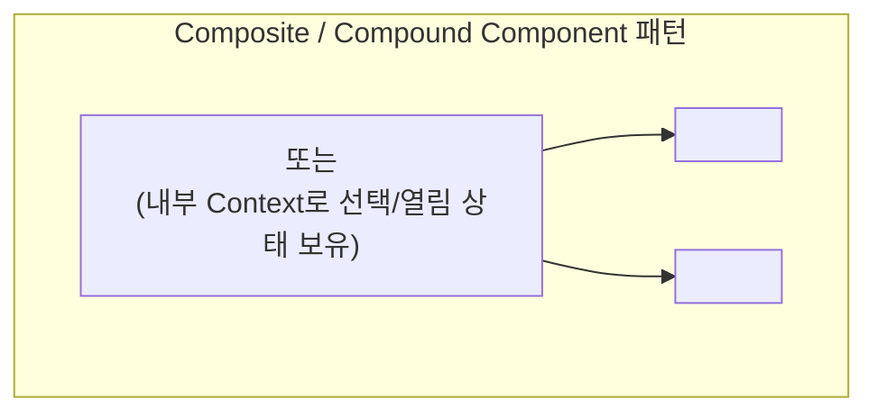

# React Hooks and Component Design Patterns

## 정의 (Definition)

**React Hooks와 컴포넌트 디자인 패턴**은 함수형 컴포넌트에서 상태 생명주기와 부수 효과(Side Effects)를 선언적으로 조합하고, 컴포넌트 간 결합도를 낮추면서 불필요한 리렌더링을 최소화하기 위한 아키텍처 원칙이다. 이 개념들은 호스트 환경에 구애받지 않는 `react` 코어 계층에 속하므로 **웹 [[React]]와 모바일 [[React Native]] 양쪽에서 100% 동일하게 작동한다** ([[2024-React in Depth]], Ch 2–3, Ch 6; [[2023-Do it! 리액트 모던 웹 개발 with 타입스크립트]], Ch 04; [[2021-Do it! 리액트 네이티브 앱 프로그래밍]], Ch 04–05).

---

## 1. 컴포넌트 리렌더링의 3대 법칙과 의존성 배열

[[2024-React in Depth]] (Ch 3, p.81–107)는 성능 최적화의 출발점으로 **함수형 컴포넌트가 리렌더링되는 3가지 유일한 조건**을 명시한다:

1. 컴포넌트가 트리에 처음 **마운트(Mount)** 될 때
2. **부모 컴포넌트가 리렌더링**될 때 (Props 변경 여부와 무관하게 기본 동작으로 자식도 함께 리렌더링됨!)
3. 컴포넌트 내부에서 호출한 **Hook(`useState`, `useReducer`, `useContext`)이 상태 변경을 플래그**했을 때

### 핵심 Hooks 역할 및 의존성 배열(`deps`) 주의점
([[2023-Do it! 리액트 모던 웹 개발 with 타입스크립트]], Ch 04 p.251–371; [[2021-Do it! 리액트 네이티브 앱 프로그래밍]], Ch 04–05 p.194–374)

| Hook | 핵심 용도 | 웹 & React Native 실전 주의점 |
|---|---|---|
| **`useState` vs `useReducer`** | 컴포넌트 로컬 상태 관리 | 독립적인 단순 값은 `useState`, 여러 하위 값이 함께 변하거나 다음 상태가 이전 상태에 복잡하게 의존할 때는 `useReducer` 사용 (`2024-Fluent React` p.141). |
| **`useEffect` vs `useLayoutEffect`** | 외부 시스템 동기화 및 생명주기 이펙트 | `useEffect`는 화면이 그려진(Paint) 후 비동기로 실행되며, **`useLayoutEffect`는 Commit 직후 화면이 그려지기 전에 동기 실행**되어 레이아웃 깜빡임(Flicker)을 방지함 (`2021-Do it! RN` p.257). 단, 공식 문서 기준 `useEffect`가 페인트 후에 실행되는 것은 "generally"이며, 클릭 같은 상호작용이 원인이면 "React may run your Effect before the browser paints the updated screen" (react.dev *useEffect* Caveats). 실행 순서 상세는 [[React Component Lifecycle and Effects]]. |
| **`useRef` & `useImperativeHandle`** | 리렌더링을 유발하지 않는 가변 참조 보관 및 명령형 핸들 노출 | `forwardRef` + `useImperativeHandle`을 결합해 부모가 자식의 `focus()`, `scrollTo()` 등을 안전하게 캡슐화하여 호출 (`2021-Do it! RN` p.355). |
| **`useMemo` & `useCallback`** | 계산 결과값 및 함수 참조(Reference) 캐싱 | `Object.is` 얕은 비교를 수행하는 의존성 배열에 매번 새로 생성되는 객체/함수를 넣으면 메모이제이션이 무력화됨 (`2024-React in Depth` p.101). 자식 컴포넌트가 `React.memo`로 감싸져 있거나 다른 훅의 의존성 배열에 들어갈 때만 선별적으로 사용 (`2024-Fluent React` p.115–135). |

---

## 2. 리렌더링을 원천 차단하는 구조적 최적화 패턴

`useMemo`/`React.memo`를 남발하기 전에 **컴포넌트 트리 구조 자체로 리렌더링 범위를 격리**하는 두 가지 핵심 기법 ([[2026-React Application Architecture for Production Second Edition]], Ch 8 p.236–243; [[2024-React in Depth]], Ch 3 p.88–95):

1. **상태 코로케이션 (State Colocation / Moving State Down, `2026-React Arch 2e` p.236)**:
   - 자주 변하는 상태(예: 검색창 타이핑 값, 모달 열림 상태, 스크롤 위치)를 최상위 부모에 두지 않고, **그 상태를 실제로 사용하는 가장 하위 컴포넌트 내부로 끌어내려(Colocate)** 형제 트리의 리렌더링을 원천 차단한다.
2. **컴포넌트 합성 (`children` Prop Pattern, `2026-React Arch 2e` p.241)**:
   - 상태를 가진 래퍼 컴포넌트가 무거운 자식 컴포넌트를 직접 렌더링하는 대신 `children` prop으로 전달받으면, 래퍼의 state가 변경되어도 `children`의 React 엘리먼트 참조는 변하지 않으므로 하위 트리가 리렌더링을 건너뛴다.

---

## 3. 시니어급 고급 컴포넌트 디자인 패턴 (Ch 2, Ch 5)

[[2024-React in Depth]] (Ch 2, p.43–79)와 [[2024-Fluent React]] (Ch 5, p.146–166)에서 강조하는 3대 컴포넌트 아키텍처 패턴:

1. **Provider Pattern (다중 Context 분리 패턴, `2024-React in Depth` p.44)**:
   - 하나의 거대한 Context에 상태(`state`)와 변경 액션(`actions`)을 함께 넣으면 상태가 바뀔 때마다 액션만 호출하는 컴포넌트까지 모두 리렌더링된다. 따라서 **`StateContext`와 `ActionContext`(또는 도메인별 세분화된 Context)를 분리**하고 전용 커스텀 훅(`useDataState`, `useDataActions`)으로만 접근하게 캡슐화한다.
2. **Composite / Compound Components Pattern (복합 컴포넌트 패턴, `2024-React in Depth` p.55; `2024-Fluent React` p.147)**:
   - 수많은 Props를 하나씩 넘기는 모놀리식 컴포넌트(Prop Explosion) 대신, `<Menu>`, `<Menu.Trigger>`, `<Menu.List>`, `<Menu.Item>`처럼 하위 컴포넌트를 조합해 선언적 레이아웃을 구성하고 부모-자식 간 상태는 내부 전용 Context로 암묵적 공유한다. ([[React Native]]의 커스텀 탭바, 아코디언, 바텀시트, 폼 컴포넌트 설계에 가장 널리 쓰인다.)
3. **Custom Hooks & Logic Extraction**:
   - UI 마크업(`
` vs `<View>`)과 데이터/상태 제어 로직(`useAuth`, `usePagination`, `useDebounce`)을 분리하면, 동일한 커스텀 훅을 웹과 React Native 모노레포에서 그대로 공유할 수 있다 ([[Web React vs React Native Shared Core and Differences]]; [[2021-Designing React Hooks the Right Way]], Ch 9).

---

## 4. 관점 비교 및 공식 문서(`react.dev`) 기준 최신 보강 (React 19+)

2021–2024년 출간 도서들의 패턴과 **React 19 공식 문서(`react.dev/blog/2024/12/05/react-19`)** 및 [[2026-Full-Stack React TypeScript and Node 2nd Edition]] (Ch 5)을 대조할 때 반드시 업데이트해야 할 4가지 핵심 변경점:

| 항목 | 기존 도서 기준 (React 16.8–18) | 공식 문서 기준 최신 표준 (React 19+, `react.dev`) |
|---|---|---|
| **`ref` 전달 방식** | 함수형 컴포넌트는 `ref`를 직접 받을 수 없어 반드시 **`forwardRef((props, ref) => ...)`** 래퍼로 감싸야 함 (`2021-Do it! RN` p.355). | **`ref`를 일반 Prop으로 직접 수신** (`function MyInput({ placeholder, ref })`). `forwardRef`는 불필요해졌으며 향후 Deprecated 예정. |
| **Context Provider 선언** | 반드시 `<ThemeContext.Provider value={theme}>` 형태로 렌더링해야 함 (`2021-React Hooks in Action` Ch 8). | **`<ThemeContext value={theme}>`** 처럼 Context 객체 자체를 Provider JSX 태그로 직접 렌더링 (`<Context.Provider>`는 Deprecated 예정). |
| **폼 및 비동기 변이(Mutation) 상태 관리** | `useState`로 `isPending`, `error`, `data`를 수동 관리하거나 외부 라이브러리에 전적으로 의존. | **Actions 및 신규 내장 훅 표준화**: 비동기 전환의 진행/결과 상태를 자동 관리하는 **`useActionState`**, 폼 제출 상태를 읽는 **`useFormStatus`**, 서버 응답 전 즉각적인 낙관적 UI를 렌더링하고 실패 시 자동 롤백하는 **`useOptimistic`** 도입. |
| **렌더링 중 비동기/컨텍스트 읽기 (`use` API)** | 모든 Hook은 조건문(`if`)이나 반복문 바깥 최상위에서만 호출해야 함 (`2021-Designing React Hooks the Right Way` Ch 3). | 새로운 **`use(resource)` API**는 일반 Hook과 달리 **`if` 조건문이나 블록 내부에서도 호출 가능**하며, Promise를 전달하면 `Suspense`와 결합해 데이터를 읽고 Context를 전달하면 조건부로 컨텍스트 값을 구독함 (`2026-Full-Stack 2e` p.164). |

---

## 관련 개념 및 엔티티

- **생명주기·Effect 심화**: [[React Component Lifecycle and Effects]], [[React Native Rendering and App Lifecycle]], [[렌더링 첫걸음 00 - 로드맵|렌더링 첫걸음 시리즈]]
- **상위/연관 개념**: [[Virtual DOM and Reconciliation from Scratch]], [[React Fiber and Reconciliation]], [[Web React vs React Native Shared Core and Differences]], [[Offline-First and Mobile State Management]]
- **구현 기술/엔티티**: [[React]], [[React Native]], [[TanStack Query and Zustand]]
- **출처 문헌**: [[2024-React in Depth]] (Ch 2–3, Ch 5–6), [[2024-Fluent React]] (Ch 5), [[2021-React Hooks in Action]] (Ch 1–13), [[2021-Designing React Hooks the Right Way]] (Ch 2–9), [[2023-Do it! 리액트 모던 웹 개발 with 타입스크립트]] (Ch 04), [[2021-Do it! 리액트 네이티브 앱 프로그래밍]] (Ch 04–05), [[2025-Advanced Front-End Development]] (Ch 9, Ch 19), [[2026-React Application Architecture for Production Second Edition]] (Ch 8), [[2026-Full-Stack React TypeScript and Node 2nd Edition]] (Ch 5)
