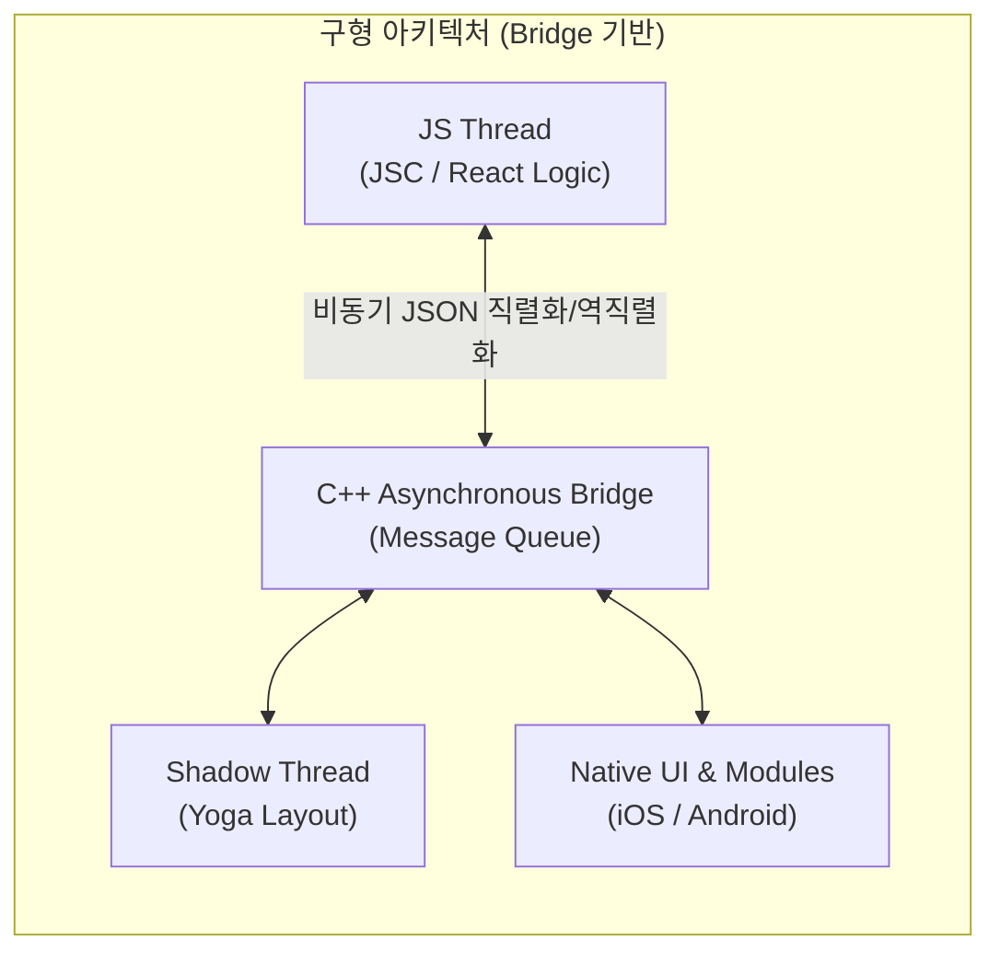
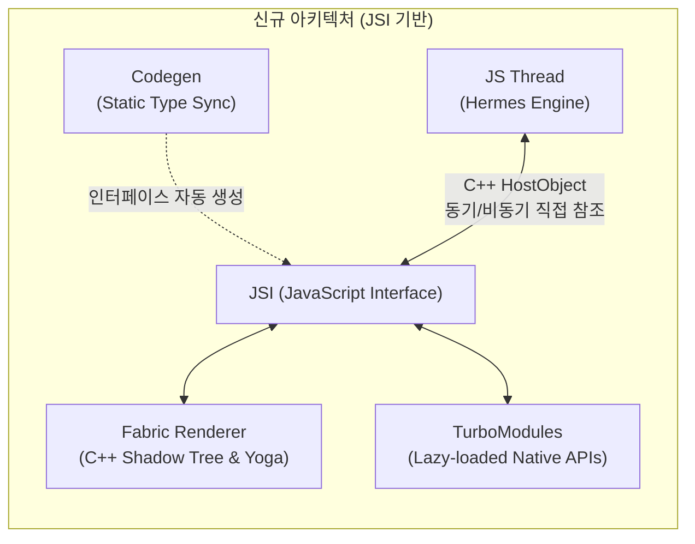

# React Native Architecture (Bridge to New Architecture)

## 정의 (Definition)

**React Native 아키텍처**는 개발자가 작성한 단일 JavaScript/TypeScript 비즈니스 로직과 선언적 React 컴포넌트 트리를 iOS(`UIView`)와 Android(`android.view`)의 **실제 네이티브 플랫폼 UI 위젯 및 네이티브 API 호출로 변환·동기화하는 런타임 및 빌드 구조**다 ([[2019-React Native in Action]], p.27–31; [[2022-React and React Native, Fourth Edition]], p.311–319).

초기 아키텍처는 C++ 기반의 비동기 JSON 메시지 큐인 **Bridge(브릿지)** 에 의존했으나, 대규모 리스트 스크롤이나 고성능 애니메이션에서 발생하는 직렬화 병목을 해결하기 위해 **JSI(JavaScript Interface), Fabric, TurboModules, Codegen, Hermes**를 축으로 하는 **New Architecture**로 진화했다 ([[2022-React and React Native, Fourth Edition]], p.318–319).

---

## 1. 빌드 파이프라인과 3대 런타임 스레드

### 1.1 빌드 및 번들링 파이프라인 (Metro, Gradle, CocoaPods)
[[2021-Do it! 리액트 네이티브 앱 프로그래밍]] (Ch 02, p.47–58)과 [[2022-React and React Native, Fourth Edition]] (Ch 15, p.315)에 따르면 [[React Native]] 앱의 구동은 **네이티브 셸 빌드**와 **JS 번들 서빙**의 결합으로 이루어진다:

1. **Metro Bundler (`npm start`)**: TypeScript와 JSX 코드를 Babel을 통해 트랜스파일하고 의존성을 단일 JavaScript 번들 파일로 패키징하여 앱에 제공한다.
2. **Android 빌드 (`npm run android` / `./gradlew installDebug`)**: `android/app/build.gradle`이 `node_modules` 내의 안드로이드 네이티브 모듈(`native_modules.gradle`)을 링크하고 Java/Kotlin 네이티브 앱을 빌드해 에뮬레이터/기기에 설치한다 ([[2021-Do it! 리액트 네이티브 앱 프로그래밍]], p.56).
3. **iOS 빌드 (`npm run ios` / `npx pod-install`)**: `ios/Podfile`을 통해 CocoaPods가 `node_modules` 내의 Objective-C/Swift 네이티브 모듈을 로컬에 설치하고 Xcode 빌드를 수행한다 ([[2021-Do it! 리액트 네이티브 앱 프로그래밍]], p.57–58).

### 1.2 런타임 3대 스레드 (The Three Threads)
[[2022-React and React Native, Fourth Edition]] (Ch 15, p.313–317)는 실행 중인 React Native 앱 내부를 다음 3개의 핵심 스레드로 구분한다:

- **JS Thread (자바스크립트 스레드)**: React 컴포넌트 렌더링(Virtual DOM diffing), Hooks, 상태 관리, REST/GraphQL 네트워크 요청 등 모든 비즈니스 로직이 단일 스레드로 실행되는 공간이다 (p.315).
- **Shadow Thread (섀도 스레드 & Yoga 엔진)**: JS 스레드에서 전달된 [[Mobile Layout and Styling with Flexbox|Flexbox 기반 CSS-in-JS 스타일 객체]]를 받아, Meta가 C++로 개발한 **Yoga 레이아웃 엔진**을 통해 실제 화면의 좌표(너비, 높이, 여백)를 계산한 뒤 Native UI 스레드로 전달한다 (p.317).
- **Native Thread (Native UI / Main Thread & Native Modules)**: iOS(Objective-C/Swift)와 Android(Java/Kotlin)의 화면 렌더링을 담당하는 **Native UI**와 카메라·블루투스·센서 등 OS 고유 기능에 접근하는 **Native Modules**가 실행된다 (p.315).

---

## 2. 구형 아키텍처(The Bridge)와 구조적 한계

### 작동 방식
JS 스레드와 Native 스레드는 서로의 메모리를 직접 참조하지 못하고 완전히 격리되어 있다. 한쪽에서 다른 쪽을 호출하려면 데이터를 **JSON 문자열로 직렬화(Serialize)** 하여 C++ 비동기 큐(**Bridge**)에 넣고, 반대편에서 이를 꺼내 **역직렬화(Deserialize)** 해야 한다 ([[2022-React and React Native, Fourth Edition]], p.315–316).

### 주요 한계 (Bridge Bottleneck)
- **비동기 지연과 프레임 드롭 (Blank Space Problem)**: 사용자가 거대한 리스트를 빠르게 스크롤할 때 Native에서 발생한 `onScroll` 이벤트가 비동기 브릿지를 거쳐 JS로 전달되고, JS가 다음 아이템을 계산해 다시 브릿지로 돌려보내는 동안(16ms 초과) 화면에 빈 공간(White blank space)이 노출된다 ([[2022-React and React Native, Fourth Edition]], p.316, p.485).
- **초기 구동 시 모든 Native Module 일괄 로드**: 앱 실행 시점에 당장 쓰지 않는 네이티브 모듈까지 모두 초기화해야 하므로 앱 시작 시간(Startup time)이 느려진다 (p.318).

---

## 3. 모던 아키텍처 (New Architecture: JSI, Fabric, TurboModules, Hermes)

[[2022-React and React Native, Fourth Edition]] (Ch 15, p.314, p.318–319)은 브릿지 병목을 근본적으로 해결하기 위해 도입된 **New Architecture**의 5대 핵심 요소를 다음과 같이 정리한다:

| 구성 요소 | 역할 및 기존 대비 혁신점 | 출처 페이지 |
|---|---|---|
| **Hermes Engine** | JavaScriptCore(JSC)를 대체하는 모바일 최적화 JS VM. 빌드 타임에 바이트코드로 사전 컴파일하여 **앱 시작 시간 단축, 앱 용량 축소, 메모리 사용량 감소** 달성. | `2022-React and React Native 4e` p.314 |
| **JSI (JavaScript Interface)** | C++ **`HostObject`** 를 통해 JS가 Native 메서드와 속성에 대한 참조(Reference)를 직접 보유. JSON 직렬화/브릿지 큐 없이 **JS에서 Native 함수를 동기적(Synchronous)·직접적으로 호출** 가능. | `2022-React and React Native 4e` p.318 |
| **Fabric (New Renderer)** | 기존의 브릿지 기반 UI 매니저를 대체하는 새로운 렌더링 계층. Shadow Tree를 C++ 영역에서 직접 생성·공유하여 렌더링 단계를 단축하고 UI 반응성을 극대화. | `2022-React and React Native 4e` p.318–319 |
| **TurboModules** | 기존의 일괄 초기화되던 Native Modules를 대체. JSI를 통해 **필요한 시점에만 지연 로딩(Lazy-loading)** 하여 앱 초기 구동 속도를 크게 개선. | `2022-React and React Native 4e` p.318 |
| **Codegen** | 동적 타입인 JS(TypeScript/Flow) 스펙으로부터 강타입 네이티브 코드(C++/Java/Obj-C) 인터페이스 스텁을 빌드 타임에 자동 생성하여 양측의 타입 안정성을 보장. | `2022-React and React Native 4e` p.319 |

> [!IMPORTANT]
> **Lean Core 전략**: Meta 팀은 코어 프레임워크의 크기와 유지보수 복잡도를 줄이기 위해 과거 코어에 내장되어 있던 `AsyncStorage`, `NetInfo`, `Geolocation` 등을 별도의 커뮤니티 패키지(`@react-native-async-storage/async-storage` 등)로 분리했다 ([[2022-React and React Native, Fourth Edition]], p.319). 따라서 [[2019-React Native in Action]] (Ch 9)의 예제 코드를 최신 버전에서 실행할 때는 반드시 분리된 커뮤니티 패키지를 설치해야 한다.

---

## 4. 공식 문서(`reactnative.dev`) 기준 최신 보강: RN 0.76 기본화부터 0.84 레거시 제거까지

[[2022-React and React Native, Fourth Edition]] 집필 당시(RN 0.68–0.70)에는 New Architecture가 실험적 옵트인(`newArchEnabled=true`) 기능이었으나, **React Native 0.76 및 0.77 공식 문서(`reactnative.dev/blog`)** 기준으로 다음과 같이 완전히 세대교체되었다:

1. **New Architecture & Bridgeless Mode 기본 활성화 (RN 0.76+ Default)**:
   - React Native 0.76부터 모든 신규 프로젝트에서 별도 설정 없이 **New Architecture(Fabric + TurboModules + JSI)가 기본값(Default)으로 활성화**된다.
   - 나아가 초기화 과정이나 에러 처리 등에 남아 있던 레거시 브릿지 의존성을 걷어낸 **Bridgeless Mode(무브릿지 모드)** 가 기본 적용된다. 단, 0.76에서는 "기본값"일 뿐 Legacy Architecture가 코드베이스에서 제거된 것은 아니다 (아래 레거시 제거 타임라인 참고).
   - **레거시 제거 타임라인 (공식 블로그 기준)**:
     - **0.82 (2025-10-08)**: "the first React Native that runs entirely on the New Architecture" — Android의 `newArchEnabled=false`, iOS의 `RCT_NEW_ARCH_ENABLED=0`을 설정해도 무시된다. 다만 "We will keep the interop layers in the codebase for the foreseeable future"라고 밝혀 레거시 모듈용 interop layer는 유지된다 (`reactnative.dev/blog/2025/10/08/react-native-0.82`).
     - **0.84 (2026-02-11)**: "We've also continued removing the Legacy Architecture on both iOS and Android" — 레거시 코드 제거가 진행 중이며, 같은 릴리스에서 Hermes V1이 기본 엔진이 되었다 (`reactnative.dev/blog`, "React Native 0.84 - Hermes V1 by Default").
2. **웹 표준 정렬 Event Loop & 동기식 레이아웃(`useLayoutEffect`)**:
   - 구형 브릿지에서는 레이아웃 측정(`onLayout`)이 비동기로만 가능해 툴팁 위치 계산 시 화면 깜빡임이 발생했으나, Fabric 렌더러에서는 `useLayoutEffect` 내부에서 네이티브 뷰의 위치·크기(`getBoundingClientRect` / `measure`)를 **동기적으로 읽고 화면이 그려지기 전에 레이아웃을 즉시 보정**할 수 있다.
   - 또한 JS Event Loop가 웹 표준 Microtask 처리 규격과 일치하도록 개편되어 React 18/19의 **Concurrent Rendering(`Suspense`, `useTransition`, Automatic Batching)** 이 모바일 네이티브 뷰에서도 완벽히 동작한다.

---

## 관련 개념 및 엔티티

- **상위/연관 개념**: [[Mobile Layout and Styling with Flexbox]], [[React Native Gesture and Animation System]], [[Offline-First and Mobile State Management]], [[React Fiber and Reconciliation]]
- **구현 기술/엔티티**: [[React Native]], [[Expo]]
- **종합 비교/심층 분석**: [[React Native Learning Roadmap and Evolution (2019-2022)]], [[React and React Native Internal Implementation Deep Dive]]
- **출처 문헌**: [[2019-React Native in Action]] (p.27–34), [[2021-Do it! 리액트 네이티브 앱 프로그래밍]] (p.47–59), [[2022-React and React Native, Fourth Edition]] (p.310–320), [[2026-React Native Official Documentation]] (Architecture Overview, Bridgeless Mode)
