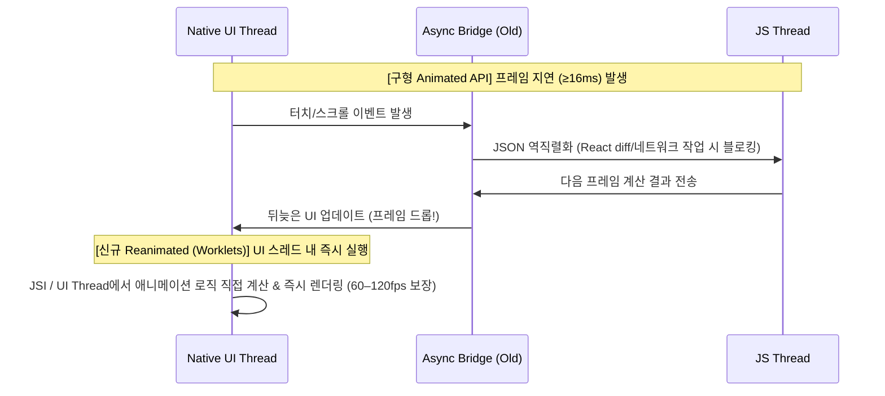

# React Native Gesture and Animation System

## 정의 (Definition)

모바일 앱의 사용자 경험(UX) 품질을 결정짓는 60fps(초당 60프레임, 프레임당 약 **16.6ms**) 이상의 부드러운 애니메이션과 멀티터치 제스처 처리를 위해 [[React Native]]가 제공하는 내장 시스템(`Animated` API, `PanResponder`)과 [[React Native Architecture (Bridge to New Architecture)|New Architecture]] 기반의 차세대 UI 스레드 애니메이션 아키텍처(**`React Native Reanimated`**)를 포괄하는 개념이다 ([[2019-React Native in Action]], p.186; [[2021-Do it! 리액트 네이티브 앱 프로그래밍]], p.376, p.483; [[2022-React and React Native, Fourth Edition]], p.466, p.485).

---

## 1. 내장 `Animated` API와 `PanResponder`

[[2019-React Native in Action]] (Ch 7, p.186–202)과 [[2021-Do it! 리액트 네이티브 앱 프로그래밍]] (Ch 06, p.376–520)은 표준 내장 API를 다음 구조로 설명한다:

### 1.1 `Animated` API의 핵심 메커니즘
1. **애니메이션 값 생성 (`Animated.Value` / `Animated.ValueXY`)**: 일반 React `useState`를 매 프레임 변경하면 컴포넌트 전체가 리렌더링되어 성능이 저하되므로, 리렌더링 없이 스타일 속성을 직접 변이시키는 `Animated.Value`(스칼라) 또는 `Animated.ValueXY`(2D 벡터)를 `useRef`와 결합해 사용한다 ([[2021-Do it! 리액트 네이티브 앱 프로그래밍]], p.381).
2. **래퍼 컴포넌트**: `Animated.View`, `Animated.Text`, `Animated.Image`, `Animated.ScrollView` 또는 `Animated.createAnimatedComponent()`로 감싼 컴포넌트만 `Animated.Value`를 `style` 속성으로 받을 수 있다 ([[2019-React Native in Action]], p.188).
3. **애니메이션 구동 함수**:
   - `Animated.timing`: 시간(`duration`)과 이징 함수(`easing`)에 따라 값을 변화시킴.
   - `Animated.spring`: 물리적인 탄성(마찰력 `friction`, 장력 `tension` 또는 `stiffness`/`damping`) 모델 적용.
   - `Animated.decay`: 초기 속도를 받아 점차 감속하며 멈춤.
4. **보간법 (`interpolate`)**: 하나의 `Animated.Value`(예: `0 → 1`)를 다른 출력 범위(예: 회전 각도 `'0deg' → '360deg'`, 배경색, 투명도)로 선형/비선형 매핑한다 ([[2021-Do it! 리액트 네이티브 앱 프로그래밍]], p.420).
5. **다중 조합**: `Animated.sequence`(순차 실행), `Animated.parallel`(동시 실행), `Animated.stagger`(일정 시간차 실행), `Animated.loop`(무한 반복) ([[2019-React Native in Action]], p.197–201; [[2021-Do it! 리액트 네이티브 앱 프로그래밍]], p.451).

### 1.2 터치 피드백과 `PanResponder` 제스처 상태 머신
- **기본 터치 컴포넌트**: `TouchableHighlight`, `TouchableOpacity`, `Pressable` 등을 통해 탭(`onPress`), 롱프레스(`onLongPress`) 및 시각적 피드백을 제공한다 ([[2022-React and React Native, Fourth Edition]], Ch 24 p.470).
- **`PanResponder` API**: 저수준 터치 이벤트를 추상화하여 드래그 앤 드롭, 핀치 줌, 스와이프 등 연속적인 제스처를 추적한다 ([[2019-React Native in Action]], p.240; [[2021-Do it! 리액트 네이티브 앱 프로그래밍]], p.483–520):
  - `onStartShouldSetPanResponder` / `onMoveShouldSetPanResponder`: 터치/이동 이벤트 권한 획득 여부 결정.
  - `onPanResponderGrant`: 터치 시작 시점 초기화.
  - `onPanResponderMove`: 손가락 이동 중 누적 변위(`gestureState.dx`, `dy`)를 `Animated.ValueXY`에 실시간 반영.
  - `onPanResponderRelease`: 손가락을 뗐을 때 원위치 복귀(`Animated.spring`) 또는 스와이프 완료 판정.

---

## 2. 관점 비교 / 아키텍처 진화: `Animated` vs `React Native Reanimated`

[[2022-React and React Native, Fourth Edition]] (Ch 25 "Using Animations", p.485–495)는 왜 모던 React Native 프로젝트가 내장 `Animated` API에서 **`React Native Reanimated`** 로 이동했는지를 아키텍처 관점에서 명확히 대비한다:

| 비교 항목 | 내장 `Animated` API (`2019` / `2021` 도서 중심) | `React Native Reanimated` (`2022` 도서 Ch 25) |
|---|---|---|
| **기반 아키텍처** | 구형 Bridge 아키텍처 기반 (`useNativeDriver: true`로 일부 보완하나 레이아웃 속성 제약 존재) | **[[React Native Architecture (Bridge to New Architecture)\|New Architecture (JSI)]]** 기반 |
| **스레드 실행 모델** | JS 스레드와 Native UI 스레드 간 비동기 통신에 의존 → JS 스레드가 React diff나 API 요청으로 바쁘면 **최소 1프레임(16ms) 이상 지연 및 프레임 드롭** 발생 (p.485) | 애니메이션 비즈니스 로직(Worklet)을 **Native UI 스레드에서 직접 동기 실행**하여 JS 스레드 부하와 무관하게 무결점 프레임 유지 |
| **핵심 훅 / API** | `new Animated.Value()`, `Animated.timing().start()` | `useSharedValue()`, `useAnimatedStyle()`, `withTiming()`, `withSpring()` |
| **레이아웃 애니메이션** | `width`, `height`, `flex` 등 레이아웃 속성은 네이티브 드라이버 미지원 | 컴포넌트 마운트/언마운트 및 레이아웃 변경 시 선언적 `entering`/`exiting`/`layout` 애니메이션 기본 지원 (p.487–492) |

---

## 관련 개념 및 엔티티

- **상위/연관 개념**: [[React Native Architecture (Bridge to New Architecture)]], [[Mobile Layout and Styling with Flexbox]]
- **구현 기술/엔티티**: [[React Native]], [[React Navigation]]
- **출처 문헌**: [[2019-React Native in Action]] (Ch 7, Ch 9), [[2021-Do it! 리액트 네이티브 앱 프로그래밍]] (Ch 06), [[2022-React and React Native, Fourth Edition]] (Ch 24–25)
