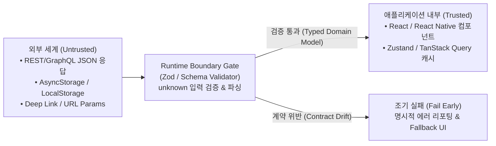

# Type-Safe Contract-First and Runtime Boundary Architecture

## 정의 (Definition)

[[TypeScript]]의 모든 정적 타입(`interface`, `type`, 제네릭)은 빌드 시점에 완전히 제거되는 **타입 소거(Type Erasure)** 특성을 가진다. 따라서 프런트엔드([[React]] / [[React Native]])와 백엔드(Node.js 등)가 단지 `.ts` 타입 정의 파일만 공유하거나 수동으로 `response as UserDto` 타입 단언(Type Assertion)을 수행하면, 실제 런타임에 외부 API·로컬 스토리지(`AsyncStorage`)·서드파티 웹훅에서 예상과 다른 JSON이 유입될 때(Contract Drift) 앱이 예고 없이 크래시된다 ([[2026-Clean Code with TypeScript]], Ch 12 "The problem shared types don't solve by themselves", p.409–415).

**계약 우선(Contract-First) 및 런타임 경계(Runtime Boundary) 아키텍처**는 ① API 스키마로부터 클라이언트 코드와 [[TanStack Query and Zustand|React Query 훅]]을 자동 생성하고, ② 신뢰할 수 없는 JSON 경계(Boundary)마다 런타임 스키마 검증 게이트(Runtime Gate)를 두어 **컴파일 타임과 런타임 양쪽의 엔드투엔드 타입 안전성**을 보장하는 설계 원칙이다 ([[2026-Clean Code with TypeScript]], Ch 11–12; [[2026-React Application Architecture for Production Second Edition]], Ch 5 p.142–150).

---

## 1. 왜 `as MyType` 타입 캐스팅은 위험한가? (Runtime Gate의 필요성)

[[2026-Clean Code with TypeScript]] (Ch 12, p.410–415)는 외부 입력이 앱 내부로 진입하는 과정을 다음과 같이 분리한다:

- **문제점**: `const user = (await res.json()) as User;`는 컴파일러의 입만 막을 뿐, 서버가 `age: "25"`(문자열)나 `null`을 내려보내도 그대로 통과시켜 한참 뒤 화면 렌더링 깊숙한 곳에서 `TypeError`를 일으킨다.
- **해결책 (Protecting the JSON boundary with a runtime gate, p.412)**:
  - `JSON.parse()`나 `res.json()`의 반환값은 항상 `unknown`으로 취급하고, 경계 계층(API Client / Storage Adapter)에서 런타임 스키마 검증기(예: Zod 등)를 통과시켜 검증된 도메인 타입으로 변환한 뒤에만 내부 비즈니스 로직으로 흘려보낸다.

---

## 2. 엔드투엔드(End-to-End) 타입 동기화 3대 아키텍처 비교

3권의 최신 도서([[2026-Clean Code with TypeScript]] Ch 11, [[2026-React Application Architecture for Production Second Edition]] Ch 5, [[2025-TypeScript 5 Design Patterns and Best Practices 2nd Edition]] Ch 11)가 제시하는 백엔드–프런트엔드(Web & React Native) 계약 동기화 방식 비교:

| 접근 방식 | 핵심 도구 체인 | 작동 원리 및 강점 | 적합한 환경 및 출처 |
|---|---|---|---|
| **1. OpenAPI Contract-First + 코드젠** | OpenAPI(Swagger) 스펙 → **Orval** / `openapi-typescript` → **[[TanStack Query and Zustand\|TanStack Query]] Hooks + Zod 스키마** | 백엔드 언어(Java/Spring, Go, Python, Node)에 구애받지 않고 OpenAPI 명세서 하나로 TypeScript 타입, 런타임 검증 스키마, `useQuery`/`useMutation` 훅까지 100% 자동 생성 | 다중 언어 백엔드 또는 대규모 웹·[[React Native]] 분리 조직 (`2026-Clean Code with TS` p.350, p.383; `2026-React Arch 2e` p.142) |
| **2. tRPC (Zero-Codegen Type Sharing)** | **tRPC Server + tRPC Client + TanStack Query + Zod** | 별도의 코드 생성 빌드 단계 없이, TypeScript 모노레포 내에서 백엔드 프로시저의 추론된 타입(`AppRouter`)을 프런트엔드가 직접 `import type`으로 가져와 IDE 자동완성과 타입 검사를 즉시 획득 | 백엔드(Node.js)와 프런트엔드(React / RN)가 단일 TypeScript 모노레포(Nx/Turborepo)를 공유할 때 (`2025-TS 5 Design Patterns` Ch 11 p.402) |
| **3. GraphQL Schema Codegen** | GraphQL Schema → GraphQL Code Generator → **Apollo Client** | 강타입 GraphQL 스키마와 쿼리 문서로부터 프런트엔드 응답 타입과 커스텀 훅을 생성 | 복합 도메인 그래프 조회 및 선언적 필드 선택이 중요할 때 (`2022-RN 4e` Ch 30–31; `2025-TS 5 Design Patterns` p.398) |

> [!IMPORTANT]
> **React Native의 네이티브 경계(Codegen)와의 상통성**:
> 백엔드–프런트엔드 간 계약을 OpenAPI/Orval로 자동 동기화하는 것과 똑같은 철학이, React Native 내부에서는 JS(TypeScript)와 C++/iOS/Android 강타입 네이티브 모듈 간 인터페이스를 자동 생성하는 **[[React Native Architecture (Bridge to New Architecture)|React Native Codegen]]** ([[2022-React and React Native, Fourth Edition]], p.319)으로 구현되어 있다.

---

## 관련 개념 및 엔티티

- **상위/연관 개념**: [[TypeScript Type System and Advanced Generics]], [[Web React vs React Native Shared Core and Differences]], [[Offline-First and Mobile State Management]], [[React Native Architecture (Bridge to New Architecture)]]
- **구현 기술/엔티티**: [[TypeScript]], [[TanStack Query and Zustand]], [[React]], [[React Native]]
- **출처 문헌**: [[2026-Clean Code with TypeScript]] (Ch 10–12, p.319–419), [[2026-React Application Architecture for Production Second Edition]] (Ch 5, p.136–162), [[2025-TypeScript 5 Design Patterns and Best Practices 2nd Edition]] (Ch 11, p.390–408)
