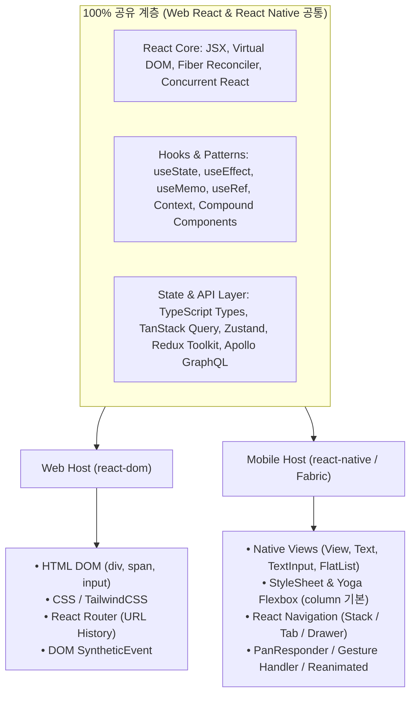

# Web React vs React Native Shared Core and Differences

## 정의 (Definition)

[[React Native]]를 공부할 때 [[React]] 웹 도서를 함께 학습해야 하는 이유는, 두 기술이 **`react` 코어 패키지([[React Fiber and Reconciliation|Fiber Reconciler]], JSX, [[React Hooks and Component Design Patterns|Hooks & 컴포넌트 패턴]], 상태 관리 생태계)를 100% 공유**하기 때문이다 ([[2024-Fluent React]], p.97; [[2022-React and React Native, Fourth Edition]], p.305–307).

반면 **호스트 렌더러(`react-dom` vs `react-native`)** 이후의 계층—즉 기본 UI 프리미티브, 스타일링 엔진, 내비게이션 모델, 이벤트/제스처 처리, 빌드 환경—은 웹 브라우저와 모바일 OS의 플랫폼 특성 차이로 인해 명확히 구분된다. 이 경계선을 정확히 아는 것이 학습 효율과 실무 코드 공유(Monorepo)의 핵심이다.

---

## 1. 아키텍처 계층별 공유 영역 vs 차이점 매트릭스

| 아키텍처 영역 | 웹 React (`react-dom`) | 모바일 React Native (`react-native`) | 코드/지식 호환성 |
|---|---|---|---|
| **Hooks API & 컴포넌트 생명주기 규칙** | `useState`, `useEffect`, `useLayoutEffect`, `useMemo`, `useCallback`, `useRef`, `useContext`, `useTransition` | **훅의 문법과 규칙은 웹과 동일** (`2023-Do it! 리액트` Ch 04 ↔ `2021-Do it! RN` Ch 04) | **API는 공유** |
| **화면·앱 생명주기** | 라우트를 떠나면 보통 화면 컴포넌트가 언마운트됨 | React Navigation은 "doesn't unmount screens when navigating away" → 포커스는 `useFocusEffect`/`useIsFocused`, 앱 포그라운드·백그라운드는 `AppState` ([[React Native Rendering and App Lifecycle]]) | **플랫폼별 상이** |
| **전역 상태 & 서버 캐싱** | [[TanStack Query and Zustand\|TanStack Query, Zustand]], Redux Toolkit, Apollo Client | **웹과 100% 동일** (단, 영속화 스토리지만 `localStorage` 대신 `AsyncStorage`/MMKV 주입) | **95%+ 공유** |
| **기본 UI 프리미티브** | HTML 태그 (`
`, `
`, ``, `<input>`, `<ul>`) | 코어 네이티브 컴포넌트 (`<View>`, `<Text>`, `<Image>`, `<TextInput>`, `<FlatList>`) | 플랫폼 전용 |
| **스타일링 & 레이아웃** | 브라우저 CSS 엔진, CSS Modules, TailwindCSS (`flex-direction: row` 기본) | [[Mobile Layout and Styling with Flexbox\|Yoga C++ 엔진, `StyleSheet.create`]] (`flexDirection: 'column'` 기본, 상속 없음) | 개념은 공유, 코드는 분리 (또는 NativeWind/Tamagui 사용) |
| **라우팅 / 내비게이션** | URL 기반 **React Router** (`<BrowserRouter>`, `<Outlet>`, URL Search Params) (`2023-Do it! 리액트` Ch 06) | 화면 스택/제스처 기반 **[[React Navigation]]** (`NavigationContainer`, Stack, Tab, Drawer) (`2021-Do it! RN` Ch 07) | 플랫폼별 상이 (단, Expo Router는 파일 기반 URL 통합 지향) |
| **이벤트 & 인터랙션** | 마우스/키보드 중심 `onClick`, `onChange`, DOM 이벤트 버블링(`SyntheticEvent`) | 터치/제스처 중심 `onPress`, `onChangeText`, [[React Native Gesture and Animation System\|`PanResponder`, `Reanimated`]] | 플랫폼 전용 |
| **웹 전용 기술 (RN 비해당)** | SSR/Streaming HTML(`renderToPipeableStream`), SEO 메타태그 | 네이티브 앱 번들 실행 및 [[React Native Architecture (Bridge to New Architecture)\|Hermes 바이트코드]], `NetInfo` 오프라인 감지 | 플랫폼 전용 |

---

## 2. 실무 모노레포(Monorepo)에서의 웹·모바일 코드 공유 전략

[[2026-React Application Architecture for Production Second Edition]] (Ch 2, Ch 5, Ch 13 p.358–359)과 [[2024-React in Depth]] (Ch 8–9)의 아키텍처를 결합하면, 하나의 TypeScript 모노레포(Turborepo / Nx) 안에서 웹과 React Native 앱을 동시에 운영할 때 다음과 같이 패키지를 분리할 수 있다:

- **`packages/core` (공유율 100%)**:
  - OpenAPI 스펙으로부터 자동 생성된 **TypeScript 인터페이스 및 Zod 검증 스키마** (`2026-React Arch 2e` Ch 5 p.142)
  - 비즈니스 도메인용 **[[TanStack Query and Zustand|TanStack Query 훅(`useQuery`/`useMutation`)]]** 및 **Zustand/RTK 스토어**
  - 플랫폼 독립적인 순수 **커스텀 React Hooks** (`useDebounce`, `useForm`, `useAuth` 등)
- **`apps/web` & `apps/mobile` (플랫폼별 Presentation Layer)**:
  - `packages/core`의 데이터 훅을 임포트하여, 웹은 HTML/TailwindCSS + React Router로, 모바일은 [[React Native]] 코어 컴포넌트 + [[React Navigation]]으로 뷰 레이어만 각각 렌더링한다 ([[2024-React in Depth]], Ch 8 p.242의 Data Layer vs Presentation Layer 분리 원칙).

---

## 관련 개념 및 엔티티

- **렌더링·생명주기 비교**: [[Browser Rendering Pipeline and Frame Lifecycle]], [[React Component Lifecycle and Effects]], [[React Native Rendering and App Lifecycle]], [[렌더링 첫걸음 00 - 로드맵|렌더링 첫걸음 시리즈]]
- **상위/연관 개념**: [[React Fiber and Reconciliation]], [[React Hooks and Component Design Patterns]], [[React Native Architecture (Bridge to New Architecture)]], [[Mobile Layout and Styling with Flexbox]], [[Offline-First and Mobile State Management]]
- **구현 기술/엔티티**: [[React]], [[React Native]], [[TanStack Query and Zustand]], [[React Navigation]], [[Expo]]
- **종합 로드맵/심층 분석**: [[React Native Learning Roadmap and Evolution (2019-2022)]], [[React and React Native Internal Implementation Deep Dive]]
- **출처 문헌**: [[2022-React and React Native, Fourth Edition]], [[2023-Do it! 리액트 모던 웹 개발 with 타입스크립트]], [[2021-Do it! 리액트 네이티브 앱 프로그래밍]], [[2024-Fluent React]], [[2024-React in Depth]], [[2026-React Application Architecture for Production Second Edition]]
