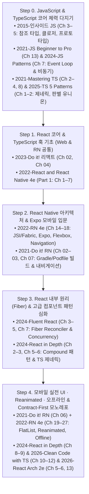

# JS · TS · React · React Native 통합 학습 로드맵 및 아키텍처 진화

## 질문 / 문제 의식

MarginNote4 라이브러리에 소장된 **[[JavaScript (ECMAScript)|JavaScript]] 3권**, **[[TypeScript]] 3권**, **[[React]] 4권**, 그리고 **[[React Native]] 3권**(총 13권)을 어떻게 유기적으로 연결해 학습해야 가장 빠르고 깊이 있게 모바일·웹 풀스택 역량을 구축할 수 있는가?

1. **언어 기초와 프레임워크의 직결성**: [[JavaScript Execution Context, Closures, and Prototype|참조 타입 불변성과 클로저]]를 모르면 React Hooks의 Stale Closure와 리렌더링 규칙을 이해할 수 없고, [[JavaScript Event Loop and Asynchronous Patterns|이벤트 루프와 비동기 패턴]]을 모르면 모바일 네트워크/제스처 병목을 제어할 수 없으며, [[TypeScript Type System and Advanced Generics|판별 유니온과 제네릭]]을 모르면 모던 컴포넌트 Props와 API 계약을 설계할 수 없다.
2. **[[Web React vs React Native Shared Core and Differences|React 코어의 100% 공유성]]**: JSX, [[React Fiber and Reconciliation|Virtual DOM & Fiber Reconciler]], [[React Hooks and Component Design Patterns|7대 React Hooks 및 합성 패턴]], 그리고 [[TanStack Query and Zustand|상태 관리/데이터 캐싱]]은 웹과 React Native가 완전히 동일하다.
3. **생태계의 세대교체**: 2019–2021년의 클래스 컴포넌트/구형 Bridge/고전 Redux 중심 서술에서, 2022–2026년의 **TypeScript 5+ · 함수형 Hooks · JSI/Fabric New Architecture · Reanimated · TanStack Query/Zustand · Contract-First(Orval/tRPC)** 로의 진화 흐름을 꿰뚫어야 한다.

---

## 1. 계층별 13권 도서 포지셔닝 매트릭스

### 1.1 JavaScript & TypeScript 언어 기반 도서 (6권)

| 영역                    | 도서                                                                                     | 핵심 강점 및 React / RN 연계 포인트                                                                                                                                                                               | 우선 읽을 핵심 챕터                                                                                   |
| --------------------- | -------------------------------------------------------------------------------------- | ------------------------------------------------------------------------------------------------------------------------------------------------------------------------------------------------------- | --------------------------------------------------------------------------------------------- |
| **JS 코어 원리**          | [[2015-인사이드 자바스크립트]] (송형주 외, 2015)                                                     | 원시/참조 타입 메모리 구조(React 불변성의 이유), 일급 함수, `this` 바인딩, 프로토타입 체인, **[[JavaScript Execution Context, Closures, and Prototype\|실행 컨텍스트와 클로저]]**(Hooks 동작 원리)를 도해로 완벽 해설.                                       | **Ch 3**(참조 타입), **Ch 4**(함수/`this`/프로토타입), **Ch 5**(실행 컨텍스트와 클로저), **Ch 7**(함수형 프로그래밍)       |
| **ES6+ & 비동기 기초**     | [[2021-JavaScript from Beginner to Professional]] (Svekis 외, 2021)                     | ES6+ 문법(`let`/`const`, 화살표 함수, 구조 분해, `class`), 내장 배열 메서드(`map`/`filter`/`reduce`), **[[JavaScript Event Loop and Asynchronous Patterns\|Callbacks · Promises · `async/await` · Event Loop]]** 입문.      | **Ch 6–8**(함수/클래스/배열 메서드), **Ch 12**(JSON/호이스팅), **Ch 13**(Concurrency & Event Loop)          |
| **JS 실전 패턴 & 비동기 성능** | [[2024-JavaScript Design Patterns]] (Di Francesco, 2024)                               | ES6 `Proxy`/`Reflect`, Observer 패턴, React View 패턴 진화(HOC → Hooks → Provider), **`Promise.allSettled` · `AbortController` 취소 · Throttling/Debouncing/Batching**, WebView-Native 브릿지 보안.                  | **Ch 2–4**(Proxy, Observer, Hooks/Provider 패턴), **Ch 7–8**(비동기 성능 제어 & 브릿지 메시징)               |
| **TS 컴파일러 & 제네릭 정석**  | [[2021-Mastering TypeScript Fourth Edition]] (Rozentals, 2021)                         | `unknown` vs `never`, 타입 가드, `keyof`/Mapped/Conditional Types/`infer`, 외부 JS 모듈 타이핑을 위한 **`.d.ts` 선언 파일**, **`tsconfig.json` Strict 옵션** 상세 해설.                                                         | **Ch 2–4**(타입 시스템 & 고급 제네릭), **Ch 7–8**(`.d.ts` 선언 파일 & Strict 옵션)                            |
| **TS 5 디자인 패턴 & FP**  | [[2025-TypeScript 5 Design Patterns and Best Practices 2nd Edition]] (Despoudis, 2025) | **TS 5 신기능(`satisfies`, `const` 제네릭)**, Branded Types, 판별 유니온, GoF 패턴, 함수형 모나드(`Option`/`Either`), TS 안티패턴, **Apollo Client & tRPC 내부 아키텍처**.                                                           | **Ch 1–2**(TS 5 & 고급 타입), **Ch 7**(함수형/모나드), **Ch 10**(안티패턴), **Ch 11**(Apollo & tRPC)        |
| **TS 클린 코드 & 풀스택 계약** | [[2026-Clean Code with TypeScript]] (Ojigbo 외, 2026)                                   | 클린 함수와 합성(Composition over Inheritance), **Nx 모노레포**, **OpenAPI + Orval + React Query 계약 우선 개발**, **[[Type-Safe Contract-First and Runtime Boundary Architecture\|JSON 런타임 경계 검증 게이트(Runtime Gate)]]**. | **Ch 2–4**(클린 함수 & Feature 구조), **Ch 9**(유틸리티 타입), **Ch 10–12**(Nx 모노레포, Orval, Runtime Gate) |

### 1.2 모던 React 코어·아키텍처 도서 (4권)

| 도서 | 핵심 강점 및 React Native와의 시너지 | 우선 읽을 챕터 (RN 연계율 100%) |
|---|---|---|
| [[2023-Do it! 리액트 모던 웹 개발 with 타입스크립트]] (전예홍, 2023) | `2021-Do it! RN`과 **동일 저자의 쌍둥이 웹 편**. 무거운 모바일 에뮬레이터 없이 가벼운 브라우저에서 JSX, Flexbox, 7대 Hooks, Redux를 동일한 예제 구조로 선행 학습 가능. | **Ch 02**(가상 DOM/JSX), **Ch 03-4**(Flexbox), **Ch 04**(함수 컴포넌트와 7대 훅 전체) |
| [[2024-Fluent React]] (Tejas Kumar, O'Reilly 2024) | **React 내부 동작 원리(Under the Hood) 최고봉**. 왜 `react` 코어가 웹(`react-dom`)과 모바일(`react-native` Fabric) 양쪽에서 동작하는지 **[[React Fiber and Reconciliation\|Fiber Reconciler와 Render Lanes]]** 수준에서 해부. | **Ch 2–4**(JSX, Virtual DOM, Fiber Reconciler), **Ch 5**(메모이제이션/패턴), **Ch 7**(Concurrent React) |
| [[2024-React in Depth]] (Morten Barklund, Manning 2024) | **시니어급 컴포넌트 패턴과 모던 데이터 관리**. Provider/Composite(Compound) 패턴, 리렌더링 3대 조건, TypeScript 제네릭 훅, 그리고 고전 Redux를 대체하는 **[[TanStack Query and Zustand\|Zustand · RTK · TanStack Query]]** 비교. | **Ch 2–3**(컴포넌트 패턴 & 렌더링 최적화), **Ch 5–6**(TS 제네릭 훅), **Ch 8–9**(Zustand, RTK, TanStack Query) |
| [[2026-React Application Architecture for Production Second Edition]] (Packt 2026) | **엔터프라이즈 프로덕션 아키텍처**. Feature 기반 폴더 구조, OpenAPI 타입 자동 생성, 상태 코로케이션, 그리고 **웹과 RN이 코드를 공유하는 Monorepo & BFF 설계**. | **Ch 2**(Feature 구조), **Ch 5–6**(OpenAPI + React Query & 상태 분리), **Ch 8**(성능/코로케이션), **Ch 13**(Monorepo/BFF/AI 규칙) |

### 1.3 React Native 전용/통합 도서 (3권)

| 비교 축 | [[2019-React Native in Action]] (Nader Dabit, 2019) | [[2021-Do it! 리액트 네이티브 앱 프로그래밍]] (전예홍, 2021) | [[2022-React and React Native, Fourth Edition]] (Boduch 외, 2022) |
|---|---|---|---|
| **언어 및 컴포넌트 패러다임** | ES6 JavaScript + **클래스 컴포넌트** (`this.state`, `componentDidMount`) 중심 | **TypeScript** + **함수형 컴포넌트 & React Hooks** (`useState`, `useEffect`, 커스텀 훅) 전면 도입 | React 18 (Concurrency, Suspense) + 함수형 Hooks + TypeScript/ESNext |
| **런타임 아키텍처 설명** | 초기 비동기 JSON **Bridge**와 Virtual DOM 모델 소개 (Ch 1) | **Metro 번들러 + Gradle(`build.gradle`) + CocoaPods(`Podfile`)** 네이티브 빌드 파이프라인 심층 해부 (Ch 02) | **[[React Native Architecture (Bridge to New Architecture)\|New Architecture]]** (Hermes, JSI, Fabric, TurboModules, Codegen) 전면 해설 (Ch 15) |
| **개발 워크플로** | React Native CLI 기본 | **React Native CLI**(Ch 01–08)로 기초를 다진 후 **[[Expo]]**(Ch 09) 및 Node.js/JWT 서버 연동 | **[[Expo]] CLI & Expo Go / Snack**으로 빠른 시작 후 실전 컴포넌트 전개 (Ch 16) |
| **코어 vs 커뮤니티 API** | `AsyncStorage`, `NetInfo`, `Geolocation` 등이 `react-native` 코어에 내장된 시절 기준 (Ch 9–11) | Lean Core 전환기 반영 (벡터 아이콘, SafeArea, 내비게이션 등 외부 패키지 설치 과정 상세 수록) | **Lean Core 완료**: `@react-native-community/netinfo`, `@react-native-async-storage/async-storage`, `react-native-maps` 등 분리된 모듈 기준 (Ch 21–27) |
| **애니메이션 & 제스처** | 내장 `Animated` API 기초 및 시퀀스/병렬 조합 (Ch 7) | 내장 `Animated` + **`PanResponder`** 상태 머신을 결합한 고난도 드래그/스와이프 직접 구현 (Ch 06) | 구형 `Animated`의 16ms 브릿지 지연을 비판하고 UI 스레드 기반 **`React Native Reanimated`** 도입 (Ch 25) |

---

## 2. 학습 시 주의해야 할 모순 및 Deprecated 항목 (Lint Notes)

1. **Lean Core 정책으로 인한 import 경로 변경**:
   - [[2019-React Native in Action]] (Ch 9–11)에서 `import { AsyncStorage, NetInfo } from 'react-native'`로 불러오던 API들은 코어 경량화([[2022-React and React Native, Fourth Edition]], p.319)로 인해 모두 코어에서 제거되었다. 현대 프로젝트에서는 반드시 `@react-native-async-storage/async-storage`, `@react-native-community/netinfo` 등 독립 패키지를 설치해야 한다.
2. **Stack 내비게이터 선택 (`stack` vs `native-stack`)**:
   - [[2021-Do it! 리액트 네이티브 앱 프로그래밍]] (Ch 07)은 JS 기반의 `@react-navigation/stack` (`createStackNavigator`)을 사용하지만, [[2022-React and React Native, Fourth Edition]] (Ch 18, p.365)은 OS 네이티브 화면 컨테이너를 직접 사용하는 **`@react-navigation/native-stack` (`createNativeStackNavigator`)** 을 기본으로 채택한다.
3. **애니메이션과 상태 관리의 세대교체**:
   - 애니메이션은 `PanResponder` + `Animated`로 기초 원리를 익힌 뒤 **`react-native-reanimated`**(UI 스레드 Worklet)로 넘어가야 한다 ([[React Native Gesture and Animation System]]).
   - 상태 관리는 모든 API 통신을 Redux `thunk`에 넣던 2019–2021년 방식 대신, 서버 캐싱은 **[[TanStack Query and Zustand|TanStack Query]]**(또는 Apollo GraphQL), 클라이언트 전역 상태는 **Zustand**(또는 RTK)로 분리하는 2024–2026년 패턴을 따르는 것이 좋다 ([[Offline-First and Mobile State Management]]).

---

## 3. 5단계 마스터 학습 로드맵 (JS/TS 코어 → React → React Native 프로덕션)

0. **Step 0 — JavaScript / TypeScript 기초 문법부터 엔진 원리·타입 시스템 기반 다지기**:
   - **JS & TS 기초 문법 (풀스택 입문 최우선)**: [[JavaScript Core Syntax and Modern ES6+ Fundamentals]](`const`/`let`, Truthy/Falsy와 `&&` 렌더링 함정, `?.`/`??`, 화살표 함수 `=> ({})` 객체 반환, 구조 분해 할당과 스프레드 `...`, 5대 배열 고차 함수 `map`/`filter`/`reduce`, `class`, ESM 모듈)와 [[TypeScript Core Syntax and Full-Stack Type Annotations]](`interface` vs `type`, 함수/비동기 `Promise<T>` 타이핑, 5대 타입 좁히기, 8대 유틸리티 타입 `Omit`/`Pick`/`Partial`, React Props/이벤트 & Express/Prisma 백엔드 실전 타이핑)를 가장 먼저 숙지한다.
   - **JS 코어 & 비동기**: [[2015-인사이드 자바스크립트]] **Ch 3–5**로 참조 타입 불변성과 실행 컨텍스트·클로저([[JavaScript Execution Context, Closures, and Prototype]])를 이해하고, [[2021-JavaScript from Beginner to Professional]] **Ch 13** 및 [[2024-JavaScript Design Patterns]] **Ch 7**로 [[JavaScript Event Loop and Asynchronous Patterns|Event Loop, `Promise.allSettled`, `AbortController`, Debounce/Throttle]]을 익힌다.
   - **TypeScript 심화**: [[2021-Mastering TypeScript Fourth Edition]] **Ch 2–4, Ch 8**과 [[2025-TypeScript 5 Design Patterns and Best Practices 2nd Edition]] **Ch 1–2**로 [[TypeScript Type System and Advanced Generics|판별 유니온, 제네릭 제약(`keyof`), Mapped/Conditional Types, `satisfies`, `tsconfig.json` Strict 옵션]]을 마스터한다.
1. **Step 1 — React 코어(JSX · Virtual DOM · 7대 Hooks)와 TypeScript 기초**:
   - [[2023-Do it! 리액트 모던 웹 개발 with 타입스크립트]]의 **Ch 02(가상 DOM/JSX)** 와 **Ch 04(7대 React Hooks)** 또는 [[2022-React and React Native, Fourth Edition]]의 **Part 1(Ch 1–7)** 을 통해 `useState`, `useEffect`, `useMemo`, `useRef`, `useContext`를 먼저 손에 익힌다.
2. **Step 2 — React Native 아키텍처 & 모바일 UI/내비게이션 입문**:
   - [[2022-React and React Native, Fourth Edition]] **Ch 14–18**로 [[React Native Architecture (Bridge to New Architecture)|3대 스레드와 JSI/Fabric New Architecture]]를 이해하고 [[Expo]] Go 환경에서 모바일 [[Mobile Layout and Styling with Flexbox|Flexbox(`column` 기본)]]와 [[React Navigation]]을 실습한다.
   - 네이티브 빌드 파이프라인(`build.gradle`, `Podfile`)과 커스텀 훅·다크모드 Context 구현은 [[2021-Do it! 리액트 네이티브 앱 프로그래밍]] **Ch 02–05, Ch 07**로 탄탄히 다진다.
3. **Step 3 — Fiber 엔진 원리와 시니어급 컴포넌트/리렌더링 최적화**:
   - [[2024-Fluent React]] **Ch 3–5, Ch 7**로 [[React Fiber and Reconciliation|Fiber Reconciler와 동시성(Render Lanes)]]을 이해하고, [[2024-React in Depth]] **Ch 2–3, Ch 5–6**으로 [[React Hooks and Component Design Patterns|Provider/Composite(Compound) 패턴, 의존성 배열 최적화, TypeScript 제네릭 훅]]을 체득한다.
4. **Step 4 — 모바일 고성능 애니메이션, 오프라인 퍼스트, Contract-First 모노레포 통합**:
   - [[2021-Do it! 리액트 네이티브 앱 프로그래밍]] **Ch 06**(`PanResponder`)과 [[2022-React and React Native, Fourth Edition]] **Ch 19–27**(`FlatList`, `React Native Reanimated`, `NetInfo` + `AsyncStorage` 오프라인 동기화)로 모바일 특화 기능을 완성한다.
   - 마지막으로 [[2024-React in Depth]] **Ch 8–9**, [[2026-React Application Architecture for Production Second Edition]] **Ch 5–6, Ch 13**, 그리고 [[2026-Clean Code with TypeScript]] **Ch 10–12**를 결합하여 **[[TanStack Query and Zustand|TanStack Query + Zustand]]**, **[[Type-Safe Contract-First and Runtime Boundary Architecture|OpenAPI/Orval/tRPC 및 JSON 런타임 검증 게이트]]**, 그리고 웹·모바일 **Nx/Turborepo 모노레포** 아키텍처로 완성한다.

---

## 4. 심화 확장 트랙 (MarginNote 4 TOP 6 + Apple Books 추천 도서 통합 로드맵)

기본 5단계 로드맵(총 13권)에 더해, 프레임워크 밑바닥 구현·Next.js 풀스택·NoSQL/벡터 DB·컨테이너/CI-CD 인프라·AI 시대 소프트웨어 엔지니어링까지 확장하는 **8대 심화 트랙(누적 30권)** 이다.

| 트랙 | 도서 (Sources) | 핵심 학습 목표 및 연결 개념 (Concepts) | 우선 읽을 핵심 챕터 |
| :--- | :--- | :--- | :--- |
| **Track 1. React Hooks 내부 설계 & 동시성 UI** | [[2021-React Hooks in Action]] [[2021-Designing React Hooks the Right Way]] | - 클로저와 전역 `states` 배열·호출 인덱스(`cursor`)로 `useState`/`useEffect`를 직접 구현하며 훅 호출 규칙의 필연성 체득 - `Suspense`, `useTransition`, `useDeferredValue` 기반 비차단(Non-blocking) UI 렌더링 - 관련 개념: [[React Hooks and Component Design Patterns]], [[React Fiber and Reconciliation]] | `Hooks Right Way` **Ch 2–3** `Hooks in Action` **Ch 11–14** |
| **Track 2. Next.js 하이브리드 렌더링 & 풀스택 Node/PostgreSQL** | [[2022-Real-World Next.js]] [[2026-Full-Stack React TypeScript and Node 2nd Edition]] | - Next.js의 CSR · SSR · SSG · ISR · RSC 5대 렌더링 스펙트럼과 `<Image>`/`<Link>` 최적화 - Express/Hono + Prisma 7(PostgreSQL), Argon2 해싱, `jose` JWT 이중 토큰 순환, **401 동시 갱신 경쟁 상태(Single-Flight Refresh Mutex)** 해결 - 관련 개념: [[Next.js Rendering Strategies (SSR, SSG, ISR, and RSC)]], [[Full-Stack Authentication, Token Refresh, and Observability]] | `Real-World Next.js` **Ch 2–4, Ch 10–12** `Full-Stack 2e` **Ch 10–14** |
| **Track 3. NoSQL 도큐먼트 모델링 & 벡터 검색 (MongoDB 8.0)** | [[2025-MongoDB 8.0 in Action, Third Edition]] | - 내장(Embedding) vs 참조(Referencing) 설계 기준과 5대 스키마 디자인 패턴 - 집계 파이프라인(`$lookup`, `$unwind`, `$group`), ESR 복합 인덱스 규칙, 멀티 도큐먼트 ACID 트랜잭션, Atlas Vector Search(`$vectorSearch`) RAG 통합 - 관련 개념: [[NoSQL Document Modeling, Aggregation, and Vector Search]] | **Ch 5**(스키마 패턴), **Ch 6–8**(집계·인덱스·트랜잭션), **Ch 12–14**(Vector Search & RAG) |
| **Track 4. 컨테이너 인프라 (Docker/K8s) · CI/CD · 관측성 2.0** | [[2021-컨테이너 인프라 환경 구축을 위한 쿠버네티스 도커]] [[2021-Hands-on GitHub Actions]] [[2025-Open Source Observability]] | - Docker 멀티스테이지 빌드 및 컨테이너 런타임(`containerd`/`runC`, `PID 1`) 원리 - Kubernetes 아키텍처(Control Plane, Pod, Deployment, Service, Ingress, HPA) - GitHub Actions(`actions/cache`, Service Containers, 모바일/웹 빌드) 및 Argo CD GitOps - OpenTelemetry + Kafka + 고카디널리티 스토리지 + Prometheus/Grafana 분리형 관측성 - 관련 개념: [[Container Infrastructure, Kubernetes, and CI-CD Pipelines]], [[Full-Stack Authentication, Token Refresh, and Observability]] | `쿠버네티스/도커` **3–6장, 부록 D** `GitHub Actions` **Ch 2, 5, 8, 10** `Observability` **Ch 2–5** |
| **Track 5. 프레임워크 밑바닥부터 구현 (From Scratch)** | [[2024-Build a Frontend Web Framework (From Scratch)]] | - 외부 라이브러리 없이 순수 JS로 `h()`, `mountDOM`, `destroyDOM`, `objectsDiff`, `arraysDiffSequence`, `patchDOM` 직접 구현 - `key` Prop이 배열 재조정(`MOVE` vs 재생성)에 미치는 결정적 영향 증명 - 관련 개념: [[Virtual DOM and Reconciliation from Scratch]] | **Ch 3–4**(Virtual DOM & Mount), **Ch 7–8**(Diffing & `patchDOM`), **Ch 12**(`key` Prop) |
| **Track 6. JS 실전 문제 해결 & 컴퓨터 과학 고전** | [[2021-JavaScript Cookbook 3e]] [[2022-자바스크립트로 배우는 SICP]] | - 정규식/유니코드, `Intl`, 비동기 제너레이터(`for await...of`), **Web Workers 멀티스레딩** 실전 레시피 - SICP의 3대 추상화(함수·데이터·메타언어), 클로저 기반 데이터 구조(`pair`/`head`/`tail`), 평가의 환경 모형 및 메타순환 평가기(`evaluate`/`apply`) - 관련 개념: [[JavaScript Execution Context, Closures, and Prototype]], [[JavaScript Event Loop and Asynchronous Patterns]] | `JS Cookbook` **Ch 7, 11–12, 16** `SICP JS` **Ch 2.1, Ch 3.1–3.2, Ch 4.1** |
| **Track 7. 프로덕션 보안 · 접근성 · 결제 통합** | [[2025-Advanced Front-End Development]] | - XSS(`DOMPurify`), CSRF, CSP 헤더 및 `HttpOnly` 쿠키 보안 방어 - WAI-ARIA 접근성(a11y), 다국어(i18n), CI/CD, Stripe 결제 연동 이커머스 구축 - 관련 개념: [[Full-Stack Authentication, Token Refresh, and Observability]] | **Ch 6**(리스트 가상화), **Ch 15–17**(보안, a11y/i18n, CI/CD), **Ch 18–20**(Stripe & 이커머스) |
| **Track 8. 비욘드 바이브 코딩 & AI 에이전트/하네스 엔지니어링** | [[2025-비욘드 바이브 코딩 (Beyond Vibe Coding)]] [[2026-AI 에이전트를 깊이 이해하기]] [[2024-Prompt Engineering for LLMs]] [[2026-Build AI-Enhanced Web Apps]] [[2023-어떤 개발자가 되고 싶니]] | - Addy Osmani의 **'70%의 문제(The 70% Problem)'** 와 **'다수결의 함정'** 돌파, AI 생성 코드 리뷰·보안 감사, 자율형 백그라운드 코딩 에이전트 - **KV Cache 친화적 접두사 불변 설계**, **탄력적 스니펫(Elastic Snippets)** 조립, 하네스 엔지니어링과 사후 학습(SFT/RL) 폐루프 - Vercel AI SDK, LangChain.js 웹 RAG, [[Model Context Protocol (MCP)]] 통합 및 25년 차 시니어 개발자의 문제 돌파력 철학 - 관련 개념: [[Beyond Vibe Coding and AI-Augmented Software Engineering]], [[AI-Enhanced React Applications and Specification-Driven Development]], [[Context Engineering]], [[AI Agent Architecture]] | `비욘드 바이브 코딩` **Ch 1, 3–5, 8, 10** `AI 에이전트` **Ch 2–3, 5–6, 8–10** `Prompt Eng` **Ch 2, 5–7** |

---

## 참고 출처 (총 30권: MarginNote 4 PDF 21권 + Apple Books EPUB 9권)

### JavaScript & TypeScript (8권)
- [[2015-인사이드 자바스크립트]] (송형주, 고현준, 한빛미디어 2015)
- [[2021-JavaScript from Beginner to Professional]] (Laurence Lars Svekis 외, Packt 2021)
- [[2021-JavaScript Cookbook 3e]] (Adam D. Scott, Matthew MacDonald, Shelley Powers, O'Reilly 2021)
- [[2022-자바스크립트로 배우는 SICP]] (Harold Abelson, Gerald Jay Sussman, Martin Henz, Tobias Wrigstad, 한빛미디어 2022)
- [[2024-JavaScript Design Patterns]] (Hugo Di Francesco, Packt 2024)
- [[2021-Mastering TypeScript Fourth Edition]] (Nathan Rozentals, Packt 2021)
- [[2025-TypeScript 5 Design Patterns and Best Practices 2nd Edition]] (Theofanis Despoudis, Packt 2025)
- [[2026-Clean Code with TypeScript]] (Rukevwe Ojigbo, Dr. Sanjay Krishna Anbalagan, Packt 2026)

### React, Next.js & React Native (13권)
- [[2019-React Native in Action]] (Nader Dabit, Manning 2019)
- [[2021-Do it! 리액트 네이티브 앱 프로그래밍]] (전예홍, 이지스퍼블리싱 2021)
- [[2022-React and React Native, Fourth Edition]] (Adam Boduch, Roy Derks, Mikhail Sakhniuk, Packt 2022)
- [[2021-React Hooks in Action]] (John Larsen, Manning 2021)
- [[2021-Designing React Hooks the Right Way]] (Fang Jin, Sagar Kale, Packt 2021)
- [[2022-Real-World Next.js]] (Michele Riva, Packt 2022)
- [[2023-Do it! 리액트 모던 웹 개발 with 타입스크립트]] (전예홍, 이지스퍼블리싱 2023)
- [[2024-Build a Frontend Web Framework (From Scratch)]] (Ángel Sola Orbaiceta, Manning 2024)
- [[2024-Fluent React]] (Tejas Kumar, O'Reilly 2024)
- [[2024-React in Depth]] (Morten Barklund, Manning 2024)
- [[2025-Advanced Front-End Development]] (Nitesh Upadhyaya, Apress 2025)
- [[2026-Full-Stack React TypeScript and Node 2nd Edition]] (David Choi, Packt 2026)
- [[2026-React Application Architecture for Production Second Edition]] (Alan Alickovic, Anthony Alicea, Packt 2026)

### Database, DevOps/Cloud & AI-Era Software Engineering (9권)
- [[2025-MongoDB 8.0 in Action, Third Edition]] (Arek Borucki, Manning 2025)
- [[2021-컨테이너 인프라 환경 구축을 위한 쿠버네티스 도커]] (조훈, 심근우, 문성주, 길벗 2021)
- [[2021-Hands-on GitHub Actions]] (Chaminda Chandrasekara, Pushpa Herath, Apress 2021)
- [[2025-Open Source Observability]] (Peter Corless, Neha Pawar, O'Reilly 2025)
- [[2026-Build AI-Enhanced Web Apps]] (Theo Despoudis, Manning 2026)
- [[2025-비욘드 바이브 코딩 (Beyond Vibe Coding)]] (Addy Osmani, O'Reilly 2025)
- [[2026-AI 에이전트를 깊이 이해하기]] (Bojie Li / 역: JeongJaeSoon, 2026)
- [[2024-Prompt Engineering for LLMs]] (John Berryman, Albert Ziegler, O'Reilly 2024)
- [[2023-어떤 개발자가 되고 싶니]] (박동기, 슬로디미디어 2023)
