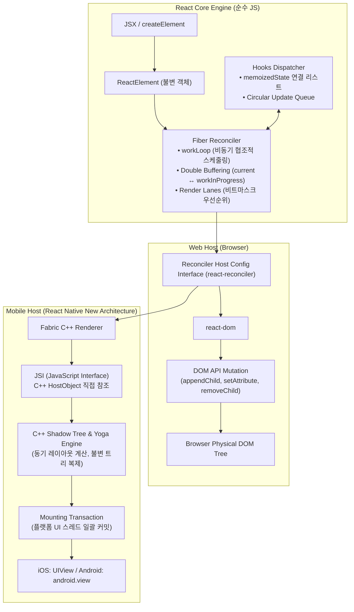
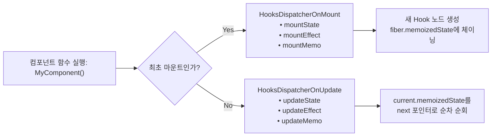
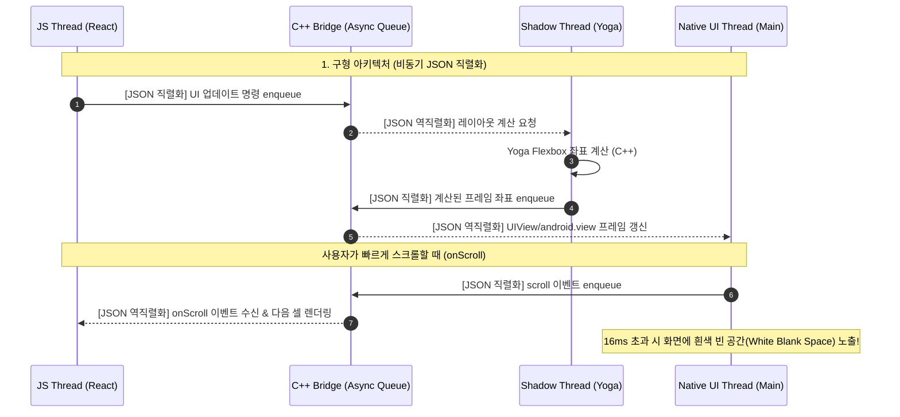
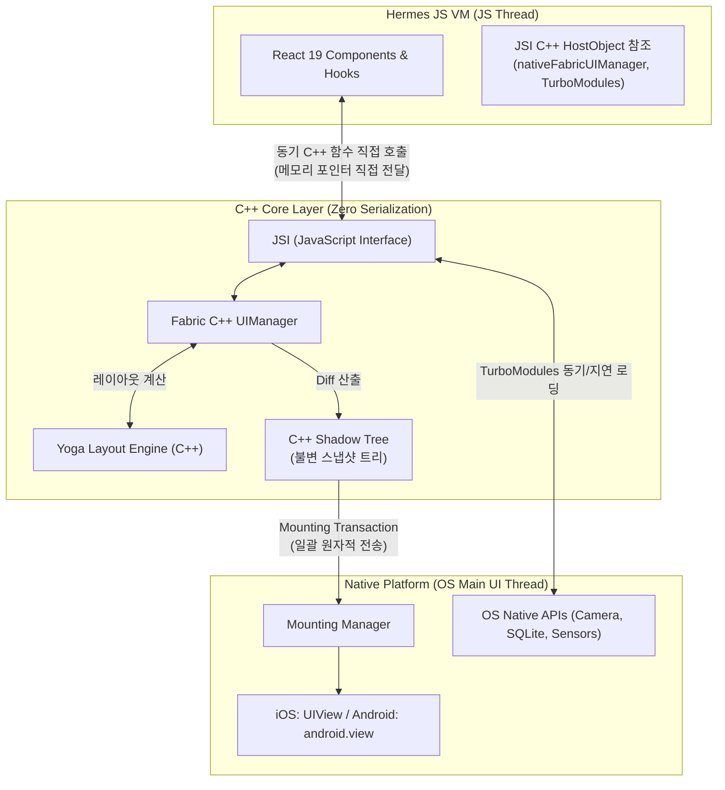

# React & React Native 내부 구현 심층 분석 (Under the Hood)

## 1. 개요 및 설계 철학

[[React]]와 [[React Native]]는 표면적으로는 동일하게 JSX와 선언적 컴포넌트 모델(`UI = f(state)`)을 사용하지만, 엔진 내부에서는 **“렌더링 작업 분할과 상태 계산을 담당하는 순수 알고리즘 계층(`react` 코어)”** 과 **“실제 화면을 그리고 OS 네이티브 런타임과 상호작용하는 호스트 계층(`react-dom`, `react-native` / Fabric)”** 이 엄격히 분리되어 동작한다 ([[2024-Fluent React]], Ch 4 p.97–102; [[2022-React and React Native, Fourth Edition]], Ch 15 p.311–319).



---

## 2. React 코어: Fiber Reconciler의 내부 데이터 구조와 동작 원리

### 2.1 ReactElement vs FiberNode
개발자가 작성하는 `<MyComponent id="app" />`는 Babel/SWC 컴파일러에 의해 `_jsx(MyComponent, { id: "app" })` 또는 `React.createElement`로 변환되어 단순한 **불변(Immutable) JS 객체인 `ReactElement`** 가 된다 ([[2024-Fluent React]], Ch 3 p.71–85).

```typescript
// ReactElement: 가상 DOM의 겉껍질 (매 렌더링마다 새로 생성되고 버려지는 임시 객체)
interface ReactElement {
  $$typeof: Symbol(react.element);
  type: any;           // 'div', 'View', 함수형 컴포넌트 참조
  key: string | null;
  props: object;
  ref: any;
}
```

반면 React 런타임 엔진이 메모리에 유지하고 갱신하는 실제 작업 단위는 **`FiberNode`** 다 ([[2024-Fluent React]], Ch 4 p.103–110).

```typescript
// FiberNode: 힙(Heap)에 상주하는 가변(Mutable) 작업 단위
interface FiberNode {
  // 1. 트리 구조를 형성하는 포인터 (단일 연결 리스트)
  child: FiberNode | null;    // 첫 번째 자식
  sibling: FiberNode | null;  // 바로 다음 형제
  return: FiberNode | null;   // 부모 (작업 완료 후 돌아갈 곳)

  // 2. 인스턴스 정보 및 타입
  tag: WorkTag;               // FunctionComponent(0), HostComponent(5) 등
  key: null | string;
  elementType: any;
  type: any;
  stateNode: any;             // 실제 호스트 인스턴스 (HTML DOM 노드 또는 C++ ShadowNode)

  // 3. 상태 및 훅 데이터
  memoizedState: any;         // 함수형 컴포넌트: 훅 연결 리스트의 첫 번째 Hook 객체
  memoizedProps: any;         // 이전 렌더링에서 확정된 Props
  pendingProps: any;          // 이번 렌더링에서 들어온 새 Props

  // 4. 더블 버퍼링 포인터
  alternate: FiberNode | null;// 맞은편 트리(current ↔ workInProgress)를 가리키는 포인터

  // 5. 이펙트 및 동시성 스케줄링
  flags: Flags;               // Insertion, Update, Deletion 등 비트마스크
  subtreeFlags: Flags;        // 하위 서브트리에 변경사항이 있는지 판별하는 비트마스크
  lanes: Lanes;               // 이 Fiber에 남아있는 작업 우선순위 (31비트 비트마스크)
}
```

### 2.2 더블 버퍼링(Double Buffering) 아키텍처
그래픽 엔진이 화면 깜빡임을 방지하기 위해 프레임 버퍼 2개를 교대로 교체하듯, React는 힙 메모리에 두 개의 트리를 유지한다 ([[2024-Fluent React]], Ch 4 p.108–109):
1. **`current` 트리**: 현재 실제 화면에 렌더링되어 있는 상태를 나타내는 Fiber 트리.
2. **`workInProgress` (WIP) 트리**: 새로운 상태 변경으로 인해 메모리 상에서 비동기적으로 새로 조립되는 Fiber 트리.

두 노드는 서로의 **`alternate`** 포인터로 연결되어 있다. 렌더 단계가 완료되면 React는 `fiberRoot.current` 포인터를 `workInProgress` 트리로 단 한 번 교체(`current = workInProgress`)하여 화면 갱신을 원자적(Atomic)으로 완료한다. 기존의 `current` 노드는 다음 업데이트 시 메모리 할당 없이 재사용(Recycle)되어 가비지 컬렉션(GC) 압박을 획기적으로 낮춘다.

### 2.3 DFS 순회 루프: `beginWork`와 `completeWork`
Stack Reconciler는 JS 콜 스택을 사용해 재귀 순회했기 때문에 중간에 멈출 수 없었다. 반면 Fiber는 **단일 연결 리스트**이므로, 전역 변수 `workInProgress` 포인터 하나만 유지하면 언제든 순회를 일시 중단했다가 재개할 수 있다 (`workLoopConcurrent`):

```javascript
function workLoopConcurrent() {
  // 브라우저의 남은 프레임 시간(5ms 단위) 또는 우선순위 만료 여부를 검사
  while (workInProgress !== null && !shouldYield()) {
    performUnitOfWork(workInProgress);
  }
}
```

1. **하향 탐색 (`beginWork`)**:
   - 루트부터 시작해 자식(`child`)을 향해 내려가며 컴포넌트 함수를 실행하고 새 `ReactElement` 자식들을 받아온다.
   - 이전 `memoizedProps`와 새 `pendingProps`가 같고 Context 변경이 없으면 서브트리를 조기 반환(Bailout)하여 렌더링을 건너뛴다.
   - 자식이 있으면 `workInProgress = workInProgress.child`로 전진한다.
2. **상향 복귀 (`completeWork`)**:
   - 리프 노드(말단 자식)에 도달하면 `completeWork`가 실행된다.
   - 실제 DOM 노드(또는 네이티브 뷰 인스턴스)를 생성(`createInstance`)하고 자식 노드들을 붙인다(`appendAllChildren`).
   - 하위 노드들의 변경 플래그를 부모의 `subtreeFlags`에 비트 OR(`|`) 연산으로 누적 버블링한다.
   - 형제 노드가 있으면 `workInProgress = workInProgress.sibling`으로 이동하고, 없으면 부모(`return`)로 올라간다.

---

## 3. Hooks의 밑바닥 구현: `memoizedState` 연결 리스트와 Dispatcher

함수형 컴포넌트는 무상태(Stateless) 함수임에도 불구하고 어떻게 호출 간 상태를 유지할 수 있는가? 그 해답은 **Fiber 노드의 `memoizedState`에 매달리는 단일 연결 리스트**에 있다 ([[2021-Designing React Hooks the Right Way]], Ch 2–3; [[Virtual DOM and Reconciliation from Scratch]]).

### 3.1 Hook 객체의 내부 구조
```typescript
interface Hook {
  memoizedState: any;       // 저장된 상태 값 (useState, useMemo) 또는 effect 인스턴스
  baseState: any;           // 기본 상태
  baseQueue: Update | null; // 아직 처리되지 않은 업데이트 큐
  queue: UpdateQueue | null;// 대기 중인 상태 업데이트들의 원형 연결 리스트
  next: Hook | null;        // 다음 훅을 가리키는 단일 연결 리스트 포인터
}
```

### 3.2 Dispatcher 전환 메커니즘
React 코어는 컴포넌트가 마운트될 때와 업데이트될 때 서로 다른 **Dispatcher** 객체를 전역 포인터(`ReactCurrentDispatcher.current`)에 갈아 끼운다:



- **최초 렌더링 (`mountState`)**: `mountWorkInProgressHook()`를 호출해 새로운 `Hook` 객체를 생성하고, Fiber의 `memoizedState`에 연결 리스트 형태로 차례차례 붙인다.
- **업데이트 렌더링 (`updateState`)**: `updateWorkInProgressHook()`를 호출하여 `currentHook.next` 포인터를 따라가며 이전 렌더링에서 구축된 훅 객체를 동일한 순서로 꺼내온다.

> [!IMPORTANT]
> **왜 Hook은 조건문이나 반복문 안에서 호출할 수 없는가?**
> React는 훅을 이름이나 고유 키가 아닌 **오직 연결 리스트의 순서(Call Order)** 로만 식별한다. 만약 조건문 때문에 훅 호출 순서가 어긋나면, 2번째 `useState`가 3번째 `useEffect`의 슬롯을 읽거나 포인터가 `null`을 참조하여 상태가 뒤섞이거나 런타임 크래시가 발생한다.

---

## 4. 호스트 렌더러 분리: `react-reconciler` Host Config

React 코어(`packages/react`)는 브라우저 DOM이나 iOS/Android 화면에 대해 일체 알지 못한다. 순수한 상태 비교와 작업 스케줄링만을 담당하며, 실제 화면 조작은 **`react-reconciler`의 Host Config 계약(Contract)** 을 통해 위임된다 ([[2024-Fluent React]], Ch 4 p.97):

```typescript
// 호스트 렌더러가 구현해야 하는 핵심 인터페이스 계약
const HostConfig = {
  // 인스턴스 생성
  createInstance(type, props, rootContainerInstance, hostContext, internalInstanceHandle) {
    // web: document.createElement(type)
    // mobile: new C++ ShadowNode(type, props)
  },
  createTextInstance(text) { /* ... */ },
  
  // 트리 조작
  appendInitialChild(parentInstance, child) { /* ... */ },
  appendChild(parentInstance, child) { /* ... */ },
  removeChild(parentInstance, child) { /* ... */ },
  insertBefore(parentInstance, child, beforeChild) { /* ... */ },

  // 커밋 단계 프로퍼티 갱신
  commitUpdate(instance, updatePayload, type, oldProps, newProps) {
    // web: DOM 속성/이벤트 갱신 (setAttribute, style 변경)
    // mobile: C++ ShadowNode의 props 변이 및 Yoga dirty flag 설정
  }
};
```

---

## 5. React Native 내부 구현 (구형 Bridge vs New Architecture)

React Native의 핵심 과제는 **"JavaScript 단일 스레드 런타임"** 과 **"iOS/Android의 멀티스레드 네이티브 UI 시스템"** 을 어떻게 지연 없이 연결할 것인가이다 ([[2022-React and React Native, Fourth Edition]], Ch 15 p.311–320).

### 5.1 구형 Bridge의 메커니즘과 병목 (The Bridge Bottleneck)



- **구형 브릿지의 3대 한계**:
  1. **비동기성(Asynchronous)**: JS와 Native 간의 모든 통신이 큐 기반 비동기이므로, 레이아웃 측정이나 텍스트 입력 동기화에서 1프레임(16ms) 이상의 레이턴시가 필연적으로 발생한다.
  2. **직렬화 오버헤드(Serialization Overhead)**: 모든 데이터(배열, 객체, 터치 이벤트)를 문자열 JSON으로 변환하고 다시 파싱해야 하므로 대용량 데이터 전송 시 CPU 부하가 급증한다.
  3. **단일 채널 경합**: 모든 비즈니스 로직, 렌더링 명령, 센서 이벤트가 단 하나의 비동기 브릿지 큐를 공유하여 병목(Traffic Jam)이 발생한다.

---

### 5.2 모던 New Architecture (RN 0.76+ Default & Bridgeless Mode)

Meta는 React Native 0.76부터 **JSI, Fabric, TurboModules, Hermes, Codegen**을 기반으로 하는 **Bridgeless Architecture**를 기본(Default)으로 채택했다. 0.76–0.81에서는 Legacy Architecture로 되돌릴 수 있었고, Legacy Architecture를 켤 수 없게 된 것은 0.82부터이며, 레거시 코드 제거는 0.84부터 진행 중이다 ([[React Native Architecture (Bridge to New Architecture)]] 4절의 레거시 제거 타임라인).



#### 1. JSI (JavaScript Interface)의 C++ HostObject 바인딩
JSI는 특정 JS 엔진(V8, JavaScriptCore, Hermes)에 종속되지 않는 C++ 추상화 인터페이스다. C++ 클래스가 `jsi::HostObject`를 상속받으면, **JavaScript 엔진은 C++ 객체와 메서드를 마치 일반 JS 객체인 것처럼 직접 메모리 참조(Reference)** 할 수 있다.
- 문자열 JSON 직렬화/역직렬화가 완전히 사라진다 ($O(1)$ 직접 참조).
- JS에서 Native 함수를 **동기적(Synchronous)** 으로 호출하여 그 반환값을 즉시 받을 수 있다.

#### 2. Fabric Renderer와 C++ Shadow Tree
Fabric은 React의 Render/Commit 파이프라인과 직접 맞물려 동작한다:
1. **Render 단계**: React의 `react-reconciler`가 컴포넌트 트리를 순회하면서, HostConfig를 통해 JSI로 노출된 C++ `nativeFabricUIManager`를 호출한다.
2. **C++ Shadow Tree 생성**: JS 힙이 아니라 **C++ 힙 메모리에 불변(Immutable) `ShadowNode` 트리**가 직접 생성된다.
3. **Yoga 레이아웃 계산**: C++ 계층에 상주하는 Yoga 엔진이 스레드 전환이나 직렬화 없이 동일한 C++ 메모리 상에서 Flexbox 크기/좌표를 동기적으로 계산한다.
4. **Mounting Phase**: 이전 Shadow Tree와 새 Shadow Tree 간의 차이(Diff)를 계산한 뒤, 최소한의 뷰 생성/이동/속성 변경 작업만을 묶은 **Mounting Transaction**을 OS 메인 UI 스레드에 원자적으로 전달해 화면을 그린다.

#### 3. TurboModules & Codegen (정적 타입 동기화)
- **Codegen**: TypeScript 또는 Flow로 작성된 네이티브 모듈 명세(`NativeLocalStorage.ts`)를 읽어, 빌드 타임에 C++, Java(JNI), Objective-C 헤더와 인터페이스 보일러플레이트를 자동 생성한다. 양측의 데이터 타입 불일치로 인한 런타임 크래시를 원천 방지한다.
- **Lazy Initialization**: 과거에는 앱 시작 시 수십 개의 네이티브 모듈을 일괄 초기화했으나, TurboModules는 실제 JS에서 `NativeModules.MyModule`을 호출하는 최초 시점에 JSI를 통해 지연 로딩(Lazy-loading)된다.

#### 4. Hermes JS 엔진의 AOT 바이트코드 최적화
모바일 환경에서는 데스크톱 브라우저와 달리 JIT(Just-In-Time) 컴파일러의 웜업 시간과 메모리 점유가 치명적이다. Meta가 개발한 **Hermes**는:
- 빌드 타임에 JS 소스코드를 **HBC(Hermes Bytecode)** 로 사전 컴파일(AOT)하여 배포한다.
- 앱 실행 시점에 JS 파싱과 바이트코드 컴파일 과정이 0초로 단축되어 **앱 시작 시간(Time to Interactive)이 50% 이상 향상**된다.
- 모바일 OS의 페이징 메모리 구조에 최적화된 경량 세대별 GC(Garbage Collector)를 탑재하여 메모리 풋프린트를 최소화한다.

---

## 6. 웹(`react-dom`)과 모바일(`react-native`)의 렌더링 파이프라인 비교 요약

| 비교 항목 | 웹 React (`react-dom`) | 모바일 React Native (New Architecture) |
|---|---|---|
| **코어 재조정 엔진** | `react` (Fiber Reconciler, workLoop) | `react` (Fiber Reconciler, workLoop) — **100% 동일** |
| **작업 단위** | `FiberNode` (JS Heap) | `FiberNode` (JS Heap) — **100% 동일** |
| **컴포넌트 상태/Hooks** | `memoizedState` 연결 리스트 | `memoizedState` 연결 리스트 — **100% 동일** |
| **중간 레이아웃 트리** | 브라우저 렌더 트리 (브라우저 C++ 엔진 자동 계산) | **C++ Shadow Tree** (Meta의 Yoga 엔진이 C++ 레벨에서 계산) |
| **호스트 통신 방식** | 브라우저 내장 Web API 직접 호출 | **JSI (JavaScript Interface)** C++ HostObject 직접 참조 |
| **스타일링/레이아웃 엔진** | 브라우저 CSS 박스 모델 (`row` 기본) | **Yoga Layout Engine** (Flexbox `column` 기본) |
| **최종 UI 산출물** | 브라우저 물리 DOM (`HTMLElement`, `TextNode`) | OS 순정 위젯 (`UIView`, `android.view`) |
| **동기식 레이아웃 측정** | `useLayoutEffect` + `getBoundingClientRect` | `useLayoutEffect` + Fabric 동기 섀도 트리 측정 (RN 0.76+) |
| **JS 런타임** | 브라우저 내장 엔진 (V8, JavaScriptCore 등) | **Hermes AOT 바이트코드 VM** |

---

## 7. 관련 위키 문서 (See Also)

- [[React Fiber and Reconciliation]] — Stack Reconciler에서 Fiber로의 진화, 2단계 파이프라인, Render Lanes 동시성
- [[React Native Architecture (Bridge to New Architecture)]] — 3대 스레드, 구형 Bridge 한계 및 New Architecture 5대 요소
- [[Virtual DOM and Reconciliation from Scratch]] — 가상 DOM 생성(`h`), 마운트, `patchDOM` Diffing 알고리즘과 훅 슬롯 밑바닥 구현
- [[React Hooks and Component Design Patterns]] — 7대 React Hooks, 상태 코로케이션 및 React 19 Actions/`use` API
- [[Web React vs React Native Shared Core and Differences]] — 웹과 모바일의 100% 공유 계층 vs 호스트 계층 분리 매트릭스
- [[2026-React Official Documentation]] — React 19 핵심 혁신, Actions, `use`, Compiler 공식 사양
- [[2026-React Native Official Documentation]] — RN 0.76+ New Architecture, Bridgeless, JSI, Fabric 공식 사양
